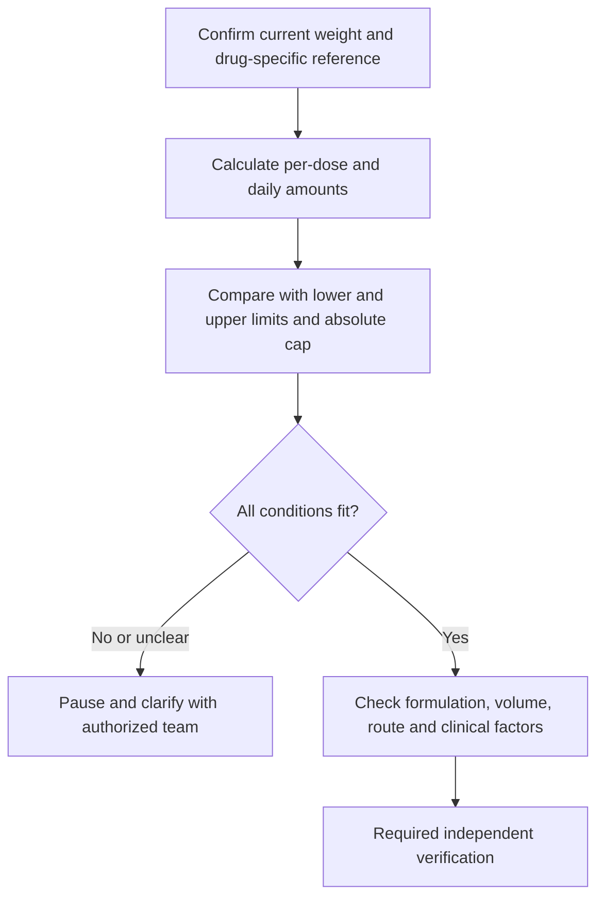

# 📚 Weight-based dosing and safe-dose range

**Study-ready, not studied.** [27 new original MCQs](../MCQs/07B-Weight-Based-Dosing-and-Safe-Dose-Range-27-MCQs.md) plus Group 07 Q5, Q6 and Q18 give 30 allocated. All examples use fictional dose rules for arithmetic learning, not prescribing or actual pediatric dosing instructions.

[Chapter](../README.md) · [07A dose calculations](07A-Dose-Units-Concentration-and-Reconstitution.md) · [MCQs](../MCQs/07B-Weight-Based-Dosing-and-Safe-Dose-Range-27-MCQs.md) · [Previous Year Questions](../Previous-Year-Questions/07B-Weight-Based-Dose-Reported-Evidence.md)

## Weight and frequency

🔴 **MOST IMPORTANT.** Jab medicine mg/kg mein likhi ho, iska matlab hai prescribed drug amount patient ke weight ke according calculate hota hai. Weight hamesha correct current measurement aur unit se verify karo. Bachchon mein chhota weight difference bhi dose ko significantly affect kar sakta hai. Agar kg ki jagah lb use karoge toh calculation roughly 2.2 times zyada ho sakti hai. Neonatal weight grams mein ho toh pehle 1000 se divide karke kg nikalo.

| Prescription expression | Arithmetic meaning |
|---|---|
| mg/kg per dose | Weight × specified rate = each administration |
| mg/kg/day | Weight × specified rate = total 24-hour dose |
| Every 8 hours | Three scheduled doses in 24 hours |
| Every 12 hours | Two scheduled doses in 24 hours |
| Once weekly | One dose in seven days, not one daily |

Example: training patient 18 kg hai. Order 4 mg/kg per dose every 8 hours hai. Har dose 18 × 4 = 72 mg. Daily total 72 × 3 = 216 mg. Agar order 4 mg/kg/day hota toh total 72 mg per day hota, har dose 24 mg hoti. Per day aur per dose ka difference pehle identify karo.

Example: weight 2400 g = 2.4 kg hai. Fictional 5 mg/kg order se 12 mg calculated dose hai. 10 mg/mL concentration se 1.2 mL calculate hoga. Actual neonatal indication, age, dose, concentration and administration method independently verify karna zaroori hai.

[Practice Q1–5](../MCQs/07B-Weight-Based-Dosing-and-Safe-Dose-Range-27-MCQs.md).

## Dose limits and ranges

Safe-dose range ka matlab reference mein specified lower aur upper dose boundary hai. Har drug ka range alag hota hai. Age, indication, organ function and other factors bhi matter karte hain. Dose calculation mathematically correct ho sakti hai but prescribed frequency or maximum dose ki wajah se unsafe ho sakti hai.

Example: fictional 12-kg child ke reference mein 6–10 mg/kg per dose hai. Minimum 12 × 6 = 72 mg aur maximum 12 × 10 = 120 mg. Ordered 60 mg minimum se 12 mg kam hai. Nurse isko independently change nahi karti. Current clinical indication aur authorized order clarify karti hai.

Example: fictional 18-kg child ka per-dose rule 10 mg/kg aur daily maximum 30 mg/kg/day hai. 180 mg har 6 hours prescribed hai. Single dose 180 mg correct per-dose limit meet karti hai, but four doses = 720 mg/day. Daily maximum 540 mg/day hai. Excess 180 mg/day. Isliye frequency clarify karo, sirf single dose verify karke proceed mat karo.

Absolute cap ka matlab weight-based answer se upar ek maximum allowed amount hai. Fictional 25-kg patient × 8 mg/kg = 200 mg. Agar protocol cap 180 mg hai, toh mathematical capped result 180 mg hai. Actual discrepancy authorized prescriber se clarify karo.

[Practice Q6–10](../MCQs/07B-Weight-Based-Dosing-and-Safe-Dose-Range-27-MCQs.md).

## Concentration and dosing basis

Weight-based calculation se usually mass ya drug-specific units nikalti hain. Actual liquid volume ke liye supplied concentration bhi chahiye. Example: 14 kg × 7 mg/kg = 98 mg. Supplied 35 mg/5 mL = 7 mg/mL. Final volume 98/7 = 14 mL. Reverse check 14 × 7 = 98 mg. Rounding and device suitability local policy se check karo.

Micrograms aur mg ke units align karo. 32 kg × 25 micrograms/kg = 800 micrograms = 0.8 mg. Supplied 0.4 mg/mL se calculated volume 2 mL hai. Drug-specific activity units ko mg mein arbitrary conversion mat karo.

Body surface area (BSA) body ki approximate surface size ko square meters mein express karti hai. Some authorized protocols mg/m² use karte hain. Mosteller formula: BSA = square root of (height in cm × weight in kg ÷ 3600). Fictional height 100 cm and weight 25 kg se BSA = 0.83333 m². 60 mg/m² × BSA = 50 mg. BSA method and actual dose limits protocol se verify karo. BSA har pediatric medicine ke liye standard replacement of weight-based dosing nahi hai.

Kabhi dose bands use hote hain, aur kuch medicines mein actual weight ke bajay specified dosing weight. Nurse apne se different body-weight method choose nahi karti. Exact boundary, protocol and authorized weight verify karo.

[Practice Q11–18](../MCQs/07B-Weight-Based-Dosing-and-Safe-Dose-Range-27-MCQs.md).

## Review and error prevention

Administered amount ko per-kg reference se compare karna ho toh mass ÷ weight calculate karo. 90 mg administered to 15 kg = 6 mg/kg per dose. Agar reference daily amount mein hai toh actual documented daily total pehle calculate karo. Ek dose missed ho toh automatically double dose mat do. Actual record reconcile karke clinically important delay promptly escalate karo.

Premature rounding avoid karo. 2.8 kg × 0.3 mg/kg = 0.84 mg. Weight ko pehle 3 kg karne se 0.90 mg aayega. Actual measurement precision and drug-specific dosing policy follow karo. Calculation check, clinical suitability and authorization alag safeguards hain.

### Historical exam formulas

Older exams may ask Fried's rule (age in months/150 × adult dose), Young's rule (age in years/(age + 12) × adult dose), or Clark's rule (weight in pounds/150 × adult dose). Inko historical examination knowledge ke roop mein pehchano. Ye general adult-dose scaling formulas modern pediatric drug-specific recommendations replace nahi karti. Infant aur child ki drug metabolism and safety adult se differ kar sakti hai. Real child ke liye age, measured weight, drug-specific reference, indication and authorized prescription use karo.

[Practice Q19–27](../MCQs/07B-Weight-Based-Dosing-and-Safe-Dose-Range-27-MCQs.md) · [Reported examination questions](../Previous-Year-Questions/07B-Weight-Based-Dose-Reported-Evidence.md).

## ▶️ Clinical sources and practice

| Section | Learning | Practice |
|---|---|---|
| Weight and frequency | [Open RN Math Calculations](https://www.ncbi.nlm.nih.gov/books/NBK593207/), indexed text | [Ritika Mam Drug Dose Calculation MCQ Sessions](https://www.youtube.com/watch?v=b6CtL33WFQQ), indexed pediatric calculation description |
| Safe range | [Open RN planning care for the ill child](https://www.ncbi.nlm.nih.gov/sites/books/NBK615330/), indexed | [Level Up RN safe dosage range worked question](https://www.youtube.com/watch?v=AKKEpDjR5ck), indexed description specifically confirms worked pediatric safe-range problem |
| Concentration and BSA | [OpenStax Dosing](https://openstax.org/books/clinical-nursing-skills/pages/11-2-dosing), directly retrieved | Pediatric calculation lead above, BSA-specific video pending |
| Clinical review and historical formulas | [NCBI Clark's Rule](https://www.ncbi.nlm.nih.gov/books/NBK541104/), indexed historical formula reference | Specific MCQ coverage pending |

Open RN newer edition direct opening failed. Both video direct openings failed, descriptions inspected. Exact video questions, timestamps and full playback not verified. Separate drug-specific clinical review still pending. Do not count historical age formulas as current dosing instructions.
