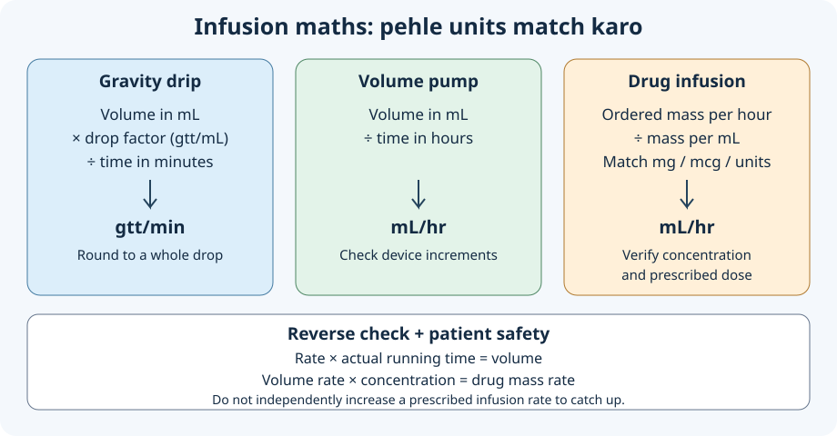

# 📚 Infusion rate and drug infusion calculations — Group 07C

**Study-ready, not yet studied.** Is topic mein hum gravity drip, infusion pump aur drug infusion ke numerical questions ko step by step samjhenge. Ye calculation exercises hain, actual drug orders nahi.

[Chapter](../README.md) · [24 new MCQs](../MCQs/07C-Infusion-Rate-and-Drug-Infusion-Calculations-24-MCQs.md) · [Previous Year Questions](../Previous-Year-Questions/07C-Infusion-Calculations-Reported-Evidence.md) · [Topic map](Nursing-Foundations-Topic-Coverage-Map.md)

## 🧭 Topic map

[Gravity and pump](#gravity-and-pump) · [Time and volume](#time-and-volume) · [Drug rate](#drug-rate) · [Weight-based drug rate](#weight-based-drug-rate) · [Safety checks](#safety-checks)

## Gravity and pump

**🟠 HIGH YIELD**

Infusion ka matlab hai fluid ya medicine ko ek defined rate par patient ke bloodstream mein dena. IV ka matlab intravenous hai, yaani vein ke through. Gravity infusion mein fluid bag ki height aur gravity se neeche flow karta hai. Roller clamp flow adjust karne mein madad karta hai. Pump infusion mein device prescribed volume rate ko control karta hai. Dono mein nurse ko actual order, tubing, patient aur delivery verify karni hoti hai.

Drop factor ka matlab hai kitni drops milkar 1 mL fluid banati hain. Iski unit gtt/mL hoti hai. Gtt ka matlab drops hai. Macrodrip set ka drop factor alag-alag ho sakta hai, jaise 10, 15 ya 20 gtt/mL. Microdrip set aam taur par 60 gtt/mL hota hai. Set ki packaging par likha hua actual factor check karo, guess mat karo.

| Calculation | Formula | Unit |
|---|---|---|
| Pump rate | Volume ÷ time in hours | mL/hr |
| Gravity rate | Volume × drop factor ÷ time in minutes | gtt/min |
| Observed gravity volume | Drops/min × running minutes ÷ drop factor | mL |
| Gravity se hourly volume | Drops/min × 60 ÷ drop factor | mL/hr |

**Example:** 240 mL fluid ko 3 hours mein dena hai. Pump rate 240/3 = 80 mL/hr hoga. Agar authorized gravity set 15 gtt/mL ka hai toh 240 × 15/180 = 20 gtt/min hoga. Dono settings alag units mein hain lekin ideal constant flow mein same hourly volume represent karti hain.

Microdrip factor 60 ho toh 80 mL/hr numerically 80 gtt/min ke barabar hota hai. Is shortcut ko sirf actual 60-gtt/mL set mein use karo. Gravity mein final drop count whole number mein round karte hain, kyunki aadhi drop count nahi kar sakte. Pump ki rounding local policy aur device resolution ke hisaab se hoti hai.

**Exam clue:** Minutes ko hours mein convert karte time 60 se divide karo. Hours ko minutes mein convert karte time 60 se multiply karo.

## Time and volume

**🟠 HIGH YIELD**

Agar pump 1 hour mein 100 mL deta hai, toh 30 minutes mein 50 mL dega, jab rate constant ho. Actual running time ka matlab hai utna time jab fluid sach mein deliver ho raha tha. Pause time ko running time mein add nahi karte.

- Delivered volume = pump rate × actual running hours.
- Remaining volume = verified starting volume − delivered volume.
- Remaining duration = remaining volume ÷ authorized rate.
- Agar rate multiple authorized phases mein change hota hai, toh har phase ka volume alag calculate karke add karo.

**Example:** 300 mL available hai. Pump 60 mL/hr par 1 hour 40 minutes chalta hai. Iske baad 20 minutes ka authorized pause hota hai. Running time 100/60 hours hai. Delivered volume 60 × 100/60 = 100 mL hai. Remaining volume 200 mL hai. Original 60 mL/hr par 200/60 = 3 hours 20 minutes aur chahiye. Pause ke karan nurse independently rate nahi badhati.

Agar infusion ruk jaye toh original clock deadline meet karna hamesha safe nahi hota. Pehle reason assess karo, patient aur infusion order verify karo, phir authorized plan follow karo.

## Drug rate

**🔴 MOST IMPORTANT**

Drug concentration ka matlab hai solution ke har mL mein kitni medicine hai. Pump par mL/hr enter karne se pehle ye samajhna zaroori hai ki order medicine ki mass ya units ke hisaab se likha hai ya total fluid volume ke hisaab se.

| Order type | Calculation |
|---|---|
| mg/hr | mg/hr ÷ mg/mL |
| mcg/min | mcg/min × 60 ÷ mcg/mL |
| units/hr | units/hr ÷ units/mL |
| Verify delivered mass | mL/hr × mass per mL |

**Example:** Ek fictional medicine ke prepared bag mein 180 mg final volume 90 mL mein hai. Concentration 180/90 = 2 mg/mL hai. Order 10 mg/hr ka hai. Pump setting 10/2 = 5 mL/hr calculate hogi. Reverse check karo: 5 mL/hr × 2 mg/mL = 10 mg/hr.

Agar pharmacy naye bag mein concentration double kar de aur authorized dose same rahe, toh required volume rate half ho jayega. Actual bag change mein line ke andar pehle se maujood solution aur pump programming bhi local protocol ke hisaab se verify karni hoti hai. Bag ki purani setting blindly copy nahi karni hai.

**VTBI** ka matlab volume to be infused hai. Ye pump ko batata hai kitna volume deliver karna hai. Ye zaroori nahi ki poora bag deliver karna ho. Agar 2 mg/mL ki fictional concentration mein 40 mL deliver karna hai, toh 80 mg drug mass represent hota hai, poore bag ka amount nahi.

## Weight-based drug rate

**🔴 MOST IMPORTANT**

Kuch critical-care infusion orders mein mcg/kg/min likha hota hai. Iska matlab har kilogram body weight ke liye har minute kitne micrograms medicine chahiye. Actual prescribed dosing weight use karo. Patient ka weight kg mein confirm karo aur bag ki final concentration ko same mass unit mein convert karo.

1. Ordered mcg/kg/min × dosing weight in kg = mcg/min.
2. Mcg/min × 60 = mcg/hr.
3. Bag ki concentration mcg/mL mein nikalo. 1 mg = 1000 mcg.
4. Mcg/hr ÷ mcg/mL = mL/hr.
5. Reverse check mein mL/hr × mcg/mL ÷ 60 ÷ kg se original order milna chahiye.

**Fictional arithmetic example:** Order 0.3 mcg/kg/min hai. Verified dosing weight 60 kg hai. Bag 15 mg in final 100 mL hai. Concentration 150 mcg/mL hogi. Dose 0.3 × 60 = 18 mcg/min hai. Hourly dose 18 × 60 = 1080 mcg/hr hai. Rate 1080/150 = 7.2 mL/hr hai. Reverse check 7.2 × 150/60/60 = 0.3 mcg/kg/min hai.

Actual bedside mein kisi specific medicine ka dose, concentration, titration increment aur rate limit drug reference, prescription aur local policy se aayega. Is example ko treatment advice ki tarah use mat karo.

## Safety checks

**🔴 MOST IMPORTANT**

- Nurse ko order, patient identification, medicine label, concentration, route, compatible solution, dosing weight aur pump settings verify karni chahiye. High-alert medicine ke liye institutional independent double-check aur monitoring rules follow karo.
- Pump ka display normal dikhne ka matlab ye nahi hai ki rate sahi enter hua hai. Reverse calculation se original order ke saath match check karo.
- Decimal point ek jagah move hone se rate 10 times tak badal sakta hai. Agar calculated rate unusual ho toh administration se pehle clarification aur independent verification lo.
- Infusion interruption ke baad nurse ko khud se catch-up rate set nahi karna chahiye. Patient ki condition, medicine aur authorized order decide karte hain ki aage ka plan kya hoga.
- Agar incorrect delivery suspect ho, toh patient ko assess karo, urgent help aur escalation lo, aur local incident aur medication safety process follow karo.
- Maximum rate ek upper limit hai. Agar pump increment ke kaaran exact value set nahi hoti, toh safe rounding aur authorized instruction verify karo. Upper limit ko round karke cross mat karo.

### Quick revision

| Trap | Yaad rakho |
|---|---|
| gtt/min and mL/hr | Dono alag units hain. |
| 30 minutes | 0.5 hour hota hai. |
| mg to mcg | 1000 se multiply karo. |
| mcg/min to mcg/hr | 60 se multiply karo. |
| Weight-based infusion | Weight factor sirf ek baar apply karo. |
| Pause | Sirf actual running time count karo. |
| Same drug dose, stronger concentration | Volume rate kam hota hai. |
| Mathematical catch-up rate | Clinical authorization ke bina use nahi hota. |

## ▶️ Teaching and practice resources

| Topic | Teaching | Separate question practice | Verification |
|---|---|---|---|
| Gravity and volume pump | [IV Fluid Calculations — NORCET exam tips](https://www.youtube.com/watch?v=Vv1Qsjkmytg) | [VS Nursing Academy — Ritika Mam drug-dose MCQ session](https://www.youtube.com/watch?v=b6CtL33WFQQ) | Indexed titles and descriptions, direct YouTube retrieval throttled. Channel for teaching lead and playback unverified. |
| Multistep and weight-based drug infusion | [Open RN 5.17 worked examples](https://wtcs.pressbooks.pub/nursingskills/chapter/5-17-multi-step-calculations/) | [RegisteredNurseRN — dopamine drip calculations](https://youtu.be/R2XMro13dD0) | Video linked by Open RN, not watched. Specific teaching video playback pending. |
| Unit-based infusion | [OpenStax dosing](https://openstax.org/books/clinical-nursing-skills/pages/11-2-dosing) | [RegisteredNurseRN — heparin drip calculation practice problems](https://youtu.be/10y4gRdnCy8) | Open RN citation verified. Exact question timestamps pending. Separate teaching video pending. |
| Safety, interruptions and rate limits | [OpenStax dosing](https://openstax.org/books/clinical-nursing-skills/pages/11-2-dosing) | Verification pending | No specific question-solving video authenticated. |

## 📖 Clinical and examination references

- [Open RN Nursing Skills 2e, 5.17 multistep calculations](https://wtcs.pressbooks.pub/nursingskills/chapter/5-17-multi-step-calculations/) and [OpenStax Clinical Nursing Skills 11.2 Dosing](https://openstax.org/books/clinical-nursing-skills/pages/11-2-dosing) directly retrieved 27 November 2026.
- [Open RN Math Calculations chapter](https://www.ncbi.nlm.nih.gov/books/NBK596732/) indexed, direct retrieval blocked by CAPTCHA. 
- [Historical exam evidence](../Previous-Year-Questions/07C-Infusion-Calculations-Reported-Evidence.md) includes HPSSC and AIIMS reports, not authenticated official keys.
- [New 24-question bank](../MCQs/07C-Infusion-Rate-and-Drug-Infusion-Calculations-24-MCQs.md) plus six allocated legacy items [Q7–11 and Q20](../MCQs/07-Drug-Dose-and-Infusion-Calculations-20-MCQs.md).

[Chapter](../README.md) · [MCQs](../MCQs/07C-Infusion-Rate-and-Drug-Infusion-Calculations-24-MCQs.md) · [Previous Year Questions](../Previous-Year-Questions/07C-Infusion-Calculations-Reported-Evidence.md)
