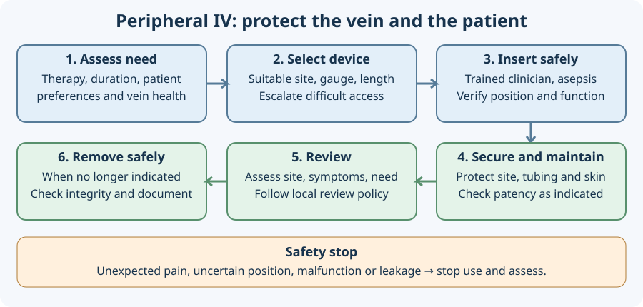

# 📚 Peripheral IV access and maintenance — Group 08A

**Study-ready, not yet studied.** Ye guide nursing exam preparation ke liye hai. Patient par cannulation sirf trained clinician, supervision, authorized order aur local policy ke according karni chahiye.

[Chapter](../README.md) · [22 new MCQs](../MCQs/08A-Peripheral-IV-Access-and-Maintenance-22-MCQs.md) · [Reported evidence](../Previous-Year-Questions/08A-Peripheral-IV-Reported-Evidence.md) · [Coverage map](Nursing-Foundations-Topic-Coverage-Map.md)

## Site selection

**🟠 HIGH YIELD**

Peripheral intravenous catheter ya PIVC ek flexible chhoti tube hai jo peripheral vein mein rehti hai. Insertion ke liye metal introducer needle use hoti hai, lekin successful insertion ke baad needle remove kar di jaati hai. Flexible catheter vein ke andar rehta hai. Is route se prescribed compatible fluid aur medicine blood tak pahunch sakti hai.

Sabse pehle ye decide karna zaroori hai ki patient ko IV access sach mein chahiye ya nahi. Agar authorized treatment oral route se safely diya ja sakta hai, toh unnecessary puncture se bachna chahiye. Site selection mein therapy, duration, patient ki preference, vein health aur limb restrictions ko assess karo.

| Situation | Reasoning |
|---|---|
| Suitable straight forearm vein | Joint movement kam hone se catheter ko stable rakhna easier ho sakta hai. |
| Adult with suitable upper-limb veins | Lower limb ki routine first choice se bachna chahiye. |
| Existing dialysis AV fistula | Is access ko routine IV puncture ya compression se protect karo. Suitable alternative limb use karo. |
| Advanced kidney disease | Future dialysis ke liye vessel-preservation plan specialist se verify karo. |
| Difficult access history | Repeated attempts ke bajay early trained help aur ultrasound option consider karo. |

Agar patient ka nondominant arm equally suitable hai toh daily activities mein comfort mil sakta hai. Lekin clinical safety aur future access preservation pehle aati hai. [Clinical care standard](https://www.safetyandquality.gov.au/clinical-care-standards/management-peripheral-intravenous-catheters) · [Safe vascular access 2025](https://onlinelibrary.wiley.com/doi/10.1111/anae.16727).

## Device selection

**🟠 HIGH YIELD**

Gauge catheter diameter ka size designation hai. Common peripheral catheter sizes mein smaller gauge number ka matlab larger diameter hota hai. 18G ka diameter 22G se bada hota hai. Lekin har patient ke liye bada catheter best nahi hota. Therapy ke required flow, vein size, device length aur compatibility ke hisaab se suitable catheter choose karna hota hai.

| Common gauge | Conventional colour |
|---|---|
| 14G | Orange |
| 16G | Grey |
| 18G | Green |
| 20G | Pink |
| 22G | Blue |
| 24G | Yellow |
| 26G | Violet |

Ye conventional exam colour scheme hai. Actual device par gauge aur manufacturer label verify karo. Fixed flow rates ya particular age ke liye ek universal gauge assume mat karo. Rapid emergency infusion aur routine low-flow treatment ke requirements alag hote hain. Same internal diameter aur pressure par longer catheter ka flow resistance generally zyada hota hai. Deeper vein mein catheter length ka sufficient portion vein ke andar rehna stability ke liye important hai. Trained access clinician device choose karta hai.

## Insertion safety

**🔴 MOST IMPORTANT**

Insertion se pehle patient ko procedure explain karo. Allergy, required therapy aur vein assess karo. Hand hygiene aur approved aseptic technique follow karo. Sterile key parts aur prepared insertion site ko contamination se protect karo. Antiseptic ko product instructions ke according contact time aur drying ka time do. Severe chlorhexidine allergy mein approved alternative verify karo.

Difficult access mein baar-baar blind attempts karne se pain, bruising aur therapy delay ho sakta hai. Child ke liye age-appropriate explanation, caregiver support aur suitable pain relief helpful hote hain. Agar procedure clinician ki competence se bahar ho toh local escalation pathway use karo.

**Dhyan de:** Partly withdrawn introducer needle ko same plastic catheter mein dobara insert nahi karna chahiye. Isse catheter damage ho sakta hai. Electric shock jaisi radiating pain nerve contact ka warning sign ho sakti hai. Procedure stop karo aur assessment karao. Unusually pulsatile return se arterial placement suspect ho sakti hai. Uncertain position mein device se fluid ya medicine mat do. Trained clinician se assessment karao.

[RCH peripheral access guideline](https://www.rch.org.au/clinicalguide/guideline_index/intravenous_access_peripheral/) · [Merck peripheral catheter insertion](https://www.merckmanuals.com/professional/critical-care-medicine/how-to-do-peripheral-vascular-procedures/how-to-insert-a-peripheral-intravenous-catheter) · [Open RN IV therapy](https://www.ncbi.nlm.nih.gov/books/NBK594499/).

## Maintenance

**🔴 MOST IMPORTANT**

Catheter ko stable rakhna securement kehlata hai. Securement ka purpose tubing ke pull aur accidental movement se vein ko protect karna hai. Dressing clean, dry, intact aur suitable honi chahiye. Transparent dressing site inspection ko easy banati hai, jab clinically appropriate ho. Agar splint ki zaroorat ho toh joint support karo, lekin tight pressure ya hidden site se bacho.

Extension set ko appropriate compatible solution se prime karo before connection. Iska matlab tubing se air remove karke solution se fill karna hai. Connector access ke time approved disinfection aur drying follow karo. Flush ka solution, volume, technique aur frequency device, prescribed therapy, patient ke fluid allowance aur policy se decide hote hain. Resistance ko force nahi karna chahiye.

Saline lock intermittent access provide kar sakta hai. Har patient ko continuous keep-vein-open infusion dena zaroori nahi hai. Unnecessary carrier fluid fluid restriction ko affect kar sakta hai. Actual flush aur carrier volume intake mein document karo.

Patient ko batao ki pain, swelling, leakage, wet dressing ya new discomfort ho toh nurse ko turant inform kare. Normal pump display har local complication ko rule out nahi karta. Assessment frequency patient ki age, infusion type, clinical condition aur local policy par depend karti hai. WHO peripheral guideline at least daily inspection ka principle deti hai. Many patients need more frequent checks. Emergency insertion mein asepsis ensure nahi hui ho toh stability ke baad prompt reassessment aur replacement plan follow karo. CDC guideline is situation mein as soon as possible within 48 hours replacement recommend karti hai. Local policy aur clinical circumstances verify karo.

## Removal

**🟠 HIGH YIELD**

Har day continuing need review karo. Therapy complete ho aur device ki need na ho toh unnecessary catheter remove karo. Site complication ya malfunction mein earlier assessment aur action chahiye. Replacement schedules guideline aur local policy ke hisaab se differ kar sakti hain. Clinically indicated replacement policy mein regular site assessment mandatory hai. Fixed 72-hour rule ko universal current law mat samjho.

Removal ke baad puncture site bleeding aur patient response assess karo. Anticoagulated patient mein adequate pressure aur reassessment zaroori ho sakti hai. Removed catheter ko intact check karo. Suspected retained fragment mein blind probing mat karo. Device preserve karo aur urgent clinical escalation follow karo. Date, time, reason, site condition aur device integrity document karo as per policy.

## Quick revision

| Exam clue | Meaning |
|---|---|
| Smaller gauge number | Commonly larger diameter. |
| Vein is deep | Device length matters. |
| Difficult access | Early trained help. |
| Shooting nerve-like pain | Stop and assess. |
| Pulsatile return, position uncertain | Do not use until assessed. |
| Site covered by a splint | Maintain access for inspection. |
| Pump runs normally | Does not rule out local complications. |
| No further clinical need | Remove according to policy. |

## Video resources

| Topic | Teaching | Dedicated MCQ practice |
|---|---|---|
| Gauge, site selection, insertion | [PW Nursing Wallah IV Cannulation Procedure Step by Step](https://www.youtube.com/watch?v=5y2t3NkcV88), indexed description explicitly covers vein selection, gauge and securement. No playback verified. | [IV Cannulation MCQ for Staff Nurse, ANM, GNM and Nursing Officer Exams](https://www.youtube.com/watch?v=YIViQbu0xzY), indexed title only, channel, coverage and playback pending. |
| Pediatric difficult access and securement | [Nurse Marci IV cannulation](https://www.youtube.com/watch?v=W8-WlfOtSo0), indexed teaching description, pediatric-specific coverage not verified. | Specific question practice pending. |
| Maintenance, removal and complications | [RCH management of peripheral IV devices](https://www.rch.org.au/rchcpg/hospital_clinical_guideline_index/peripheral_intravenous_iv_device_management/) written guideline, not video. | Specific question practice pending. |

All 22 original questions require specific video mapping. Teaching-only video is not counted as question practice.

## References

- [Australian Commission PIVC Clinical Care Standard 2021](https://www.safetyandquality.gov.au/clinical-care-standards/management-peripheral-intravenous-catheters), [CDC catheter recommendations](https://www.cdc.gov/infection-control/hcp/intravascular-catheter-related-infections/summary-recommendations.html), [RCH peripheral access](https://www.rch.org.au/clinicalguide/guideline_index/intravenous_access_peripheral/) and [RCH maintenance guidance](https://www.rch.org.au/rchcpg/hospital_clinical_guideline_index/peripheral_intravenous_iv_device_management/) directly retrieved 27 November 2026.
- [WHO 2024 peripheral catheter guidance](https://www.who.int/india/publications/i/item/9789240093829) and [recommendations](https://www.ncbi.nlm.nih.gov/books/NBK604058/) indexed, NCBI direct CAPTCHA.
- [India NCDC IPC guidelines](https://ncdc.mohfw.gov.in/wp-content/uploads/2024/09/NGIPC.pdf) indexed extract on vascular access competency. Full PDF and visual verification pending.
- [Open RN initiate IV therapy](https://www.ncbi.nlm.nih.gov/books/NBK594499/), [Merck IV catheter insertion](https://www.merckmanuals.com/professional/critical-care-medicine/how-to-do-peripheral-vascular-procedures/how-to-insert-a-peripheral-intravenous-catheter) and [Association of Anaesthetists safe vascular access 2025](https://onlinelibrary.wiley.com/doi/10.1111/anae.16727) indexed. Comprehensive independent clinical review pending.
- Related infection prevention practice already exists in [IPC Group 28](../../Infection-Control-and-Microbiology/MCQs/28-CLABSI-and-Vascular-Device-Infection-Prevention-40-MCQs.md). Do not count sibling questions again.

[Chapter](../README.md) · [Original MCQs](../MCQs/08A-Peripheral-IV-Access-and-Maintenance-22-MCQs.md) · [Previous Year Questions](../Previous-Year-Questions/08A-Peripheral-IV-Reported-Evidence.md)
