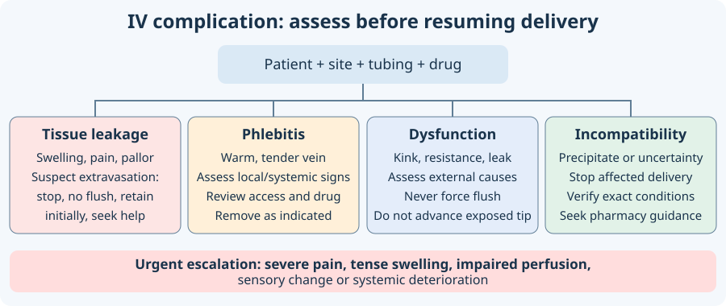

# 📚 IV complications and compatibility — Group 08B

**Study-ready, not yet studied.** Ye notes nursing exam aur supervised clinical learning ke liye hain. Actual intervention drug-specific instructions, patient condition aur authorized local protocol par depend karti hai.

[Chapter](../README.md) · [25 new MCQs](../MCQs/08B-IV-Complications-and-Compatibility-25-MCQs.md) · [Reported exam evidence](../Previous-Year-Questions/08B-IV-Complications-Reported-Evidence.md) · [Peripheral IV access](08A-Peripheral-IV-Access-and-Maintenance.md)

## Recognition

**🔴 MOST IMPORTANT**

IV fluid ko vein ke andar jaana chahiye. Jab catheter ki position change hoti hai ya vessel damage hota hai, fluid surrounding tissue mein pahunch sakta hai. Nurse patient ka pain, site colour, temperature, swelling, leakage, distal sensation aur circulation assess karti hai. Pump ka silent rehna local leakage ko exclude nahi karta.

| Problem | Kya hota hai | Common clues |
|---|---|---|
| Infiltration | Nonvesicant fluid tissue mein leak hota hai. | Swelling, coolness, pallor, tightness, reduced flow. |
| Extravasation | Potentially tissue-damaging infusate tissue mein leak hota hai. | Burning, pain, swelling, blanching, blistering ya delayed injury. |
| Phlebitis | Vein ki wall inflame ho jaati hai. | Warmth, redness, tenderness, kabhi palpable venous cord. |
| Occlusion | Catheter se fluid delivery block ho jaati hai. | Resistance, reduced flow, pressure alarm. |
| Dislodgement | Catheter partly ya completely vein se bahar hota hai. | Changed external length, leakage, bleeding, malfunction. |

Terminology guideline ke hisaab se vary karti hai. Kuch pediatric protocols extravasation word broadly use karte hain. Exam mein nonvesicant infiltration aur vesicant extravasation ka difference useful hai. Nonvesicant leak bhi large volume ya vulnerable site mein serious injury cause kar sakta hai.

Infant, sedated patient ya reduced sensation wale patient ko pain communicate karne mein difficulty ho sakti hai. Dono limbs compare karo. Normal distal refill ek time-point finding hai, future deterioration exclude nahi karta. Suspected leak mein affected delivery stop karo aur repeated assessment ka plan banao.

## Extravasation

**🔴 MOST IMPORTANT**

Vesicant ek aisa agent hai jo tissue mein leak hone par severe damage cause kar sakta hai. Irritant bhi pain aur inflammation cause kar sakta hai. Injury drug, concentration, amount, anatomical site aur time par depend karti hai. Isliye har leak ka treatment same nahi hota.

1. Suspected damaging drug leak par infusion ya injection turant stop karo aur appropriate help bulao.
2. Tubing disconnect karne aur device ko initially retain karne ka drug-specific protocol follow karo. Catheter residual medicine aspirate karne ke kaam aa sakta hai.
3. **Do not flush.** Flush se remaining drug tissue mein push ho sakti hai.
4. Exact drug, concentration, estimated volume, timing, local injury aur distal neurovascular status assess karo. Trained team protocol ke according aspiration aur indicated antidote plan kare.
5. Device removal, limb elevation, thermal application aur specialist review agent aur severity ke hisaab se decide hote hain. Blind massage ya universal warm/cold application mat karo.

Cold compress kuch drugs ke spread ko limit karne ke liye use hota hai. Warm compress kuch agents ke dispersal mein helpful ho sakta hai. Vasoactive vasoconstrictor leakage mein ice se aur vasoconstriction ho sakti hai. Exact drug-specific guidance check karo. Antineoplastic drugs ke liye eviQ jaise protocols dekho. Antidote selection aur administration trained team ka kaam hai.

Severe escalating pain, tense swelling, passive movement par disproportionate pain, numbness ya perfusion change compartment syndrome ya neurovascular compromise ka concern raise karte hain. Emergency escalation karo. Blistering aur tissue injury hours baad develop ho sakti hai. Patient education, follow-up aur safety-netting important hain.

Documentation mein drug, concentration, estimated leaked amount with uncertainty, time, site findings, circulation, sensation, interventions, response aur follow-up record karo. Clinical photographs only approved consent and policy ke according. Guess kiya hua exact volume record mat karo.

## Phlebitis

**🟠 HIGH YIELD**

Phlebitis ka matlab vein ki wall mein inflammation hai. Mechanical irritation catheter movement ya vessel contact se ho sakti hai. Chemical irritation medicine ki properties, concentration ya rate se ho sakti hai. Infection-related inflammation mein microbes involved ho sakte hain. Sirf redness se bloodstream infection ya thrombosis confirm nahi kar sakte.

Tender linear vein aur palpable cord inflammation ka clue de sakte hain. Thrombophlebitis mein thrombus ke saath inflammation hoti hai. Clot ki presence aur extent clinical assessment aur indicated investigation se decide hoti hai. Deep vein thrombosis aur superficial inflammation ko same diagnosis mat samjho.

Established peripheral phlebitis mein affected catheter use stop karke removal aur alternative access ka clinical plan follow karo. Mild irritation ke assessment aur removal threshold local guideline par depend karte hain. Repeated chemical irritation mein pharmacy se approved diluent, concentration, rate aur access suitability review karo. Independently dilution ya rate modify mat karo.

Purulent drainage ke saath rigors, hypotension, confusion ya systemic deterioration se serious infection concern badhta hai. Urgent escalation, patient assessment aur authorized sepsis pathway follow karo.

## Occlusion

**🟠 HIGH YIELD**

Occlusion catheter ke through fluid delivery block hone ko kehte hain. External clamp ya kink, position-dependent mechanical obstruction, internal blockage ya tissue leakage iske causes ho sakte hain. Pehle site assess karo aur tubing mein visible mechanical problem dekho. Safe positioning correction ke baad function reassess karo. Pressure alarm bypass ya forceful flush mat karo. Persistent nonfunctional peripheral device ko replace karne ki need ongoing therapy ke hisaab se evaluate karo. Blind wire insertion ya unauthorized thrombolytic use inappropriate hai.

## Dislodgement

**🟠 HIGH YIELD**

Catheter ka external portion badalna ya tubing traction ke baad leakage position compromise ka clue hai. Infusion stop karo aur site assess karo. Exposed segment ko blindly vein mein advance mat karo. Completely removed catheter reinsert nahi karna hai. Bleeding mein appropriate sterile gauze pressure, hemostasis assessment aur device integrity check karo. New access ki need evaluate karo. Suspected retained fragment ka approach [Group 08A](08A-Peripheral-IV-Access-and-Maintenance.md#removal) mein hai.

## Compatibility

**🔴 MOST IMPORTANT**

Y-site tubing ka junction hota hai jahan do solutions short time ke liye contact kar sakte hain. Compatibility ka matlab particular conditions mein solutions saath contact kar sakte hain bina clinically significant physical ya chemical incompatibility ke. Ye universal property nahi hai. Concentration, diluent, route, contact duration aur preparation matter karte hain.

| Observation | Safe interpretation |
|---|---|
| New precipitate, haze or colour change | Suspect incompatibility. Stop affected delivery. Do not flush particles into the patient. |
| Both solutions clear | Chemical stability prove nahi hoti. Reference verify karo. |
| Y-site compatible at specific concentrations | Different diluent ya concentration automatically covered nahi hai. |
| Short Y-site contact compatible | Same bag mein hours tak mixing ki stability prove nahi hoti. |
| Time-critical infusion cannot be paused | Separate suitable access ya authorized alternative plan arrange karo. |

Approved compatibility database, manufacturer information aur pharmacist se exact conditions verify karo. Sequential medicines ko same line se dena kabhi suitable ho sakta hai, agar compatible flush solution, volume, timing, rate aur authorized treatment plan confirm ho. Time-critical infusion independently interrupt mat karo. Extension tubing ke internal volume mein drug remain kar sakti hai. Subsequent flush residual medication deliver karti hai. Drug-specific flush rate aur policy follow karo, unintended rapid bolus se bacho.

## Quick revision

- Normal pump display local tissue leak ko rule out nahi karta.
- Suspected damaging drug leakage mein immediate stop, no flush, urgent agent-specific plan.
- Tender venous cord phlebitis suggest karta hai, clot ya sepsis independently prove nahi karta.
- Occlusion mein forceful flushing nahi. Dislodged catheter blindly advance nahi.
- Compatibility exact conditions par depend karti hai.
- Severe pain, impaired perfusion, sensory change ya systemic deterioration mein urgent escalation.

## Video resources

| Topic | Teaching | Dedicated MCQ practice |
|---|---|---|
| Infiltration, extravasation and phlebitis | [Level Up RN — IV Complications](https://www.youtube.com/watch?v=NMTljsRxr5Q), indexed description confirms topics. | [ADAPT NCLEX REVIEW practice test](https://www.youtube.com/watch?v=U6DHO19qvr4&t=860s), published 14:20 phlebitis question chapter, related to Q12–15 only. |
| Occlusion, dislodgement and compatibility | [Open RN IV push chapter](https://www.ncbi.nlm.nih.gov/sites/books/NBK594489/), written teaching, not a video. | Specific question-solving video pending. |

Four originals have related practice chapter metadata, 21 specific gaps remain. All exact item mappings and playback pending. Teaching resources do not count as question practice.

## References

[RCH extravasation injuries](https://www.rch.org.au/clinicalguide/guideline_index/Peripheral_Extravasation_Injuries/) · [RCH PIVC and midline management](https://www.rch.org.au/rchcpg/hospital_clinical_guideline_index/Peripheral_Intravenous_IV_Device_Management/) · [eviQ clinical procedure](https://www.eviq.org.au/clinical-resources/extravasation/4156-extravasation-management-clinical-procedure) · [Open RN IV push medications](https://www.ncbi.nlm.nih.gov/sites/books/NBK594489/) directly opened 27 November 2026.

[Australian PIVC standard](https://www.safetyandquality.gov.au/clinical-care-standards/management-peripheral-intravenous-catheters) · [UIC September 2026 drug extravasation review](https://dig.pharmacy.uic.edu/faqs/2026-2/september-2026-faqs/what-are-current-recommendations-for-treatment-of-drug-extravasation/) · [OpenStax IV therapy](https://openstax.org/books/clinical-nursing-skills/pages/13-1-principles-of-intravenous-therapy) indexed.

Related [IPC Group 28](../../Infection-Control-and-Microbiology/MCQs/28-CLABSI-and-Vascular-Device-Infection-Prevention-40-MCQs.md) is not counted again.

[Chapter](../README.md) · [MCQs](../MCQs/08B-IV-Complications-and-Compatibility-25-MCQs.md) · [Previous Year Questions](../Previous-Year-Questions/08B-IV-Complications-Reported-Evidence.md)
