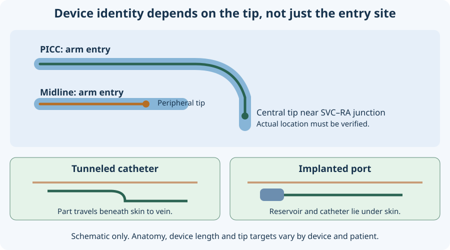

# 📚 Central venous access — Group 08C

**Study-ready, not yet studied.** Is guide mein hum central line ka basic meaning samjhenge aur phir dekhenge ki nurse ko device choose karne, use karne aur complication identify karne ke time kin baaton ka dhyan rakhna chahiye. Actual insertion, removal aur specialized interventions trained clinicians aur approved local protocol ke according hoti hain.

[Chapter](../README.md) · [28 new MCQs](../MCQs/08C-Central-Venous-Access-28-MCQs.md) · [Previous Year Questions](../Previous-Year-Questions/08C-Central-Access-Reported-Evidence.md) · [Peripheral access](08A-Peripheral-IV-Access-and-Maintenance.md)

## Devices

**🟠 HIGH YIELD**

Dekho, peripheral IV cannula mein ek chhoti flexible tube peripheral vein mein rehti hai. Central venous access device (CVAD) mein catheter ki tip ek suitable badi central vein tak pahunchti hai. Hamare upper body ka venous blood superior vena cava (SVC) se heart ke right atrium tak aata hai. Central catheter ki tip high blood flow wale area mein hone se suitable prescribed concentrated infusate blood ke saath jaldi mix ho sakta hai.

Iska matlab ye nahi hai ki har medicine central line se di ja sakti hai. Nurse ko drug ki route requirement, concentration, compatibility, device instructions aur prescribed treatment verify karna hota hai.

| Device | Simple explanation |
|---|---|
| Non-tunneled CVC | Ye catheter directly venous entry se central location tak jaata hai. Isko commonly acute hospital care mein use kiya jaata hai. |
| PICC | Peripherally inserted central catheter arm ki vein se insert hota hai, lekin tip suitable central location mein hoti hai. |
| Midline | Ye peripheral catheter short cannula se lamba ho sakta hai, lekin tip central vein tak nahi jaati. |
| Tunneled catheter | Is catheter ka ek portion skin ke neeche se travel karta hai. Isliye skin exit aur vein entry alag ho sakte hain. |
| Implanted port | Skin ke neeche ek reservoir hota hai jo catheter se connected hai. Jab port access nahi hota, toh external tubing nahi rehti. |

PICC aur midline ka confusion exam mein common hai. Dono arm se insert ho sakte hain, lekin PICC ki tip central hoti hai aur midline ki tip peripheral hoti hai. Agar kisi medicine ke liye central access mandatory hai, toh midline ko PICC samajhkar use nahi karna chahiye.

Port ka reservoir ek chhote chamber jaisa hai. Uske upar self-sealing septum hota hai. Trained nurse specified non-coring needle se access karti hai, kyunki ordinary cutting needle septum ko damage kar sakti hai. Contrast ke liye high-pressure injector use karne se pehle exact device aur needle ki power-injection rating verify karna zaroori hai.

Multilumen catheter mein separate internal channels hote hain. Ek lumen functional hone se dusre lumen ka function prove nahi hota. Agar parenteral nutrition (vein se nutrition) ke liye designated lumen hai, toh usko local policy ke according preserve karo aur doosri medicines ke liye compatible access plan banao.

## Position

**🔴 MOST IMPORTANT**

Upper-body CVAD ki tip commonly lower SVC ya cavoatrial junction ke paas intended hoti hai, lekin exact acceptable location device aur patient ke hisaab se vary kar sakti hai. Nurse ko routine central-only infusion se pehle documented verification aur permission check karni chahiye. Approved tip verification methods mein chest imaging ya suitable intracavitary ECG technique ho sakti hai. Emergency exceptions trained team aur protocol ke under hi hoti hain.

Migration ka matlab catheter apni original position se move ho gaya hai. PICC ka external length 3 cm se 6 cm ho jaaye, toh nurse ko sochna chahiye ki catheter bahar move hua ho sakta hai. Patient ko pain na ho, tab bhi internal tip position uncertain ho sakti hai. Exposed catheter ko blindly andar advance nahi karna chahiye. Use hold karke appropriate team se position verify karao.

Agar insertion ke baad heart rhythm mein new ectopic beats aati hain, toh possible tip irritation ke saath other clinical causes assess karo. Nurse ko patient ki condition monitor karni chahiye aur urgent review arrange karna chahiye.

Transfer ke time device type, insertion date, external length, confirmed tip, lumen function, dressing condition, restrictions aur prescribed therapy ka record verify karo. Sirf hospital se transfer hone se catheter safe use ke liye automatically cleared nahi hota.

## Patency

**🟠 HIGH YIELD**

Patency ka matlab catheter ka pathway khula aur suitable function mein hona hai. Kabhi fluid andar easily jaata hai, lekin blood wapas aspirate nahi hota. Is situation ko withdrawal dysfunction kehte hain. Catheter tip vein ki wall ke paas ho sakti hai ya fibrin sheath ban sakti hai. Fibrin sheath clot-related protein ki layer hoti hai jo catheter ke around ban sakti hai. Ye blood aspiration ko block kar sakti hai jabki injection possible rahta hai.

Isliye sirf easy flush ko complete patency ka proof mat samjho. Therapy-specific blood return requirement aur approved patency assessment follow karo. External clamp, kink, valve mechanism, catheter position, clot aur medicine precipitate alag causes ho sakte hain. Nurse ko forceful flushing nahi karni chahiye. Cause identify karne ke baad trained team suitable management decide karti hai. Clot ke liye prescribed thrombolytic aur chemical blockage ke liye compatibility-based plan alag ho sakte hain.

Lock ka matlab approved solution ko catheter ke internal space mein specified time ke liye chhodna hai. Har catheter mein heparin lock mandatory nahi hai. Lock drug, volume aur handling manufacturer instructions, prescription aur policy se decide hoti hai. Kuch medicated locks aspirate karne pad sakte hain. Har solution ko patient mein flush karna safe nahi hota. Connector aur valve design ke hisaab se clamping sequence bhi alag ho sakti hai.

## Complications

**🔴 MOST IMPORTANT**

Central catheter ke saath infection, mechanical malfunction, venous thrombosis, air entry aur insertion-related injury ka risk hota hai. Infection prevention ka detailed practice already [IPC Group 28](../../Infection-Control-and-Microbiology/MCQs/28-CLABSI-and-Vascular-Device-Infection-Prevention-40-MCQs.md) mein hai. Us bank ke questions ko yahan dobara count nahi kiya gaya hai.

Pneumothorax ka matlab lung aur chest wall ke beech pleural space mein air aa jaana hai. Neck ya chest access ke dauran lung ke paas injury ho sakti hai. Agar insertion ke baad patient ki breathing suddenly kharab ho aur ek side breath sounds kam ho jaayein, toh nurse urgent assessment aur escalation karti hai. Ye routine catheter adjustment nahi hai.

Agar large-bore catheter ya dilator galti se artery mein chala gaya ho, toh blind removal se uncontrolled bleeding ho sakti hai. Operator aur appropriate specialist ko urgently inform karo. Device ko independently remove ya use mat karo.

Venous thrombosis ka matlab vein mein blood clot ban jaana hai. PICC ke around clot venous drainage block kar sakta hai. Isliye arm, shoulder ya neck mein new swelling aur discomfort ko ignore nahi karna chahiye. Clean insertion site clot ko rule out nahi karti. Nurse ko prompt clinical assessment aur indicated imaging arrange karni chahiye. Massage ya independent catheter removal treatment nahi hai.

Air embolism mein air bloodstream mein enter kar sakti hai. Open connection ya removal ke baad catheter tract se air entry possible ho sakti hai. Sudden breathing difficulty, hypotension ya collapse par emergency response activate karo, further air entry prevent karo, oxygen aur resuscitation support authorized protocol ke according do. Patient positioning clinical condition aur team guidance ke hisaab se decide hoti hai. Removal ke baad appropriate occlusive dressing aur observation important hain.

Implanted port ke upar infusion ke dauran new swelling aaye toh access needle displacement ya leak consider karo. Affected infusion stop karke drug-specific extravasation assessment karao. Port rotation suspect ho aur septum confidently locate na ho, toh repeated blind puncture nahi karna chahiye.

## Monitoring

**🟠 HIGH YIELD**

Central venous pressure (CVP) central veins aur right atrium ke paas ka pressure reflect karta hai. Ye left ventricular ejection fraction ka direct measurement nahi hai. Nurse pressure tubing aur transducer se monitor par reading dekh sakti hai. Transducer pressure ko electrical signal mein convert karta hai.

Accurate measurement ke liye transducer ko atmospheric pressure par zero aur appropriate right-atrial reference par level kiya jaata hai. Agar transducer reference se neeche hoga, toh fluid column ka pressure reading mein add ho sakta hai. Isliye reading falsely high ho sakti hai. Agar transducer upar hoga, toh reading falsely low ho sakti hai. Patient position change karne ke baad level dobara verify karna important hai.

PEEP ka matlab ventilator se expiration ke end par maintained positive pressure hai. Ye chest pressure ko affect kar sakta hai. Isliye PEEP badhne ke baad CVP badhna automatically fluid overload prove nahi karta. Heart function, venous tone, respiration aur measurement technique bhi CVP ko influence karte hain.

Fluid responsiveness ka matlab fluid dene par cardiac output ya stroke volume mein meaningful improvement hona hai. Indian Society of Critical Care Medicine ki hemodynamic monitoring guidance CVP alone se fluid responsiveness predict karne ke against recommend karti hai. Isliye ek low CVP number dekhkar unrestricted fluid nahi dena chahiye. Patient ki perfusion, clinical findings, authorized dynamic assessment aur prescribed plan saath mein consider karo.

## Video resources

| Topic | Teaching video | Dedicated MCQ practice |
|---|---|---|
| CVC, PICC and device types | [ICU Advantage — Basics of Central Lines](https://www.youtube.com/watch?v=bYa4tDKRjdA) aur [Central Venous Pressure, PICC Line & PCWP Simplified](https://www.youtube.com/watch?v=4ngvErUP9a0) ke indexed descriptions relevant hain. Playback confirm nahi hua hai. | Device-specific practice mapping pending hai. |
| Ports and tunneled lines | [Central Lines: Ports & Types](https://www.youtube.com/watch?v=idIcAmDnx8w) ka indexed description relevant hai. Channel aur playback confirmation pending hai. | Specific question practice pending hai. |
| CVP measurement and interpretation | [CVP, PICC and PCWP Simplified](https://www.youtube.com/watch?v=4ngvErUP9a0) teaching lead hai. | [NORCET 10 cardiovascular MCQ series](https://www.youtube.com/watch?v=TKqG10U7Pco&t=9637s) ke published description mein 2:40:37 par CVP topic hai. Q22–25 se related topic-level lead hai, exact item, channel aur playback pending hain. |

Baaki 24 originals ke liye specific question-solving video confirm nahi hua hai. All 28 exact playback mappings pending hain. Teaching-only videos ko MCQ practice nahi gina gaya hai.

## References

- [Association of Anaesthetists safe vascular access 2025](https://pmc.ncbi.nlm.nih.gov/articles/PMC12519924/). Indexed guideline text reviewed, direct PMC CAPTCHA and publisher 403.
- [Open RN Manage Central Lines](https://www.ncbi.nlm.nih.gov/books/NBK594495/?report=classic). Indexed chapter excerpts reviewed, direct retrieval cache miss.
- [CNSA occlusion assessment and management](https://www.cnsa.org.au/implement/vascular-access-devices/section-1-patency-occlusion-prevention/occlusion-assessment-management.html). Directly retrieved on 28 November 2026.
- [ISCCM Guidelines for Hemodynamic Monitoring in the Critically Ill](https://pmc.ncbi.nlm.nih.gov/articles/PMC9989872/), [CVP narrative review](https://pmc.ncbi.nlm.nih.gov/articles/PMC12351226/) aur [LHSC central venous monitoring standard](https://www.lhsc.on.ca/critical-care-trauma-centre/standard-of-care-central-venous-monitoring). Indexed text supports CVP limitations and leveling. Full independent source audit pending.

[Chapter](../README.md) · [MCQs](../MCQs/08C-Central-Venous-Access-28-MCQs.md) · [Previous Year Questions](../Previous-Year-Questions/08C-Central-Access-Reported-Evidence.md)
