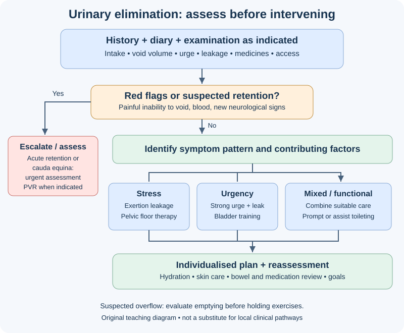

# 09A — Urinary Elimination Assessment and Continence Care

**Nursing Foundations | NORCET / all-India staff nurse | 🟠 High yield**

[26 new original MCQs](../MCQs/09A-Urinary-Elimination-Assessment-and-Continence-Care-26-MCQs.md) · [Legacy Group 09 bank](../MCQs/09-Urinary-Elimination-and-Catheter-Care-20-MCQs.md) · [Reported evidence](../Previous-Year-Questions/09A-Urinary-Elimination-Reported-Evidence.md)

## 1. Normal voiding aur continence ka basic concept

Kidneys continuously urine banati hain. Urine ureters se bladder mein collect hota hai. Storage ke time bladder ko low pressure par fill hona chahiye aur urethral outlet closed rehna chahiye. Jab patient safely void kar sakta hai, coordinated nervous control detrusor contraction aur outlet relaxation allow karta hai.

Continence ka matlab sirf strong bladder nahi hai. Normal sensation, pelvic support, nervous system coordination, toilet access, cognition aur mobility bhi important hain. Inmein kisi component ki problem se leakage ho sakta hai. Isliye har patient ko same intervention dena sahi nahi hai.

## 2. Common symptom patterns ko distinguish karo

| Pattern | Typical finding | Nursing reasoning |
|---|---|---|
| Stress | Coughing, sneezing, lifting ya exertion ke samay leak | Abdominal pressure increase ke time urethral closure inadequate ho sakta hai. Appropriate pelvic floor assessment aur training consider karo. |
| Urgency | Achanak compelling urge ke saath involuntary leak | Bladder storage symptoms assess karo. Detrusor overactivity common association hai, lekin clinical symptom se urodynamic diagnosis prove nahi hota. |
| Mixed | Stress aur urgency dono features | Dominant symptoms aur patient priorities identify karo. Suitable pelvic floor training aur bladder training combine kar sakte hain. |
| Overflow | Incomplete emptying, weak stream, dribbling | Bladder mein residual urine remain kar sakta hai. Outlet obstruction, impaired contraction ya medicines evaluate karo. |
| Functional | Patient ko timely toilet access mein difficulty | Mobility, cognition, communication aur environmental barriers address karo. Dusri bladder pathology coexist kar sakti hai. |
| Continuous leakage | Persistent loss independent of usual voiding pattern | Fistula ya other causes ke liye appropriate assessment aur referral arrange karo. |

**Exam trap:** Psychological stress aur stress urinary incontinence same cheez nahi hain. Stress incontinence mein pressure-related leakage hota hai. Urgency symptom aur proven detrusor overactivity bhi interchangeable diagnoses nahi hain.

Nocturia ka matlab sleep se jagkar voluntarily urine pass karna hai. Nocturnal enuresis mein sleep ke dauran involuntary wetting hoti hai. Frequency ka matlab frequent voids hai, jabki polyuria total urine volume increase ko describe karta hai.

## 3. Assessment: pehle pattern samjho, phir intervention choose karo

Patient se privately aur non-judgmental manner mein baat karo. Leakage ka onset, frequency, quantity, triggers, urge, weak stream, pain, nocturia, haematuria aur complete emptying ki feeling document karo. Obstetric, surgical, neurological aur medical history relevant ho sakti hai. Mobility, cognition, constipation, prescribed medicines aur access to toilet bhi assess karo.

Bladder diary mein void ka time aur measured volume, drinks, urgency aur leakage record karwao. NICE NG123 women ke initial assessment mein kam se kam three days ka diary recommend karta hai, including variation in usual activities. Ek single void ya pad count poora pattern nahi batata.

Urine testing aur further investigations clinical indication ke according arrange karo. NICE women mein routine initial pad-weight testing recommend nahi karta. Har investigation ka purpose aur patient consent clear rakho.

## 4. Retention aur post-void residual (PVR)

PVR voluntary void ke turant baad bladder mein bachi urine ka volume hai. Bladder ultrasound non-invasive measurement ka useful method hai. Measurement promptly karo, kyunki delay se newly produced urine add ho jaata hai aur original residual overestimate ho sakta hai.

Scanner reading ko symptoms aur clinical context ke saath interpret karo. Ascites, pelvic masses aur measurement technique result distort kar sakte hain. Unexpected result ko protocol aur clinician ke guidance ke according verify karo. Ek universal residual cut-off ko sab patients par apply mat karo.

Painful inability to pass urine ya suspected acute retention prompt urgent evaluation demand karta hai. Overflow symptoms ko automatically urgency incontinence maan kar holding exercises shuru mat karo. Obstruction, constipation, neurological dysfunction aur medication adverse effects assess karne pad sakte hain.

**Emergency:** New back pain ke saath difficulty initiating urine, saddle/perineal sensory change ya new bowel dysfunction cauda equina syndrome ka concern raise karta hai. Routine continence appointment ka wait nahi karna chahiye. Emergency pathway activate karo.

Unexplained visible haematuria ko uncomplicated stress incontinence ka expected feature mat samjho. Appropriate prompt referral aur clinical evaluation arrange karo.

## 5. Conservative nursing care

### Pelvic floor muscle training

Women with stress or mixed urinary incontinence ke liye NICE supervised pelvic floor training at least three months as first-line therapy recommend karta hai. Trained clinician pehle correct contraction assess kare. Assessment mein informed consent, privacy aur appropriate competence maintain karo. NICE programme mein minimum eight contractions three times daily ka framework deta hai, lekin patient ki ability aur clinical plan ke according tailor karo.

Correct contraction mein pelvic floor ko gently lift aur squeeze karna hota hai. Bearing down, breath holding aur excessive straining intended movement nahi hain. Technique incorrect ho to repetitions blindly increase mat karo. Regular supervised practice aur review se progress assess karo.

### Bladder training

Women with urgency or mixed urinary incontinence mein NICE kam se kam six weeks ka bladder training trial recommend karta hai. Baseline diary ke basis par achievable intervals set karo. Suitable urge-control strategies aur gradual progression se patient bladder habits improve kar sakta hai. Painful distension, suspected retention ya acute symptoms ke against forced holding nahi karwana chahiye.

### Prompted voiding aur timed toileting

Prompted voiding mein regular reminders, wetness/urge inquiry, assisted toilet use aur positive feedback include hote hain. Cognitive impairment ke saath suitable patient ko isse help mil sakti hai. Timed toileting mein observed pattern ke around scheduled opportunity provide hoti hai. Patient preferences, comfort aur safety ke according interval change karo. Dono approaches ko forced holding se confuse mat karo.

### Lifestyle and medication review

Caffeine reduction ka trial urgency symptoms mein useful ho sakta hai. Excessive ya inadequate fluid intake ko avoid karo. Cardiac, renal aur prescribed fluid restrictions individual hote hain. Patient ko leakage control karne ke liye dangerously restrict karne ko mat bolo.

Constipation bladder symptoms ko contribute kar sakti hai. Bowel history, diet, mobility aur prescribed bowel care review karo. Antimuscarinic therapy ke baad new voiding difficulty ya suprapubic fullness develop ho to retention assessment aur prescriber review zaroori hai. Diuretic timing nocturia contribute kar sakti hai, lekin dose ya timing independently change mat karo.

## 6. Dignity, containment aur skin protection

Private toilet access, call bell, adequate lighting, accessible commode, mobility aids aur timely assistance provide karo. Absorbent products supportive containment hain, underlying cause ka treatment nahi. Patient preferences aur independence respect karo.

Routine incontinence management ke liye indwelling catheter use mat karo. CDC appropriate indications aur alternatives consider karne ko recommend karta hai. External collection devices suitable selected patients mein use ho sakte hain. Fit, skin integrity, drainage aur local circulation assess karo. Constriction, swelling ya injury ho to device remove karke clinical review arrange karo.

Frequent moisture exposure se incontinence-associated dermatitis (IAD) ho sakti hai. Diffuse superficial erythema ya erosion IAD suggest kar sakte hain. Pressure/shear history aur focal pressure-point lesions separately assess karo, kyunki IAD aur pressure injury coexist kar sakti hain. Gentle cleansing, suitable skin protection aur timely product changes local protocol ke according karo.

## 7. Evaluation and patient education

Patient ke goals establish karo. Baseline aur follow-up diary mein leakage episodes, urgency, voiding pattern, comfort, skin condition aur daily activities compare karo. Complete dryness hi improvement ka only measure nahi hai. Fewer accidents, better sleep aur social participation bhi meaningful outcomes hain.

Teach-back use karo. Patient ko batane do ki diary kaise fill karenge, training kab karenge aur kaunse red flags report karenge. Persistent symptoms ke liye follow-up arrange karo.

## 8. Legacy allocation and boundaries

Group 09 Q9, Q10, Q18 and Q19 are allocated once to 09A, alongside 26 new MCQs. The earlier questions and rationales remain untouched. Catheter insertion/removal, maintenance/CAUTI and specimen collection are subsequent 09B–09D work. Fluid balance and other chapter questions are cross-references rather than duplicated originals.

## 9. Sources and practice resources

- [NICE NG123 recommendations](https://www.nice.org.uk/guidance/ng123/chapter/recommendations) — indexed recommendation text reviewed, direct access restricted.
- [NHS urinary incontinence treatment](https://www.nhs.uk/conditions/urinary-incontinence/treatment/) — direct page reviewed.
- [OpenStax Fundamentals of Nursing, urinary elimination](https://openstax.org/books/fundamentals-nursing/pages/26-4-the-nurses-role-in-urinary-elimination) — direct page reviewed.
- [NIDDK urinary retention](https://www.niddk.nih.gov/health-information/urologic-diseases/urinary-retention/symptoms-causes/) — indexed clinical guidance.
- [NIDDK bladder control treatment](https://www.niddk.nih.gov/health-information/urologic-diseases/bladder-control-problems/treatment) — indexed clinical guidance.
- [NCBI Bookshelf PVR](https://www.ncbi.nlm.nih.gov/books/NBK539839/) — indexed text for immediate measurement and scanner limitations.
- [CDC CAUTI prevention](https://www.cdc.gov/infection-control/hcp/cauti/summary-of-recommendations.html) — direct recommendations reviewed.
- [NSW emergency low back pain](https://aci.health.nsw.gov.au/networks/eci/clinical/tools/orthopaedic-and-musculoskeletal/acute-low-back-pain) — indexed clinical emergency guidance.
- [IAD and pressure injury differentiation](https://pmc.ncbi.nlm.nih.gov/articles/PMC12210662/) — indexed clinical research, used with assessment caveat.
- [Nexus Nursing Institute — NCLEX Practice for Urinary Elimination](https://www.youtube.com/watch?v=x1a-q6SY3sk) — indexed title/channel, dedicated topic practice lead. Exact questions and playback timestamps not verified.
- [Ishwari Chandran — Urinary Incontinence, USMLE MCQs](https://www.youtube.com/watch?v=dW0Ws2VESs8) — description contains practice prompts for stress/overflow and mechanism. Medical entrance resource, not a NORCET nursing PYQ. Verify individual playback and explanations before marking a question mapping complete.

Clinical recommendations apply to the stated patient populations and should be adapted to local policy. This is educational material, not independent prescribing guidance.

Reviewed 2026-11-28. Independent clinical and semantic audit pending.
