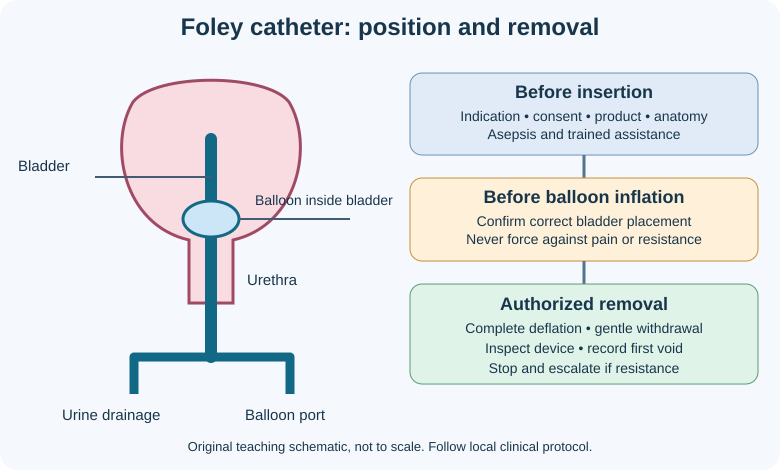

# 09B — Urinary Catheter Insertion and Removal

**Study-ready, not yet studied.** Ye topic Nursing Foundations aur bedside procedural safety ke liye hai. Invasive procedure sirf trained aur authorized staff local policy ke under perform karte hain.

[Chapter](../README.md) · [24 original MCQs](../MCQs/09B-Urinary-Catheter-Insertion-and-Removal-24-MCQs.md) · [Historical evidence and videos](../Previous-Year-Questions/09B-Catheter-Insertion-Reported-Evidence.md)

## 1. 🟠 HIGH YIELD — Catheter ka purpose aur selection

Bladder normal condition mein urine store karta hai aur urethra se empty hota hai. Jab clinically indicated drainage possible nahi hoti, toh catheter bladder se urine bahar nikalne ka artificial route provide kar sakta hai. Indwelling Foley catheter bladder mein retention balloon ki madad se rehta hai. Intermittent catheter bladder drain karke nikal diya jaata hai. Suprapubic catheter lower abdomen ke through bladder tak jaata hai aur specialist plan ke under manage hota hai.

Foley ke do common channels ko samjho. Ek channel urine ko drainage bag tak le jaata hai aur doosra retention balloon mein fluid pahunchata hai. Three-way catheter mein ek additional irrigation channel hota hai. Irrigation ko routine infection-prevention step mat samjho. Iski indication aur order alag hoti hai.

| Selection factor | Clinical reasoning |
|---|---|
| French size | Fr ko 3 se divide karke external diameter mm mein milta hai. Example: 15 Fr ka diameter 5 mm hai. |
| Material | Patient ko latex allergy ho toh verified latex-free product choose karo. Silicone-coated latex aur all-silicone ek jaise nahi hain. |
| Length | Male urethra lambi hoti hai, isliye suitable length chahiye. Short female-length catheter ko adult male mein use mat karo. |
| Balloon | Product-specific label se inflation fluid aur volume verify karo. Zyada volume catheter ko safe nahi bana deta. |

CDC ke mutabik suitable drainage ke liye smallest appropriate bore select karte hain. Har adult ko ek fixed size dena appropriate nahi hai. Device size, duration, material aur indication clinical team decide karti hai.

## 2. 🔴 MOST IMPORTANT — Assessment before insertion

Nurse patient ki identity, indication, order ya authorized protocol, allergies, medical history, mobility, consent aur privacy check karti hai. Patient ko samjhao ki procedure kyun chahiye aur unhe kis tarah ki sensation ho sakti hai. Competent patient refuse kare toh non-emergency procedure force nahi karna chahiye. Unki concern ko samajhkar clinician se alternatives discuss karo.

Pelvic trauma ke baad urethral meatus par blood milna urethral injury ka important clue hai. Aise patient mein routine blind urethral catheter insertion ko rok kar trauma/urology team ko urgently inform karo. Previous stricture, difficult catheter insertion, recent urological surgery ya abnormal anatomy ho toh plan pehle clarify karna chahiye. Repeated blind attempts se false passage aur bleeding ho sakti hai.

## 3. 🔴 MOST IMPORTANT — Aseptic insertion ka principle

Acute-care indwelling insertion aseptic technique aur sterile equipment se trained staff perform karte hain. Sterile field prepare karne ke baad anatomy identify karo. Patient ki hip precautions, pain aur mobility ke hisaab se positioning adapt karo. Female patient mein dorsal recumbent position commonly use hoti hai, lekin safe alternatives trained help se choose kiye ja sakte hain.

Labia ya skin ko hold karne wali hand ko contaminated treat karo. Catheter ka sterile insertion segment doosri sterile hand se handle karo. Lubricant friction kam karta hai. Agar local anaesthetic lubricant use ho toh allergy aur product-specific contact time check karo. Catheter accidentally vagina mein chala jaaye toh same catheter ko urethra mein reuse nahi karna chahiye. Local protocol allow kare toh usse temporary landmark ki tarah rakhkar new sterile catheter se fresh aseptic insertion karte hain.

Male insertion mein first urine return tip ki position ka clue hai, lekin balloon tip se peeche hota hai. Isliye prescribed technique ke appropriate insertion depth aur correct bladder placement confirm karne ke baad hi balloon inflate kiya jaata hai. Pain ya marked resistance ho toh force nahi lagana chahiye. Balloon inflation ke waqt sharp urethral pain ho toh inflation stop karke instilled fluid deflate karo aur competent reassessment arrange karo.

Uncircumcised patient mein retracted foreskin ko procedure ke baad normal position mein return karna important hai. Agar woh glans ke peeche constricting ring banakar reh jaaye toh paraphimosis aur circulation compromise ho sakta hai.

## 4. Insertion ke baad verification aur documentation

Urine drainage aur patient comfort check karo. Catheter ko appropriate securement aur slack ke saath stabilize karo. Device ka type, size, length, inflation volume, manufacturer/lot as required, indication, date/time, procedure difficulties aur patient response document karo. Ye information later removal aur device problem mein useful hoti hai. Maintenance, specimens aur CAUTI-specific decisions subsequent 09C/09D topics mein separately cover honge.

## 5. 🔴 MOST IMPORTANT — Authorized removal aur post-removal care

Catheter removal ka order ya nurse-led authorized protocol verify karo. Patient ko explain karo aur privacy maintain karo. Balloon port aur documented inflation volume identify karo. EAUN 2024 passive balloon deflation ko support karta hai kyunki forceful suction cuff formation badha sakta hai. Manufacturer ki instructions follow karo aur removal se pehle complete deflation verify karo. Agar gentle withdrawal mein resistance ho ya fluid return uncertain ho toh attempt stop karo. Cutting, blind puncture ya forceful pulling independently mat karo.

Removed catheter ki integrity check karo. Tip damaged ya missing lage toh device preserve karo aur clinician ko promptly inform karo. CDC routine clamping before removal ko necessary nahi maanta. Special urological plan mein authorized instructions alag ho sakte hain.

Removal ke baad first void ka time aur volume note karo. Patient small amount void kare tab bhi complete emptying prove nahi hoti. Protocol ke according symptoms aur indicated post-void residual assess karo. Fixed water loading sab patients ke liye safe nahi hoti, especially cardiac ya renal fluid restriction mein. Mild transient irritation ho sakti hai, lekin persistent dysuria, painful distension, inability to void, fever ya worsening bleeding mein clinical assessment chahiye. Acute painful retention urgent concern hai.

Recently created suprapubic catheter accidentally nikal jaaye toh urgent urology help chahiye. Tract close ho sakta hai aur immature tract mein blind replacement injury cause kar sakta hai.

## 6. Allocation aur practice

Group 09 ke Q1,8,15,16,17 aur previously reserved Group 05 Q18 ko 09B mein ek baar allocate kiya gaya hai. Naye 24 questions device selection, procedural decision-making aur removal safety par hain. Existing IPC CAUTI bank ke tasks ko additional originals ke roop mein count nahi kiya gaya hai.

## 7. Clinical references and videos

- [CDC CAUTI recommendations](https://www.cdc.gov/infection-control/hcp/cauti/summary-of-recommendations.html) — direct HTML reviewed.
- [EAUN 2024 equipment](https://nurses.uroweb.org/guidelines/indwelling-catheterisation-in-adults-urethral-and-suprapubic/chapter/equipment-and-products), [procedure appendices](https://nurses.uroweb.org/guidelines/indwelling-catheterisation-in-adults-urethral-and-suprapubic/chapter/appendices) and [nursing intervention](https://nurses.uroweb.org/guidelines/indwelling-catheterisation-in-adults-urethral-and-suprapubic/chapter/principles-of-management-of-nursing-intervention) — direct HTML reviewed.
- [Open RN elimination skills](https://www.ncbi.nlm.nih.gov/sites/books/NBK596722/?report=reader) and [EAU urological trauma](https://uroweb.org/guidelines/urological-trauma/chapter/urogenital-trauma-guidelines) — indexed relevant text reviewed.
- [RegisteredNurseRN female Foley removal](https://www.youtube.com/watch?v=9pRyoBXAYl0) — publisher description covers removal, deflation and device inspection. Teaching lead, not dedicated MCQ practice.
- [JINC E-NURSING procedure-based NORCET10 urinary catheterization](https://www.youtube.com/watch?v=ofQ1VNcp-aQ) — indexed title and description identify catheterization MCQ preparation. Exact question coverage and playback remain unverified.

[Chapter](../README.md) · [MCQs](../MCQs/09B-Urinary-Catheter-Insertion-and-Removal-24-MCQs.md) · [Evidence](../Previous-Year-Questions/09B-Catheter-Insertion-Reported-Evidence.md)
