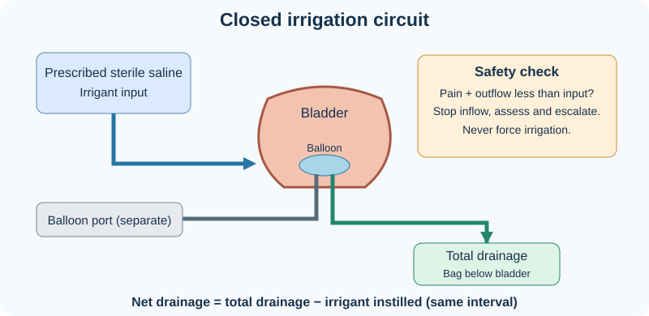

# 09C — Catheter Maintenance and CAUTI Prevention

**Study-ready, not yet studied.** Is lesson mein catheter maintenance, bedside complications aur prescribed bladder irrigation ko samjhenge. Ye trained nursing staff ke authorized clinical protocol ke liye study material hai.

[Chapter](../README.md) · [23 new MCQs](../MCQs/09C-Catheter-Maintenance-and-CAUTI-Prevention-23-MCQs.md) · [Evidence](../Previous-Year-Questions/09C-Catheter-Maintenance-Reported-Evidence.md)

## Closed drainage aur infection prevention

CAUTI ka matlab catheter-associated urinary tract infection hai. Catheter urethra ki natural protective barrier ko bypass karta hai. Microorganisms catheter ke outer surface ya drainage circuit ke through ascend kar sakte hain. Jab bacteria surface par chipak kar protective layer banate hain, toh use biofilm kehte hain. Free urine flow hone se device sterile prove nahi hota.

Nurse har shift mein catheter ki ongoing need, patient comfort, urine output aur circuit check karti hai. Hand hygiene catheter touch karne se pehle aur baad mein zaroori hai. Drainage system ko closed rakho aur bag ko bladder se neeche support karo, floor par nahi. Tubing mein bend, compression aur dependent loops avoid karo. Bag ko separate clean container mein aseptically empty karne ka local protocol follow karo. Routine meatal hygiene appropriate hai. Infection prevent karne ke liye routine antiseptic instillation, unnecessary irrigation ya daily antibiotic prophylaxis mat karo.

## Blockage, bypassing aur spasms

Jab drainage kam ho, toh pehle patient assess karo. Pain, bladder fullness, fluid intake/output, vitals aur tubing ka course dekho. Mechanical obstruction aur low kidney urine production different problems hain. Painful retention ya sudden deterioration mein prompt escalation chahiye.

Long-term catheter par crystalline deposits ban sakte hain. Proteus jaise urease-producing organisms urea ko break karte hain. Isse urine alkaline ho sakta hai aur struvite ya calcium phosphate crystals catheter ke lumen ko obstruct kar sakte hain. Repeated blockage mein stone aur infection evaluation ki zaroorat ho sakti hai. Previous catheter changes ki date, reason aur visible deposits document karo.

Catheter ke around urine leak ho toh use bypassing kehte hain. Bypassing ka cause automatically small catheter nahi hota. Partial blockage, spasm, constipation, traction ya oversized catheter bhi contribute kar sakte hain. Balloon mein extra fluid bharna ya blindly bore increase karna safe nahi hai.

Bladder spasm mein detrusor muscle involuntarily contract karti hai. Patent drainage ke saath cramping aur urgency possible hain. Obstruction aur acute complications assess karne ke baad clinician-directed anticholinergic treatment consider ho sakta hai. Constipation bladder discomfort worsen kar sakti hai. Individual bowel plan aur appropriate fluid intake useful hain. Renal ya cardiac fluid restriction ko ignore mat karo.

## Mobility aur home care

Leg bag ka weight suitable holder par rehna chahiye, catheter tubing par nahi. Straps se circulation restrict nahi honi chahiye. Skin par persistent redness mile toh pressure relieve karke skin assess karo. Catheter valve selected patients ko mobility aur discreet drainage mein help kar sakta hai. Small bladder capacity, poor compliance, severe cognitive impairment ya inability to empty safely mein specialist suitability assessment chahiye. Approved overnight free-drainage plan mein compatible bag aur open valve use kiya ja sakta hai.

## Continuous bladder irrigation (CBI)

Urological surgery ya significant haematuria ke baad blood clots bladder outlet block kar sakte hain. Prescribed CBI ka purpose catheter patency maintain karna aur clot accumulation reduce karna hai. Three-way catheter mein balloon, irrigation input aur drainage ke separate channels hote hain. Sterile prescribed irrigant aur correct connection verify karo.

Irrigation ke time total drainage sirf kidney urine nahi hoti. Ismein instilled fluid bhi hota hai. Same interval mein **net urinary drainage = total drainage minus instilled irrigant**. Agar 2400 mL irrigant aur 2820 mL drainage hai, toh net 420 mL hai. Leakage, retained fluid ya measurement error calculation ko affect kar sakte hain.

Agar input 900 mL aur drainage 500 mL ho, saath mein pain badh raha ho, toh 400 mL difference ko negative urine production mat samjho. Further inflow rok kar outflow assessment aur urgent trained help arrange karo. Forceful irrigation unsafe hai. Manual washout sirf trained staff local protocol ke according karte hain. Increasing haematuria, clots, pallor ya tachycardia mein bleeding aur circulation assess karo aur surgical team ko promptly inform karo.

Handover mein instilled volume, total drainage, net output, colour, clots, pain, interventions aur response document karo.

## Symptomatic CAUTI aur culture

Pyuria ka matlab urine mein white blood cells hain. Catheter users mein pyuria ya bacteriuria akeli symptomatic infection establish nahi karti. Symptoms, alternative causes aur clinical assessment important hain. Routine asymptomatic culture aur antibiotic treatment se unnecessary harm ho sakta hai.

NICE NG113 symptomatic CAUTI mein seven days se zyada old catheter ko remove ya, still indicated ho toh replace karne par consideration deta hai. Antibiotic treatment delay nahi hona chahiye. EAU two-week criterion describe karta hai. ICMR 2026 workflow device-related replacement intervals bhi discuss karta hai. CDC arbitrary fixed-interval change solely for infection prevention recommend nahi karta. Manufacturer limits, clinical indications aur approved local care plan follow karo.

Culture indicated ho toh prescribed replacement ke baad new catheter ke sampling port se aseptic sample le sakte hain. Catheter remove ho gaya aur patient void kar sakta hai toh fresh midstream sample appropriate ho sakta hai. Urgent treatment ko specimen ke liye delay nahi karna chahiye.

## Study links and clinical sources

- [CDC prevention guidance](https://www.cdc.gov/infection-control/hcp/cauti/summary-of-recommendations.html) and [EAUN complications](https://nurses.uroweb.org/guidelines/indwelling-catheterisation-in-adults-urethral-and-suprapubic/chapter/catheter-complications) — direct HTML reviewed.
- [EAUN equipment and valves](https://nurses.uroweb.org/guidelines/indwelling-catheterisation-in-adults-urethral-and-suprapubic/chapter/equipment-and-products) and [BAUS irrigation](https://www.baus.org.uk/trainees/bladder_washout_irrigation.aspx) — direct HTML reviewed.
- [NSW bladder irrigation toolkit](https://aci.health.nsw.gov.au/networks/urology/resources/bladder-irrigation/overview) — indexed net-output guidance, direct continuous page failed.
- [EAU infections](https://uroweb.org/guidelines/urological-infections/chapter/the-guideline) — direct guideline retrieved. [NICE NG113](https://www.nice.org.uk/guidance/ng113/chapter/Recommendations) indexed, direct retrieval 403.
- [ICMR July 2026 nephrology workflow](https://www.icmr.gov.in/icmrobject/uploads/STWs/1793170716_nephrology.pdf) — extracted official PDF text, screenshot failed.
- [Nursing Foundation II curriculum](https://nursingatoms.in/academy/nursing-courses/bsc-nursing-basic/syllabus/n-nf-ii-125/) — indexed INC-based syllabus reproduction includes urinary drainage and irrigation.
- [Catheter care bundle — teaching candidate](https://www.youtube.com/watch?v=N6UCB3JUvvY) and [JINC E-NURSING catheterization practice](https://www.youtube.com/watch?v=ofQ1VNcp-aQ) — indexed titles and descriptions, exact playback and question-level practice mappings pending.

[Chapter](../README.md) · [MCQs](../MCQs/09C-Catheter-Maintenance-and-CAUTI-Prevention-23-MCQs.md) · [Evidence](../Previous-Year-Questions/09C-Catheter-Maintenance-Reported-Evidence.md)
