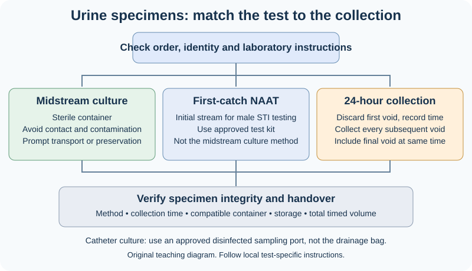

# 09D — Urinary Specimen Collection

**Study-ready, not yet studied.** Is lesson mein hum urine specimen collect karne ka purpose, sample quality, transport aur timed collection ka calculation samjhenge. Test-specific laboratory instructions aur authorized clinical policy ko priority do.

[Chapter](../README.md) · [27 original MCQs](../MCQs/09D-Urinary-Specimen-Collection-27-MCQs.md) · [Reported exam evidence](../Previous-Year-Questions/09D-Urinary-Specimen-Reported-Evidence.md)

## 1. Specimen test ke hisaab se choose karo

Hamare kidneys urine ke through water, dissolved waste aur electrolytes excrete karti hain. Urine test se clinician infection, blood cells, protein, glucose aur other substances assess kar sakta hai. Lekin result sirf patient's condition par depend nahi karta. Collection aur storage ke dauran sample change ho jaaye toh report misleading ho sakti hai. Isliye nurse ka role sample collect karne ke saath uski quality protect karna bhi hai.

| Test | Collection ka reason |
|---|---|
| Routine urinalysis and microscopy | Fresh suitable urine mein chemical findings aur cells assess hote hain. First morning urine kuch constituents detect karne ke liye useful ho sakti hai. |
| Bacterial culture | Properly collected fresh sample se viable bacteria aur unki drug susceptibility assess hoti hai. Midstream sterile container commonly preferred hai. |
| Male chlamydia NAAT | NAAT microbial genetic material detect karta hai. Initial urine stream collect ki jaati hai, kyunki urethral material capture karna purpose hai. Kit-specific volume aur timing follow karo. |
| Timed quantitative urine | Poore defined interval ki excreted quantity measure karte hain. Every void aur total volume important hote hain. |

## 2. Clean-catch aur culture

Patient identity aur order verify karo. Purpose explain karo aur privacy maintain karo. Culture ke liye laboratory-approved sterile container arrange karo. Patient ko local cleaning instructions samjhao aur midstream portion collect karne mein support karo. Lid aur container ke inner surfaces ko touch nahi karna chahiye. Agar inside surface touch ho gayi ho toh contamination disclose karke suitable recollection arrange karo. Weak grip ya mobility limitation ho toh dignified assistance provide karo. Sirf collection convenience ke liye indwelling catheter insert karna appropriate nahi hai.

Fresh culture sample ko prompt laboratory transport chahiye. Agar room temperature par sample prolonged period tak rahe, toh bacteria collection ke baad bhi grow kar sakte hain. Isse culture count patient ke original bladder finding ko accurately represent nahi kar sakta. University of Washington ka example unpreserved room-temperature sample ke liye two-hour limit aur refrigerated sample ke liye 24-hour limit describe karta hai. Ye example institution-specific hai. Local lab ki actual time, temperature aur container instructions follow karo. Freezing routine culture preservation ka substitute nahi hai.

Boric acid culture preservative measured urine volume ke liye designed hota hai. Underfilled tube mein preservative concentration zyada ho sakti hai aur organism recovery reduce ho sakti hai. Isi liye fill line important hai. Laboratory-specific minimum volume vary karti hai. UW example mein 3 mL boric-acid tube aur 0.5 mL sterile cup minimum hai. Historical exam ka 10 mL answer universal laboratory minimum nahi hai. Chhota sample mile toh approved alternative confirm karo. Paani add karke fill line complete mat karo.

## 3. Catheter and pediatric sampling

Existing indwelling catheter se fresh urine sample indicated ho toh CDC approved needleless sampling port se aseptic aspiration recommend karta hai. Port ko approved disinfectant se prepare karo aur required contact time follow karo. Closed circuit disconnect mat karo. Agar suitable port nahi hai toh arbitrary tubing puncture karne ke badle authorized protocol aur trained assistance se appropriate route clarify karo. Drainage bag routine culture ke liye suitable source nahi hai. CDC selected large-volume nonculture analysis ke liye bag se aseptic collection describe karta hai, lekin ye separate test-specific exception hai.

Infant ka adhesive collection bag skin bacteria se contaminate ho sakta hai. Positive bag culture se definite UTI diagnose nahi karna chahiye. NICE practical ho toh clean-catch method prefer karta hai. Jab noninvasive collection possible nahi hai toh trained clinical team catheter specimen ya suprapubic aspiration consider kar sakti hai. Suprapubic aspiration ka matlab bladder se direct sample obtain karna hai. Ye trained specialist procedure hai. Ordinary diaper ya cotton wool se urine squeeze karke routine reliable culture mat samjho. Seriously unwell child ka urgent treatment sample collection ke liye indefinitely delay nahi karna chahiye.

Collection method request par record karna important hai, kyunki different routes ka contamination risk aur culture interpretation different hota hai.

## 4. Timed 24-hour urine collection

Jab clinician ko ek poore din mein excreted analyte ki quantity chahiye, toh concentration alone enough nahi hoti. Complete time interval aur total volume chahiye.

1. Start time par bladder completely empty karwao aur initial urine discard karo. Date aur exact time record karo.
2. Is time ke baad har void collect karwao, including night aur bowel movement ke time passed urine. Stool contamination avoid karo.
3. Agle din same time par final void collect karke interval close karo.
4. Test-specific storage aur preservative instructions follow karo. Acid-containing collection jug mein direct voiding ke badle approved separate receptacle aur safe transfer use karo.
5. Agar ek void miss ho jaaye, toh actual error report karo. Laboratory ki guidance ke according collection repeat karni pad sakti hai. Lost urine ko water ya estimated volume se replace nahi kar sakte.
6. First container full ho jaaye toh compatible additional lab container arrange karo. Dono retain karo aur total volume record karo.
7. Agar lab aliquot maange, toh approved mixing process ke baad representative small portion transfer karo aur full collection volume record karo. Incompatible chemical tests ke liye laboratory se separate collection plan clarify karo.

### Worked calculation

Complete timed collection 1800 mL hai aur protein concentration 40 mg/dL hai. 1800 mL = 18 dL. Total protein = 40 mg/dL × 18 dL = 720 mg/24 hours. Concentration aur daily mass alag units hain. Calculation tabhi meaningful hai jab collection complete aur sample properly mixed ho.

## 5. Dipstick aur sample integrity

Reagent strip ke chemical pads prescribed time par colour change karte hain. Har pad ko manufacturer-specified time par read karo. Humid room mein bottle open rehne se reagents compromise ho sakte hain. Expiry date ke saath correct storage aur QC check karna chahiye. QC ka matlab known control material se test system ki performance check karna hai.

Vitamin C kuch strip reactions interfere kar sakta hai. Agar negative blood result clinical concern se match nahi karta, toh supplement history communicate karo aur indicated further assessment arrange karo. Delayed urine microscopy mein cells lyse ya deteriorate ho sakte hain. Fresh sample aur proper preservation important hain. Routine microscopy ke liye aged pooled 24-hour sample automatically appropriate nahi hai.

Cracked ya leaking container se sample integrity aur exposure dono ka risk hota hai. Local spill and PPE protocol follow karo, laboratory ko inform karo aur recollection as indicated arrange karo. Old sample transfer karke original problem hide nahi karni chahiye.

## 6. Exam focus and references

- First morning, first catch aur midstream teen different terms hain. Test ka purpose dekhkar method choose karo.
- Timed collection mein every void aur total measured volume essential hain.
- Old or contaminated specimen aur genuine patient infection ko confuse mat karo.
- [University of Washington urine culture laboratory protocol](https://testguide.labmed.uw.edu/view/URNC?tabs=yes) and [Labcorp urine specimen guidance](https://www.labcorp.com/test-menu/resources/urine-specimens) — direct HTML retrieved.
- [EFLM European Urinalysis Guideline 2023](https://www.degruyterbrill.com/document/doi/10.1515/cclm-2024-0070/html), [preanalytical urinalysis](https://pmc.ncbi.nlm.nih.gov/articles/PMC3936984/) and [vitamin C interference study](https://pmc.ncbi.nlm.nih.gov/articles/PMC6816989/) — indexed relevant text.
- [CDC catheter prevention](https://www.cdc.gov/infection-control/hcp/cauti/summary-of-recommendations.html), [CDC chlamydia testing](https://www.cdc.gov/std/treatment-guidelines/chlamydia.htm), [NICE pediatric UTI](https://www.nice.org.uk/guidance/ng224/chapter/Recommendations) and [RCH pediatric UTI](https://www.rch.org.au/clinicalguide/guideline_index/Urinary_tract_infection/) — relevant indexed guidance.
- [IGNOU nurse responsibilities in laboratory investigations](https://egyankosh.ac.in/bitstream/123456789/101950/1/Unit-11.pdf) — extracted text from urine-test section retrieved, screenshot unavailable. [DSSSB Nursing Officer syllabus](https://dsssb.delhi.gov.in/sites/default/files/DSSSB/universal-tab/nursing_officer_in_h_fw_deptt.pdf) and [INC-based Nursing Foundation II syllabus reproduction](https://nursingatoms.in/academy/nursing-courses/bsc-nursing-basic/syllabus/n-nf-ii-125/) cover urine specimens and testing.

Teaching candidate: [ARJUNA CLASS 32, urine sample collection](https://www.youtube.com/watch?v=ls09ojopBH8). Dedicated practice candidate: [NORCET 10 renal MCQ series](https://www.youtube.com/watch?v=FzjMv67IJA8), published description marker 01:52:16 for pediatric urine collection. Direct watch retrieval failed. Ye Q12–14 ke liye topic-level lead hai, exact question verification nahi. [NHA phlebotomy practice, urine and other specimens](https://www.youtube.com/watch?v=28gx9z7sArc) description indicates mixed laboratory MCQ practice, exact content and channel not independently verified. All 27 specific playback mappings remain pending.

[Chapter](../README.md) · [MCQs](../MCQs/09D-Urinary-Specimen-Collection-27-MCQs.md) · [Evidence](../Previous-Year-Questions/09D-Urinary-Specimen-Reported-Evidence.md)
