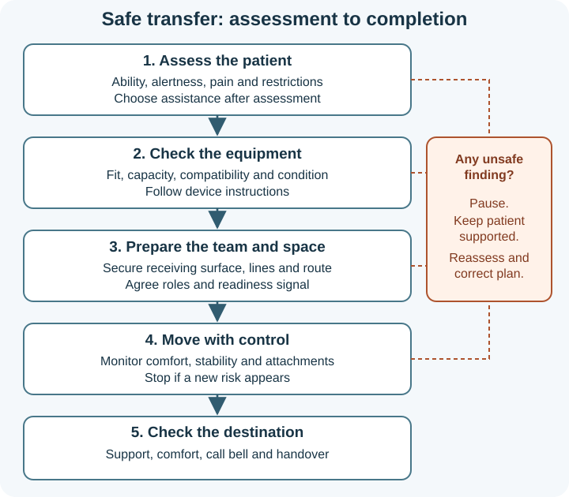

# 10A — Safe Patient Handling, Transfers and Body Mechanics

**Study-ready draft, not studied.** Is lesson mein hum patient ko ek jagah se doosri jagah safely move karne ka logic samjhenge. Practical skill hamesha supervised training, current clinical assessment, local protocol aur device ki instructions ke according perform karo.

[Chapter](../README.md) · [26 original practice MCQs](../MCQs/10A-Safe-Patient-Handling-and-Transfers-26-MCQs.md) · [Existing Group10 bank](../MCQs/10-Mobility-Positioning-and-Body-Mechanics-20-MCQs.md) · [Evidence](../Previous-Year-Questions/10A-Safe-Handling-Reported-Evidence.md)

## Contents
- [Safe handling ka matlab](#safe-handling-ka-matlab)
- [Assessment aur assistance](#assessment-aur-assistance)
- [Equipment safety](#equipment-safety)
- [Team aur environment](#team-aur-environment)
- [Transfer ke dauran aur baad](#transfer-ke-dauran-aur-baad)
- [Body mechanics](#body-mechanics)
- [Revision aur videos](#revision-aur-videos)

## Safe handling ka matlab

Dekho, transfer ka matlab hai patient ko ek support surface se doosri surface par move karna. Jaise bed se wheelchair ya bed se stretcher. Repositioning mein patient ki position change hoti hai, lekin zaroori nahi ki surface change ho. Safe patient handling mein nurse dono situations mein patient aur healthcare worker ko injury se bachane ki koshish karti hai.

Jab koi patient khud apna weight support nahi kar sakta, toh nurse ke muscles aur joints par bahut load aa sakta hai. Agar patient achanak balance lose kare, toh load aur badh sakta hai. Sirf sahi posture rakhna is risk ko hamesha control nahi karta. Isliye nurse ko suitable handling aid, trained staff aur correct preparation use karni chahiye.

Diagram ka main idea ye hai ki transfer ek single lifting action nahi hai. Pehle patient assess hota hai, phir equipment aur environment ready hote hain. Movement ke dauran bhi monitoring hoti hai. Agar kisi stage par naya risk mile toh nurse patient ko supported rakhkar plan reassess karti hai.

## Assessment aur assistance

Patient se poochho ki use kis movement mein help chahiye. Uski current alertness, ability to follow instructions, pain, trunk control, prescribed weight-bearing status aur movement restrictions dekho. Weight-bearing ka matlab hai ki patient apni limb par kitna body weight rakh sakta hai. Agar clinician ne affected limb ko non-weight-bearing bataya hai, toh standing transfer ke dauran us restriction ko violate nahi karna chahiye.

Patient subah ek nurse ki help se chair tak gaya tha, lekin ab sedating medicine milne ke baad bahut drowsy hai. Ab purana transfer plan automatically safe nahi maana ja sakta. Nurse new assessment ke hisaab se assistance ya device decide karegi. Isi tarah naya severe pain ho toh routine movement shuru karne se pehle clinical assessment chahiye.

| Transfer aid | Kab consider karte hain? |
|---|---|
| Gait belt | Jab patient ki assessed ability aur clinical condition assisted movement allow kare, toh ye guidance aur support de sakti hai. Ye full-body lifting sling nahi hai. Recent abdominal surgery ya abdominal wound mein routine belt pressure harmful ho sakta hai. [OpenStax transfer guidance](https://openstax.org/books/clinical-nursing-skills/pages/9-3-transferring-patients) aur [OSHA transfer-belt guidance](https://www.osha.gov/ergonomics/guidelines/nursing-home/final-nh-guidlines) ke according belt suitability reassess karo aur appropriate alternative arrange karo. |
| Sit-to-stand device | Jab selected patient device ki required weight-bearing, sitting, cooperation aur other criteria meet karta ho, tab team ise consider kar sakti hai. Har model ki requirements same nahi hoti. |
| Full-body sling lift | Jab patient ko body support ke liye mechanical assistance chahiye aur assessed condition device ke liye suitable ho, tab compatible sling aur lift use kiye ja sakte hain. |
| Seated transfer board | Jab patient ki assessed sitting control aur technique ke liye required ability suitable ho, tab board stable bridge provide kar sakta hai. Receiving surface aur armrest bhi suitable honi chahiye. |
| Lateral transfer aid | Jab patient ko horizontal support surfaces ke beech move karna ho, tab appropriate transfer aid aur trained team unnecessary manual load kam kar sakte hain. |

Sirf table dekhkar actual device select mat karo. Patient ki current condition, clinician ki restrictions, equipment instructions aur facility policy sab check karne hote hain.

## Equipment safety

Sling ek supportive fabric ya support system hai jo compatible lift ke through patient ke body weight ko support karta hai. Lift par maximum patient load likha ho sakta hai. Sling ki own rating, size, attachment type aur compatibility bhi check karni hoti hai.

Socho ek lift 180 kg ke patient ko handle kar sakti hai, lekin available compatible sling 125 kg tak rated hai. Agar patient 138 kg ka hai toh lift ki 180 kg rating dekhkar proceed nahi karna chahiye. Sling overload ho jaayegi. Nurse ko adequate weight rating aur approved compatibility wali sling arrange karni chahiye. Isi tarah wheelchair ya commode bhi patient ke weight ke liye suitable honi chahiye.

Sling par fraying, holes ya damaged stitching mile toh use repair date aane tak use mat karte raho. Agar label unreadable hai aur model ya capacity verify nahi ho pa rahi, toh approved identification ya replacement arrange karo. Different hanger bars aur attachment systems dekhne mein similar ho sakte hain, lekin interchangeable hona zaroori nahi.

Manufacturer ke instructions se sling ka size, head ya trunk support aur attachments verify karo. Recent wound ya prescribed movement restriction ho toh fitting technique us restriction se compatible honi chahiye. Kisi bhi loaded attachment ko suspended patient ke saath adjust ya unhook mat karo.

## Team aur environment

Nurse pehle destination prepare karti hai. Wheelchair ke footplates ko transfer ke route se clear karna pad sakta hai. Receiving surface secure honi chahiye. Floor lift ke wheels, base aur movement ke instructions model ke hisaab se follow karo, kyunki lift aur receiving wheelchair ki braking requirements ko ek rule mat samjho.

Lateral transfer mein surface height, gap, transfer aid aur staff access pehle check karo. Agar furniture device ko turn karne se rok raha hai toh patient ko suspended karke baad mein furniture move karna safe nahi hai.

Team transfer ke liye ek leader decide karo. Leader sab staff ki readiness confirm karke common signal deta hai. Jab patient ke saath IV line ya urinary drainage system hai, toh nurse line ko insertion site se device tak check karti hai. Tubing trapped ya pulled nahi honi chahiye. Routine disconnection har transfer mein required nahi hoti. Clinical indication aur facility protocol decide karte hain.

Patient ko simple words mein batana bhi safety ka part hai. Agar patient confuse ho jaata hai toh ek baar mein ek instruction do aur response confirm karo. Agar nonurgent transfer se pehle patient fear ki wajah se stop bolta hai toh uski concern suno. Trained staff ya necessary equipment unavailable ho toh unsafe manual alternative use mat karo.

Air-assisted glide sheet kuch lateral transfers mein surface friction aur staff ki pulling effort kam karne mein help karti hai. Agar chosen model ko transfer se pehle full inflation chahiye, toh partly inflated sheet par movement start mat karo. Compatible pump aur connections check karo. Agar required inflation achieve nahi hoti toh alternative approved method arrange karo. Ye advice [manufacturer ki safety information](https://www.stryker.com/us/en/sage/disclosure-and-safety-information.html) ke context mein hai. Har model ki instructions alag ho sakti hain.

Ceiling-track hoist mein overhead motor aur lifting tape ka alignment important hai. Patient ko raise karne se pehle motor ko appropriate lifting point ke directly upar rakhna aur tape vertical check karna chahiye. Agar tape angled hai toh patient supported rakhkar device instructions ke according alignment correct karo. Tape ko sideways pull karke motor reposition mat karo. [HSE hoisting guidance, Annex 1, printed page 4](https://www.hse.gov.uk/pubns/hsis3.pdf) is check ko explain karti hai.

## Transfer ke dauran aur baad

Mechanical lift ke low-height safety trial mein team dekhti hai ki sling stable hai, straps securely attached hain aur patient comfortable hai. Agar patient tilt karta hai toh controlled lowering se patient ko support surface par wapas lao. Fitting aur attachments dobara check karo. Patient suspended ho tab straps unhook karna unsafe hai.

Power failure ho toh trained team manufacturer ki emergency lowering instructions follow kare. Device ko force se move ya dismantle karne ki koshish mat karo. Safe transfer ke liye staff ko pehle se emergency controls aur backup plan pata hona chahiye.

Jab patient chair par pahunch jaata hai tab bhi nursing care complete nahi hoti. Alignment, support, skin pressure, attached devices aur call bell access check karo. Sling patient ke neeche reh sakti hai ya remove karni hai, ye sling design, manufacturer instructions aur individual skin risk par depend karta hai. Agar fold pressure create kar rahi hai toh appropriate assistance se safely correct karo.

Handover mein sirf assist with transfer likhna enough nahi hai. Current assistance level, device, restrictions aur observed difficulty document karo. Next nurse ko phir bhi patient ki condition dobara assess karni chahiye.

## Body mechanics

Body mechanics ka matlab hai movement ke dauran body ke joints, muscles aur posture ka efficient use. Jab nurse kisi object ko body se door rakhkar reach karti hai, toh same force ke bawajood turning effect badh sakta hai. Isliye unnecessary forward reach kam karna useful hai. Bed ki height care task ke according adjust karo aur possible ho toh nearer accessible side se kaam karo. Care complete hone ke baad bed ko patient ke safe resting level par return karo.

Ek simple physics example se samjho. Turning moment ko torque bhi kehte hain. Kisi assumed pivot ke around moment ka magnitude force aur perpendicular distance ke product se milta hai.

**Moment = force × perpendicular distance**

Agar 60 N force ka perpendicular distance 0.4 m hai, toh moment 60 × 0.4 = 24 N m hai. Agar wahi force 0.2 m par act kare, toh moment 60 × 0.2 = 12 N m hai. Distance half hua, isliye moment bhi half ho gaya. Ye sirf idealized mechanics example hai. Actual spine load calculate karne ya patient ko manually lift karne ki permission decide karne ke liye ise use nahi kar sakte.

Patient handling ke liye device aur team assessment phir bhi mandatory hai.

## Revision aur videos

| Exam angle | Yaad rakhne wali baat |
|---|---|
| Patient reassessment | Nayi sedation, pain, cooperation ya mobility change ke baad old transfer plan dobara assess karo. |
| Device selection | Fit, capacity, compatibility aur actual condition separate checks hain. |
| Team safety | Ek leader common signal de aur staff apni roles confirm karein. |
| Lift instability | Patient ko safely support surface par lower karke recheck karo. |
| Transfer completion | Patient ki support, comfort, attachments aur help access check karo. |

| Teaching | MCQ practice |
|---|---|
| [Safe Handling and Body Mechanics](https://www.youtube.com/watch?v=ae0nh_SBlCE) — indexed teaching description. Channel, exact coverage and playback pending. | [Patient Safety and Positioning MCQ Sessions — Ritika Mam, VS Nursing Academy](https://www.youtube.com/watch?v=SISfTMUsLHg) — indexed broad MCQ-session description. No exact question playback or timestamp verified. |

## Clinical references

- [OpenStax Clinical Nursing Skills 9.3](https://openstax.org/books/clinical-nursing-skills/pages/9-3-transferring-patients)
- [Clinical Procedures for Safer Patient Care, patient transfers](https://opentextbc.ca/clinicalskills/chapter/3-7-transfers-and-ambulation/)
- [FDA patient lifts](https://www.fda.gov/medical-devices/general-hospital-devices-and-supplies/patient-lifts)
- [FDA Patient Lifts Safety Guide](https://www.fda.gov/files/medical%20devices/published/Patient-Lifts-Safety-Guide.pdf) — extracted text, page images pending.
- [Health Canada patient lifts](https://www.canada.ca/en/health-canada/services/drugs-medical-devices/patient-lifts.html)
- [OSHA safe handling](https://www.osha.gov/ergonomics/guidelines/nursing-home/final-nh-guidlines)
- [OpenStax torque](https://openstax.org/books/university-physics-volume-1/pages/10-6-torque)

[Practice bank](../MCQs/10A-Safe-Patient-Handling-and-Transfers-26-MCQs.md) · [Evidence and pending checks](../Previous-Year-Questions/10A-Safe-Handling-Reported-Evidence.md) · [Chapter](../README.md)
