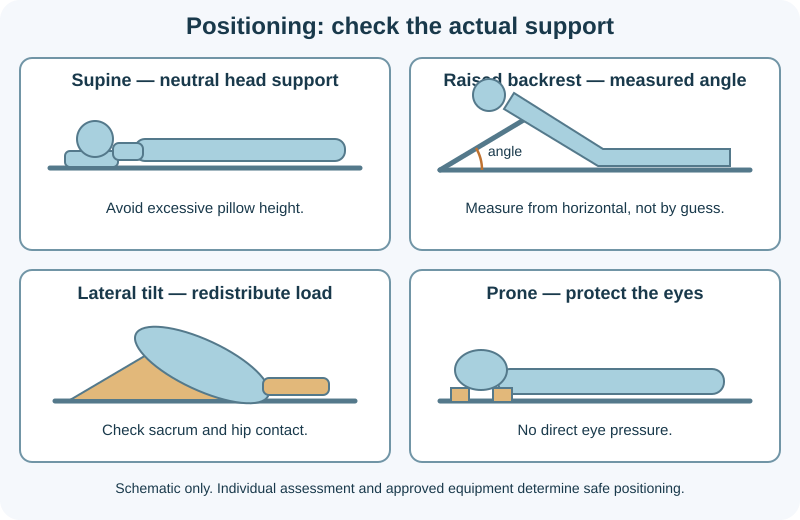

# 10B — Therapeutic Positioning and Alignment

**Study-ready candidate, not studied or released.** Positioning ko hum patient ki breathing, comfort, skin protection, examination aur procedure ki needs ke hisaab se samjhenge. Actual bedside technique mein training, individual assessment, prescribed precautions aur local protocol follow karo.

[Chapter](../README.md) · [22 original MCQs](../MCQs/10B-Therapeutic-Positioning-and-Alignment-22-MCQs.md) · [Evidence](../Previous-Year-Questions/10B-Positioning-Reported-Evidence.md) · [Safe transfers](10A-Safe-Patient-Handling-and-Transfers.md)

## Position aur alignment ka matlab

Position ka matlab hai patient ki body bed ya chair mein kis posture mein hai. Alignment ka matlab hai head, trunk aur limbs ek doosre ke respect mein kaise supported hain. Ek hi named position har patient mein same mechanical effect nahi deti. Agar pillow bahut thick hai, toh supine patient ka neck flex ho sakta hai. Agar wedge body ke weight se flatten ho jaati hai, toh side-lying ka intended angle maintain nahi hoga.

Diagram sirf conceptual hai. Ye actual procedure ke liye device-fitting instructions nahi hai. Nurse patient ka body shape, pain, movement restrictions aur support ka actual effect check karti hai.

## Common positions

| Position | Simple explanation |
|---|---|
| Supine | Patient back par leta hota hai. Head aur limbs ko comfortable support dena chahiye. |
| Dorsal recumbent | Patient back par leta hai aur knees flex hoti hain. Examination ke purpose aur comfort ke according support diya ja sakta hai. |
| Fowler's | Backrest raise hoti hai. Angle exact document karo, kyunki textbook categories mein thoda difference mil sakta hai. |
| Orthopneic or tripod | Patient supported sitting mein aage lean kar sakta hai. Ye kuch breathing problems mein comfort de sakta hai, lekin acute respiratory distress ko sirf positioning se manage nahi karna chahiye. |
| Lateral | Patient side par leta hai. Head, upper leg aur trunk ko support diya ja sakta hai. |
| Sims' | Patient side aur prone posture ke beech supported position mein hota hai. Procedure-specific assessment zaroori hai. |
| Prone | Patient abdomen ki taraf face down leta hai. Head, eyes, chest aur abdomen ki safe support trained team assess karti hai. |
| Lithotomy | Patient back par hota hai aur legs approved supports mein elevated aur positioned hoti hain. Hip range, nerve pressure aur controlled return check karo. |
| Trendelenburg and reverse Trendelenburg | Entire table ya bed tilt hota hai. Head-down aur head-up whole-body tilt, backrest raise karne se different hain. In positions ko routine shock treatment ke substitute ke roop mein use nahi karna chahiye. |

Agar backrest 20 degree par hai aur prescribed angle 35 degree hai, toh 15 degree increase chahiye. Actual angle verify karna zaroori hai. Whole bed tilt aur backrest elevation ek jaise nahi hain.

## Repositioning aur actual pressure relief

Pressure injury tab develop ho sakti hai jab skin aur deeper tissues par sustained pressure ya pressure ke saath shear ka load aata hai. Repositioning se load redistribute ho sakta hai. Lekin sirf patient ko position ka naam dekar chhod dena enough nahi hai.

International Guideline ke current repositioning chapter mein 30-degree lateral position ek conditional suggestion hai. Agar patient's body shape ki wajah se sacrum abhi bhi loaded hai, toh angle ya support adjust karna pad sakta hai. Greater trochanter yani hip ke side ka bony prominence bhi protect karna hai. Upper leg ko pillow se support karne se rotation aur knees ka direct contact reduce ho sakta hai.

Palliative care mein agar full turn severe pain cause karta hai, toh patient ke goals aur comfort ke according smaller supported shifts consider kiye ja sakte hain. Clinical condition, tissue response, support surface aur patient ki ability ke hisaab se repositioning interval individualize karo. Ek fixed schedule har situation mein sufficient nahi hota.

Agar aspiration risk ki wajah se head elevation clinically required hai, toh sacral pressure kam karne ke liye ise bina review lower mat karo. Dono risks ko saath manage karo. Heel suspension boot use karte waqt extra pillow kabhi-kabhi heel ko mattress se contact kara sakti hai. Device instructions aur actual floating heel check important hain. Routine pressure-injury staging aur general heel offloading ko Group11 mein separately study karo.

## Procedure-related positioning safety

Anesthetized patient pain ya nerve stretch ko report nahi kar paata. Isliye procedure se pehle joint ki available range assess karna useful hai. Supine procedure mein arm ko ordinarily 90 degree se zyada abduct karna avoid kiya jaata hai. Brachial plexus shoulder se arm tak jaane wali nerves ka group hai. Excessive stretch se injury ho sakti hai. Ulnar nerve elbow ke medial side ke paas vulnerable hoti hai. Tucked arm mein neutral forearm aur pressure relief consider karo.

Lateral procedure mein thoracic support roll axilla ke directly andar nahi rakha jaata. Suitable device dependent thorax ko support karta hai aur axillary neurovascular structures par pressure avoid karta hai. Ear fold aur eye pressure bhi check karo.

Prone procedure mein eyes par direct pressure avoid karo. Chest aur abdomen ke supports ka actual effect breathing aur alignment par assess karo. Lithotomy mein fibular head ke paas common fibular nerve superficial hoti hai. Stirrup ka direct pressure nerve injury cause kar sakta hai. Procedure ke baad trained staff dono legs ko coordinated support se lower karein aur hemodynamic response monitor karein.

Prolonged head-down procedural position ke baad facial aur tongue swelling upper-airway edema ka warning sign ho sakti hai. Anesthesia team ko extubation risk assess karna chahiye. Routine nursing exam ke naam par specialist positioning protocols independently perform mat karo.

## Seating aur reassessment

Wheelchair mein pelvis, thighs aur feet ek supported system ki tarah kaam karte hain. Footrests bahut high ho jaayein toh thighs ka seat contact kam ho sakta hai. Cushion shift ho jaaye toh prescribed pressure redistribution effective nahi reh sakti. Seating assessment se actual posture, skin response aur comfort check karo. Patient khud position change kar sakta hai toh uski independence preserve karte hue supported comfortable alternatives samjhao.

## Exam preparation

- Position ke naam ke saath actual angle, support aur patient response samjho.
- Pressure protection ke liye skin load verify karo, sirf device ki presence nahi.
- Anesthesia mein nerve, eye aur joint protection especially important hai.
- Patient ki clinical priorities conflict karein toh individualized plan review karo.

## Video and source status

Teaching lead: [Patient Positions Nursing](https://www.youtube.com/watch?v=ys83zRslXlA). Indexed description includes common positions. Creator and exact playback not independently verified.

Practice lead: [Patient Safety and Positioning MCQ Sessions — VS Nursing Academy, Ritika Mam](https://www.youtube.com/watch?v=SISfTMUsLHg). Indexed broad-topic description only. All 22 exact item mappings remain pending.

Clinical references: [OpenStax Positioning in Bed](https://openstax.org/books/clinical-nursing-skills/pages/9-4-positioning-in-bed), [International Guideline Repositioning](https://www.internationalguideline.com/repositioning), [Heels](https://www.internationalguideline.com/heels), [Seating](https://www.internationalguideline.com/seating), [NCBI patient positioning](https://www.ncbi.nlm.nih.gov/books/NBK513320/), [OpenStax physical assessment](https://openstax.org/books/clinical-nursing-skills/pages/27-2-physical-assessment), [ASA peripheral neuropathy practice advisory](https://doi.org/10.1097/ALN.0000000000001937) (indexed excerpt, direct access failed).

[MCQs](../MCQs/10B-Therapeutic-Positioning-and-Alignment-22-MCQs.md) · [Evidence](../Previous-Year-Questions/10B-Positioning-Reported-Evidence.md) · [Chapter](../README.md)
