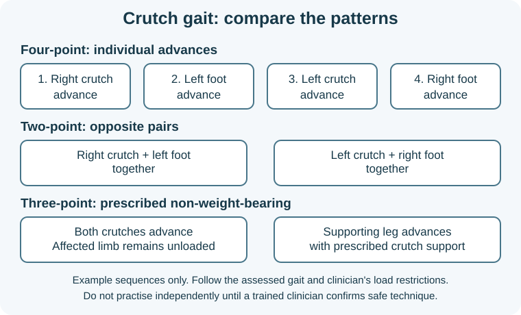

# 10C — Mobility Aids and Weight-Bearing Gait

**Study-ready candidate, not studied or released.** Actual walking aid ka selection aur gait training patient ki strength, balance, prescribed weight-bearing aur therapist ke assessment par depend karte hain. Ye notes supervised skill training ko replace nahi karte.

[Chapter](../README.md) · [26 MCQs](../MCQs/10C-Mobility-Aids-and-Weight-Bearing-Gait-26-MCQs.md) · [Evidence](../Previous-Year-Questions/10C-Mobility-Aids-Evidence.md) · [Group10A](10A-Safe-Patient-Handling-and-Transfers.md)

## Walking aid kyun chahiye?

Jab patient ki leg weak hoti hai, pain hota hai ya balance affect hota hai, tab walking ke dauran body ka weight control karna difficult ho sakta hai. Cane, walker aur crutches additional support de sakte hain. Lekin har device ka support pattern alag hota hai. Nurse ko sirf device dekar patient ko independent nahi maan lena chahiye. Patient ki grip, upper-limb strength, coordination, sensation, current clinical status aur actual walking route assess karna zaroori hai.

| Device | Basic difference |
|---|---|
| Single-tip cane | Jab limited extra support chahiye, tab cane consider ki ja sakti hai. |
| Quad cane | Iske base mein four feet hote hain. Loading se pehle stable ground contact check karo. |
| Standard pickup walker | Frame ko move karke stable surface par place karna hota hai. |
| Two-wheeled walker | Front wheels controlled forward advancement mein help karti hain. |
| Rollator | Wheeled frame ko patient ko safely control karna hota hai. Braking aur required support needs assess karo. |
| Crutches | Upper limbs ke through support mil sakta hai. Grip aur upper-limb capacity important hai. |

## Cane aur walker safety

Conventional unilateral weakness mein cane generally stronger side mein hold hoti hai. Cane aur weak limb ko trained sequence mein advance karke strong leg follow karti hai. Ye rule particular assessed gait ke context mein hai. Quad cane ke feet uneven surface par properly contact nahi kar rahe toh load transfer se pehle placement correct karo.

Assessed stair technique mein stronger leg usually upward movement lead karti hai. Descent mein cane ko lower support surface par place karke weaker limb ko controlled tareeke se advance kiya ja sakta hai. Rail use, specific steps aur required assistance trained clinician determine karta hai. Agar patient ko stair training nahi mili hai toh improvisation mat karo.

Standard walker bahut door place karne se patient ka trunk lean ho sakta hai. Usse support area ke andar controlled movement chahiye. Wheelchair transfer ya chair se rise karte waqt walker ko pull karna unstable ho sakta hai. Stable chair armrests aur trained transition use karo. Frame ke type ke hisaab se movement technique badalti hai. Ordinary walker ko flight of stairs par use nahi karna chahiye. Safe alternative access ya specialist-assessed technique arrange karo.

Rail-assisted crutch stair technique mein agar therapist ne fixed handrail ka use prescribe kiya hai, toh rail pakadne ke liye ek hand free hona chahiye. Assessed aur taught technique mein doosre hand se dono crutches securely manage ki ja sakti hain. Step sequence aur prescribed limb loading ko maintain karo. Agar patient safe control demonstrate nahi karta toh assistance ya alternate access arrange karo. [MedlinePlus crutch guidance](https://medlineplus.gov/ency/patientinstructions/000344.htm) ke stair section mein ye option describe hai.

## Crutch gait

Gait ka matlab walking ka movement pattern hai. Four-point gait mein crutch aur opposite foot sequentially advance karte hain. Two-point gait mein opposite pairs saath move karte hain. Three-point gait ke non-weight-bearing variation mein affected limb par weight nahi aata aur supporting leg crutches ke support se advance karti hai. Swing-to mein feet crutch tips tak move karte hain, jabki swing-through mein feet tips se aage jaate hain. Ye definitions exam ke liye useful hain. Actual gait ka selection patient ki loading permission, balance, strength aur rehabilitation assessment ke according hota hai.

Crutch fitting mein pad ka underarm clearance aur handle position dono important hain. Patient axilla par body weight nahi daale. Agar wrist disease ke kaaran secure hand grip possible nahi hai toh crutch fitting sahi hone ke bawajood device suitable nahi ho sakti. Therapist se reassessment karvao.

Forearm crutch mein cuff elbow ke neeche forearm ko support karti hai. Correct handgrip height hone ke bawajood cuff direct elbow joint par pressure daal sakti hai. Therapist se cuff fit reassess karvao aur approved adjustment ya suitable model arrange karo. [NHS elbow crutch guidance](https://www.southtees.nhs.uk/resources/how-to-use-elbow-crutches/) aur [Learning on TAP fitting guidance](https://www.gate-tap.org/topic/fitting-different-types-of-walking-aids/) is distinction ko support karte hain.

## Weight-bearing instructions

Non-weight-bearing ka matlab affected limb par load nahi dena hai. Partial weight-bearing mein prescribed amount tak load allowed hota hai. Touch-down ya toe-touch terminology ka exact meaning service aur order ke hisaab se vary kar sakta hai. Isliye unclear order ko clarify karo. Weight-bearing as tolerated mein clinician ki permission aur symptoms ke according loading progress kar sakti hai. Iska matlab ye nahi ki patient aid turant discard kar de.

**Example:** Agar patient ka weight 80 kg hai aur clinician ne 25% partial weight bearing prescribe ki hai, toh approximate mass-equivalent target 80 × 0.25 = 20 kg hai. Scale training ka ye estimate dynamic walking ke dauran actual limb load ka guarantee nahi hai. Therapist ki training aur reassessment essential hain.

## Equipment aur discharge readiness

Rubber tips worn hon, adjustable lock loose ho ya frame damage ho toh patient ko unsafe equipment ke saath continue mat karvao. Device ki approved replacement ya service arrange karo. Walking route dry aur clear rakho. Patient ki required handgrips ko free rakhne ke liye safe hands-free pouch use ki ja sakti hai. Home doorway ya threshold device ke liye suitable hai ya nahi, actual route assess karo.

Patient ko gait explain karne ke baad supervised return demonstration se technique, restrictions aur assistance need confirm karo. Handover mein device, gait pattern, allowed limb load aur assistance document karo. Confidence alone independent walking ka proof nahi hai.

## Teaching and practice

- [Canes, Walkers, and Crutches — Level Up RN](https://www.youtube.com/watch?v=WZ4eujiQ5To) — indexed teaching description with gait segment. Playback not reviewed.
- [Two Point Gait — Mission High Nursing Classes](https://www.youtube.com/watch?v=xTRaSuM9Yv8) — indexed demonstration, not a verified MCQ-solving video.
- Dedicated YouTube question-solving verification pending. [Supplementary NCLEX practice](https://academy.nursing.com/lesson/01-05-mobility-assistive-devices/) is an indexed quiz page, not a YouTube video or Indian historical question.

## Sources

[OpenStax Clinical Nursing Skills 9.3](https://openstax.org/books/clinical-nursing-skills/pages/9-3-transferring-patients) · [MedlinePlus cane instructions](https://medlineplus.gov/ency/patientinstructions/000343.htm) · [AAOS walking aids](https://www.orthoinfo.org/treatment/nonsurgical-treatments/how-to-use-crutches-canes-and-walkers/) · [KVV Walking Aids](https://emodules.kvv.edu.in/e-modules/walking-aids/) · [OpenStax musculoskeletal assessment](https://openstax.org/books/clinical-nursing-skills/pages/25-2-physical-assessment).

[MCQs](../MCQs/10C-Mobility-Aids-and-Weight-Bearing-Gait-26-MCQs.md) · [Evidence](../Previous-Year-Questions/10C-Mobility-Aids-Evidence.md) · [Chapter](../README.md)
