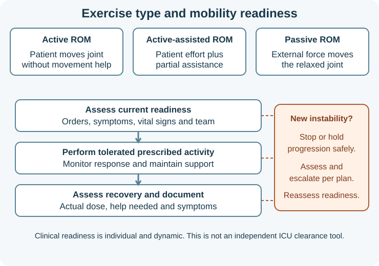

# 10D — Range of Motion, Exercise and Monitored Mobilization

**Study-ready draft, not studied or released.** Movement ki type, exercise dose aur patient ki current response ko samajhna nursing foundation ka important part hai. Actual exercise hamesha prescribed restriction, clinical assessment aur trained rehabilitation plan ke according karo.

[Chapter](../README.md) · [26 MCQs](../MCQs/10D-Exercise-and-Monitored-Mobilization-26-MCQs.md) · [Evidence](../Previous-Year-Questions/10D-Exercise-and-Mobilization-Evidence.md) · [Group10C](10C-Mobility-Aids-and-Weight-Bearing-Gait.md)

## Range of motion ka matlab

Range of motion yani ROM kisi joint ki available movement hai. Jab patient bed rest par hota hai toh joint movement kam ho sakti hai. Muscles weak ho sakti hain aur soft tissue ki flexibility affect ho sakti hai. Prescribed exercises movement ko maintain ya improve karne mein help kar sakti hain, lekin har joint ko forcefully normal textbook angle tak le jaana safe nahi hota.

| Type | Simple meaning |
|---|---|
| Active ROM | Patient khud apni muscles se joint move karta hai. Nurse observe kar sakti hai, lekin actual motion ki physical help nahi deti. |
| Active-assisted ROM | Patient movement ka kuch part khud karta hai aur required portion mein external help milti hai. |
| Passive ROM | Patient voluntary effort se joint move nahi karta. External person ya prescribed device relaxed joint ko move karta hai. |

Agar nurse permitted passive knee movement kara rahi hai, toh limb ko joint ke around suitable support de. Movement smooth aur prescribed range ke andar rakho. New sharp pain ya unusual resistance aaye toh force mat karo. Limb support karke assess karo aur exercise plan clarify karo. Tendon repair ya joint surgery ke baad specific restriction general exercise chart se zyada relevant hai.

## Movement aur strength ko assess karna

Active ROM aur passive ROM ka difference functional problem ka clue de sakta hai. Agar active elbow flexion 80 degree hai aur passive flexion 120 degree hai, toh patient available range independently achieve nahi kar pa raha. Iska reason weakness, pain, coordination ya neurological problem ho sakta hai. Sirf difference dekhkar final diagnosis mat lagao.

Goniometer joint angle measure karne ka instrument hai. Repeated measurement same starting position aur landmarks ke saath zyada interpretable hoti hai. Agar recorded knee flexion 65 degree se 95 degree hui, toh absolute increase 30 degree hai. Is improvement se actual walking independence automatically prove nahi hoti.

## Muscle contraction aur exercise

| Type | Mechanism and example |
|---|---|
| Isometric | Muscle tension develop hoti hai lekin joint angle appreciably change nahi hota. Quadriceps setting prescribed ho toh example ho sakta hai. |
| Dynamic resistance | Muscle contraction movement against resistance produce karti hai. Basic nursing books ise isotonic exercise ke roop mein teach kar sakti hain. |
| Concentric | Active muscle tension produce karte hue shorten hoti hai, jaise curl ki lifting phase. |
| Eccentric | Active muscle tension produce karte hue lengthen hoti hai, jaise weight ko control ke saath neeche laana. |

Exercise ke dauran ordinary controlled breathing maintain karo. Breath holding ya unnecessary strain avoid karo. Healing tissue ki restriction present ho toh exercise easy lagne ke baad bhi resistance khud se increase mat karo. Patient compensatory trunk movement use kar raha ho toh ise intended joint ki full motion mat count karo. Therapist ke plan ke according technique reassess aur cue karo.

## Monitored activity aur orthostatic assessment

Mobilization ka matlab patient ko safe available activity ki taraf progress karana hai. Bed-level activity, supported sitting, standing aur walking jaise levels patient ke response ke hisaab se choose kiye ja sakte hain. Nurse ko activity se pehle current symptoms, relevant vital signs, restrictions aur required assistance check karni chahiye. Morning clearance current deterioration ko cover nahi karti.

Orthostatic hypotension mein position change ke saath BP substantially gir sakti hai. Standard CDC STEADI method mein patient ko safely supine rest karane ke baad baseline BP aur pulse lete hain, phir standing par one aur three minutes mein repeat karte hain. Agar standing unsafe hai toh test force mat karo. Conventional criteria aur interpretation ke liye existing Group03A blood pressure bank ko refer karo. New dizziness ya instability ko immediately assess karo.

Activity ke dauran pulse, breathing, oxygen saturation aur symptoms clinically indicated tarah monitor karo. Example mein pulse 82/min se 108/min hui toh increase 26/min hai. Ye numerical difference alone exercise continuation clearance nahi hai. Patient-specific oxygen target se marked fall aur significant breathlessness aaye toh activity safely stop karke appropriate assessment aur escalation karo.

Stable medically cleared patient mein talk test relative intensity ka simple clue de sakta hai. Agar patient conversation kar sakta hai lekin gaana nahi gaa paata, toh moderate relative intensity ke saath compatible ho sakta hai. Is clue se normal vitals ya clinical safety prove nahi hoti. Prescribed rehabilitation limits follow karo.

## ICU context

Critically ill patient ki mobility readiness dynamic hoti hai. Endotracheal tube presence alone har active movement ko prohibit nahi karti. Lekin safe airway, ventilation needs, circulation, neurological condition, lines aur trained team ki availability evaluate karna zaroori hai. Rapidly increasing vasopressor requirement ho toh out-of-bed activity progression hold karke ICU team current status reassess kare. Generic nursing exam facts ko independent ICU mobility clearance ki tarah use mat karo.

## Recovery and documentation

Patient ne kitni distance walk ki, kitni duration exercise hui, kitni help chahiye thi aur symptoms ya vital response kya tha, ye actual performance record karo. Joint range aur sustained activity tolerance different functions hain. Patient ka ROM improve ho sakta hai lekin endurance abhi limited reh sakti hai. Recovery response ke according next session ka goal set karo.

## Teaching and practice

[Range of Motion Nursing — Nursing made Simple with Aruna Sreeram](https://www.youtube.com/watch?v=xpwMJ0h73XA) — indexed teaching description includes three ROM types and joint movement. Playback not verified. Dedicated YouTube MCQ solving remains pending. [Supplementary exercise quiz](https://academy.nursing.com/lesson/07-03-types-of-exercise/?parentId=39317) is an indexed practice page only, not a verified historical Indian exam or a video.

## References

[OpenStax mobility assessment](https://openstax.org/books/clinical-nursing-skills/pages/9-2-assessing-mobility) · [OpenStax functional ability](https://openstax.org/books/clinical-nursing-skills/pages/9-1-assessing-functional-ability) · [Open RN mobility](https://www.ncbi.nlm.nih.gov/books/NBK610826/) · [CDC orthostatic assessment](https://cdc.gov/steadi/media/pdfs/STEADI-Assessment-MeasuringBP-508.pdf) · [CDC intensity](https://www.cdc.gov/physical-activity-basics/measuring/index.html) · [2024 ICU mobility guideline](https://link.springer.com/article/10.1007/s00134-024-07532-2) · [2014 expert consensus](https://pmc.ncbi.nlm.nih.gov/articles/PMC4301888/).

[MCQs](../MCQs/10D-Exercise-and-Monitored-Mobilization-26-MCQs.md) · [Evidence](../Previous-Year-Questions/10D-Exercise-and-Mobilization-Evidence.md) · [Chapter](../README.md)
