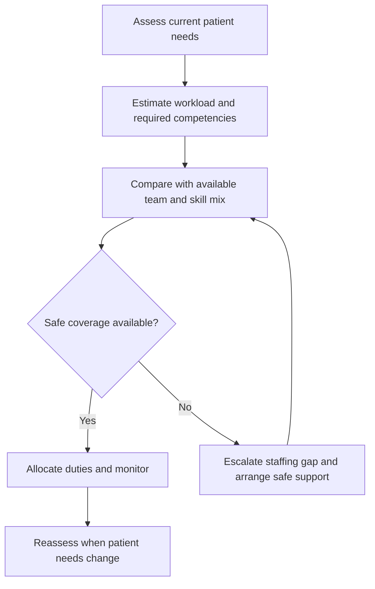

# Staffing and delegation — nursing management

**Candidate concept guide:** NORCET aur Staff Nurse ke liye yeh guide staffing aur delegation ke principles samajhne mein help karegi. Yeh official exam question nahi hai. Indian hospital ki applicable staffing policy, registration requirements aur authorized scope ko clinical practice mein follow karna zaroori hai.

[Practice ke 20 MCQs](../MCQs/02-Staffing-and-Delegation-20-MCQs.md) · [Chapter](../README.md) · [Topic coverage map](Nursing-Management-and-Education-Topic-Coverage-Map.md)

## 1. Staffing ka matlab sirf nurses ki ginti nahi hai

Socho ki do wards mein occupied beds barabar hain. Pehle ward mein zyada patients apna kaam khud kar lete hain, jabki doosre ward mein kuch patients ko baar-baar observation, turning aur assisted mobility chahiye. Agar manager dono wards ko sirf bed count ke basis par staff dega, toh doosre ward mein necessary care delay ho sakti hai.

**Acuity** ka matlab patient ki current clinical severity aur monitoring ki zaroorat hai. **Dependency** ka matlab patient ko daily care ke liye kitni assistance chahiye. Patient classification tool in needs ko systematic tareeke se estimate karne mein help karta hai, lekin bedside assessment ko replace nahi karta. Manager ko admissions, discharges, observation frequency, ward layout aur non-bedside duties bhi consider karni padti hain.

**Skill mix** se pata chalta hai ki team mein kaun se qualifications, skills aur experience available hain. Agar sabhi nurses new recruits hain aur specialty orientation abhi complete nahi hui, toh sirf roster mein sufficient numbers hone se specialized care automatically safe nahi ho jaati. In-charge ko appropriate assignments, supervision aur escalation ka plan banana chahiye.

## 2. Staffing indicators aur establishment

| Indicator | Kaise samjhein |
|---|---|
| Nursing hours per patient-day (NHPPD) | Defined period ki eligible productive nursing hours ko usi period ke patient-days se divide karke average care hours nikalte hain. |
| Full-time equivalent (FTE) | Required productive hours ko ek full-time equivalent ki available productive hours se divide karne par simplified staffing requirement milti hai. |
| Employee turnover | Defined period mein organization chhodne wale employees ko average workforce ke relation mein measure karte hain. |
| Unscheduled absence | Planned roster mein unexpected sickness ya doosri unplanned absence ki wajah se kitni duty hours unavailable hui hain, iska record rakhte hain. |

NHPPD ek aggregate indicator hai. Is average se har patient ko utne hi hours care mili, aisa conclude nahi karna chahiye. Different reporting systems eligible hours aur patient-days ko differently define kar sakte hain.

FTE aur daily on-duty headcount ek cheez nahi hain. Establishment calculate karte waqt weekly off, leave, training time aur required competencies ka allowance chahiye. Agar seven nurses har morning chahiye, toh exactly seven funded posts se continuous daily coverage guarantee nahi hogi.

Float pool se unexpected workload cover ho sakta hai. Lekin floated nurse ko unfamiliar specialty mein independent care dene se pehle uski competence aur orientation verify karni chahiye. Duty distribution transparent honi chahiye, aur operational needs ke saath fair rotation bhi consider karna chahiye.

## 3. Safe staffing decision flow

Jab workload ya patient condition change hoti hai, toh nurse in-charge ko staffing plan dobara assess karna chahiye. Agar safe care ke liye resources kam hain, toh applicable escalation route se help mangni chahiye aur unresolved risk document karna chahiye.

## 4. Assignment aur delegation

Routine assignment mein team member ko uske established authorized role ke andar duties distribute ki jaati hain. Delegation mein specific permitted activity doosre competent person ko perform karne ke liye di jaati hai, jisme suitable authorization aur oversight zaroori hai. Exact legal definitions jurisdiction aur hospital policy ke hisaab se vary kar sakti hain.

Delegation ka matlab apni professional responsibility se free ho jaana nahi hai. Delegating nurse ko decision aur required supervision justify karna hota hai, aur delegatee apne performance ke liye accountable hota hai. Nursing judgment aur aise activities jo policy prohibit karti hai, unhe sirf workload zyada hone ki wajah se transfer nahi karna chahiye.

## 5. Five rights of delegation

| Right | Nursing decision |
|---|---|
| Right task | Nurse confirm karegi ki activity applicable policy aur authorized scope ke andar delegate ki ja sakti hai. |
| Right circumstance | Nurse dekhegi ki patient ki current stability aur available resources task ko safely perform karne ke liye suitable hain. |
| Right person | Nurse verify karegi ki delegatee ke paas required competence aur training hai. |
| Right direction and communication | Nurse clearly batayegi ki task kya hai, expected result kya hai, kab report karna hai aur kaun se warning findings immediately communicate karni hain. |
| Right supervision and evaluation | Nurse appropriate follow-up karegi, result verify karegi aur zaroorat padne par care plan reassess karegi. |

Agar delegated observation se pehle patient ko suddenly severe breathlessness ho jaati hai, toh pehle urgent clinical assessment aur applicable escalation chahiye. Pehle safe lagne wala delegated task ab suitable nahi bhi ho sakta hai. Isi tarah worker ko unfamiliar device use karne ko kehna tab safe nahi hai jab required competency verify nahi hui ho.

Closed-loop communication mein receiver instruction ko repeat ya confirm karta hai, aur sender misunderstanding ko correct karta hai. Task complete hone ke baad actual result aur unexpected findings report karna zaroori hai. Agar worker ko competence se bahar technical problem milti hai, toh usse task safely stop karke responsible nurse se guidance leni chahiye.

## 6. Exam revision

Staffing ke questions mein pehle identify karo ki examiner patient demand, skill mix, numerical calculation ya staff availability pooch raha hai. Delegation ke questions mein identify karo ki problem task ki permission, patient ki situation, worker ki training, instruction ki clarity ya follow-up mein hai. Is distinction se similar-looking options eliminate karna easier ho jaata hai.

## References and evidence limits

- [NICE SG1 adult acute inpatient ward staffing recommendations](https://www.nice.org.uk/guidance/sg1/chapter/Recommendations), UK context. Acuity, dependency, skill mix aur current staffing reassessment ke principles ko support karta hai.
- [CDC NHSN Nurse Staffing Hours Indicator](https://www.cdc.gov/nhsn/psc/nhppd/index.html) aur [indicator FAQs](https://www.cdc.gov/nhsn/psc/nshi/faqs.html), US reporting context. Inhe Indian mandatory staffing norms ke roop mein interpret nahi karna hai.
- [Open RN, Delegation and Supervision](https://www.ncbi.nlm.nih.gov/books/NBK610432/), US educational framework. Five rights aur professional responsibilities ke general principles ko support karta hai.

| Topic | Concept teaching video | Dedicated MCQ practice video |
|---|---|---|
| Staffing calculations and skill mix | Verification pending. | Verification pending. |
| Five rights of delegation | Verification pending. | Verification pending. |

Specific video coverage aur independent review abhi pending hai. Is guide se koi new MCQ, mock ya PYQ inventory credit nahi liya gaya hai.
