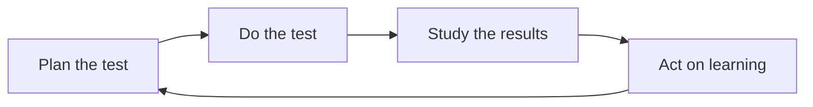
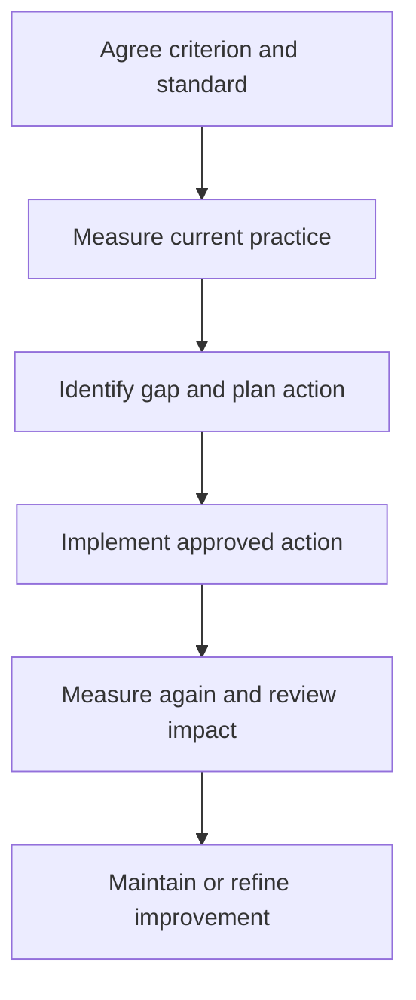

# Quality improvement and clinical audit

**Candidate concept guide for Staff Nurse and NORCET preparation.** Quality improvement mein hum care delivery ke system ko samajhte hain aur measurable changes test karte hain. Is guide ka purpose exam preparation hai. Actual hospital audit, patient data use aur clinical change ke liye local authorization, confidentiality aur applicable governance requirements follow karna zaroori hai.

[Chapter](../README.md) · [Practice ke 20 MCQs](../MCQs/04-Quality-Improvement-and-Audit-20-MCQs.md) · [Topic map](Nursing-Management-and-Education-Topic-Coverage-Map.md)

## 1. Structure, process aur outcome

Donabedian framework care ki quality ko alag perspectives se assess karne mein help karta hai. Socho ki ward mein patient falls kam karne ke liye improvement project chal raha hai.

| Component | Example aur meaning |
|---|---|
| Structure | Suitable walking aids aur working call bells ki availability check karne se pata chalta hai ki care ke liye resources maujood hain ya nahi. |
| Process | Eligible patients ki documented falls-risk assessment completion rate se pata chalta hai ki expected care activity perform hui ya nahi. |
| Outcome | Fall-related patient injury ki rate se pata chalta hai ki patient safety par actual effect kya hua. |

Ek achha structure useful hai, lekin usse successful outcome automatically guarantee nahi hota. Nurse ko resources, actual care aur patient result ko saath mein assess karna chahiye.

## 2. Improvement measures

Improvement aim ko clearly define karo. Agar ward discharge waiting time kam karna chahta hai, toh median waiting time improvement outcome ke liye relevant measure ho sakta hai. Discharge checklist completion ek process measure ho sakta hai. Unclear instructions ki wajah se aane wali follow-up calls ka rate balancing measure ho sakta hai, kyunki faster discharge se communication quality affect ho sakti hai.

Measure ki operational definition likhna important hai. Is definition mein event inclusion criteria, denominator, observation period aur data source clear hone chahiye. Do wards alag definitions se events count kar rahe hain, toh same denominator scale use karne ke baad bhi unke rates directly comparable nahi honge.

## 3. PDSA cycle

PDSA mein team ek small, authorized change ko test karke learning collect karti hai. Example ke liye ward handover checklist ka pilot plan kar sakta hai.

| Phase | Nursing application |
|---|---|
| Plan | Team aim define karegi, expected result predict karegi aur measurement method decide karegi. |
| Do | Team planned pilot conduct karegi aur unexpected difficulties document karegi. |
| Study | Team observed results ko prediction ke saath compare karke differences samjhegi. |
| Act | Team evidence ke according change adopt, adapt ya abandon karne ka decision legi aur zaroorat par next test plan karegi. |

**Diagram:** Yeh cycle ek original conceptual representation hai. Large-scale implementation se pehle safety, authorization aur local suitability check karni hai.

## 4. Quality improvement tools

| Tool | Kab useful hai |
|---|---|
| Process map | Jab current workflow ke steps aur handoffs clear nahi hain, toh map team ko shared sequence samajhne mein help karta hai. |
| Pareto chart | Jab defect categories ka data available hai, toh chart frequently occurring ya high-impact categories ko prioritize karne mein help karta hai. |
| Fishbone diagram | Jab team possible contributing causes organize karna chahti hai, toh diagram structured discussion mein help karta hai. Suspected cause ko evidence se verify karna ab bhi zaroori hai. |
| FMEA | Jab new process implement karne se pehle possible failures aur unke risks assess karne hain, toh prospective failure analysis useful hai. |
| Run chart | Jab time ke saath data ka pattern dekhna hai, toh time-ordered graph useful hota hai. |
| Control chart | Jab appropriate data ke liye statistically derived control limits ke saath process variation assess karna hai, toh suitable control chart use kiya ja sakta hai. |

Run chart ya control chart ka signal apne aap intervention ki causality prove nahi karta. Team ko data quality, case mix aur concurrent changes bhi consider karne chahiye.

## 5. Clinical audit cycle

Clinical audit mein team current practice ko predefined evidence-based criterion aur target ke saath compare karti hai. Gap milne par improvement action plan implement hota hai. Uske baad comparable measurement se action ka impact evaluate karna zaroori hai. Sirf meeting conduct karna ya staff ko instruction dena audit cycle completion ka evidence nahi hai.

**Audit aur improvement mein difference:** Audit se performance gap identify ho sakta hai aur PDSA se proposed change test ho sakta hai. Dono methods ek doosre ko support kar sakte hain.

## 6. Calculations aur interpretation

Compliance percentage ke liye compliant eligible records ko total eligible records se divide karke 100 se multiply karte hain. Agar 72 of 80 records compliant hain, toh compliance 90% hai. Is result ko audit ke stated target se compare karo.

Agar exposure periods alag hain, toh sirf adverse-event counts compare karna misleading ho sakta hai. Example ke liye 3 events per 600 patient-days aur 4 events per 1,000 patient-days ki rates respectively 5 aur 4 per 1,000 patient-days hain. Doosre period mein count badha, lekin calculated rate kam hai. Valid comparison ke liye definitions aur population context bhi check karne chahiye.

## 7. Governance aur sustainability

Local care improvement aur generalizable knowledge generate karne wale research project ke primary aims alag ho sakte hain. Lekin classification sirf project title se decide nahi hoti. Applicable institutional process se ethics review, consent, patient privacy aur data use ke requirements establish karo.

Ek favourable week ke baad improvement ko permanent declare nahi karna chahiye. Consistent measurement aur appropriate follow-up se pata chalega ki change maintain ho raha hai ya nahi.

## References and practice mapping

- [OpenStax evaluation methods](https://openstax.org/books/fundamentals-nursing/pages/14-4-evaluation-methods) supports the structure, process and outcome framework.
- [IHI testing changes](https://www.ihi.org/library/model-for-improvement/testing-changes) and [project measures](https://www.ihi.org/library/tools/quality-improvement-project-measures-worksheet) support PDSA and measurement planning.
- [IHI quality improvement toolkit](https://www.ihi.org/library/tools/quality-improvement-essentials-toolkit), [run chart](https://www.ihi.org/library/tools/run-chart-tool) and [flowchart](https://www.ihi.org/library/tools/flowchart) cover the improvement tools discussed above.
- [HQIP quality improvement methods](https://www.hqip.org.uk/guidance/guide-to-quality-improvement-methods/) and [clinical audit best practice](https://www.hqip.org.uk/guidance/best-practice-in-clinical-audit/) provide audit methodology in a UK context, not Indian regulatory mandates.

| Guide section | Existing practice | Video evidence |
|---|---|---|
| Quality framework and measures | Q1–4 and Q16–17 | Dedicated practice video verification pending. |
| PDSA | Q5–8 | Dedicated practice video verification pending. |
| Tools | Q9–13 and Q18 | Dedicated practice video verification pending. |
| Audit, governance and sustainability | Q14–15 and Q19–20 | Dedicated practice video verification pending. |

The bank's existing teaching lead remains unverified. No specific video playback, historical question authentication, independent human review or rendered diagram certification is claimed. All examples in this guide are independently written illustrative scenarios, not additional counted MCQs.
