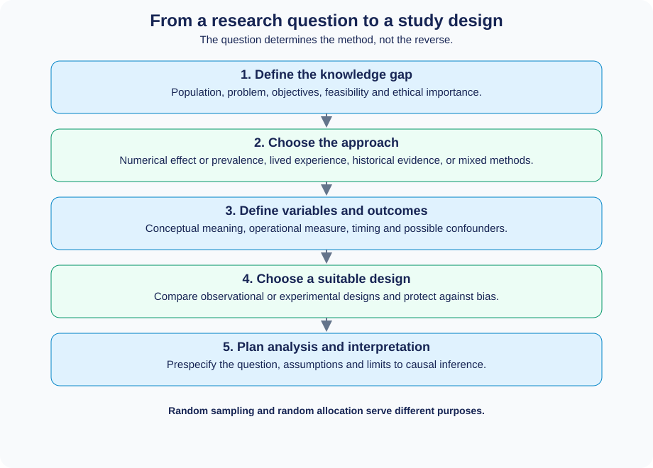

# Research process, study designs, variables and hypotheses

**Candidate concept guide.** Yeh notes original practice ke saath use karo. Research design ko question ke according choose karna important hai.

## Research process and design

Research ek systematic inquiry hai. Nursing mein iska purpose patient care, education, organization aur community health ke problems ko evidence ke through samajhna hai. Pehle problem identify karo, available evidence review karo, measurable objective define karo, suitable design and population choose karo, appropriate ethical approvals obtain karo, data collect and analyze karo, findings interpret and communicate karo. Har stage mein documentation and participant protection important hain.

| Design | Main purpose | Major caution |
|---|---|---|
| Cross-sectional | Ek time point par distribution or prevalence | Temporality usually unclear |
| Case-control | Outcome-defined groups mein prior exposure compare | Control selection and recall bias |
| Cohort | Exposure groups ka outcome occurrence compare | Confounding and follow-up loss |
| Randomized controlled trial | Assigned intervention ka causal effect assess | Allocation, outcome bias, adherence and missing data |
| Quasi-experimental | Nonrandomized intervention evaluation | Baseline differences and concurrent changes |
| Interrupted time series | Intervention ke around level or trend change | Other simultaneous events and seasonality |
| Crossover | Same participants multiple conditions receive | Carryover, period effects and suitability |
| Factorial | More than one intervention and their interaction | Interaction interpretation and sample requirements |

Qualitative inquiry lived experience, processes or cultures samajhne ke liye useful hai. Phenomenology lived meaning, grounded theory explanatory process, ethnography culture and practices, and case study bounded setting par focus kar sakti hai. Mixed methods mein quantitative and qualitative findings ko meaningful integration ki zaroorat hai. Sequential and concurrent designs question ke hisaab se choose karo.

Random allocation intervention group assignment ko chance-based banati hai. Allocation concealment upcoming assignment ko recruiter se hide karta hai. Blinding assigned condition ki information restrict karti hai to reduce relevant bias. Intention-to-treat principle originally assigned groups ke according analysis preserve karne mein help karta hai. Missing outcome data phir bhi appropriate handling require karte hain.

## Variables and hypotheses

Independent variable intervention or predictor ho sakta hai. Dependent variable measured outcome hai. Confounder exposure and outcome ke relationship ko distort kar sakta hai. Mediator causal pathway ka intermediate factor ho sakta hai. Effect modifier subgroup-specific effect differences describe karta hai. In roles ko study question aur causal assumptions ke context mein identify karo.

Conceptual definition variable ka meaning batati hai. Operational definition batati hai ki variable actual study mein kaise measure hoga. Nominal data unordered categories, ordinal data ordered categories, interval data equal increments without meaningful absolute zero, ratio data meaningful zero ke saath numerical measurements ho sakte hain. Numeric category codes measurement scale change nahi karte.

Null hypothesis usually specified no difference or no association hai. Alternative hypothesis directional or nondirectional ho sakti hai. Hypotheses and analysis plan pehle specify karo. Nonsignificant test equivalence prove nahi karta. Multiple outcomes and post hoc comparisons transparent label karo.

## Worked example

Research question: A teaching session se four-week medication knowledge score improve hota hai kya? Intervention assignment independent variable hai, four-week score outcome hai. Baseline knowledge covariate ho sakti hai. Outcome scale and timing define karo. Comparison group and appropriate analysis select karo. Causation claim design strength aur bias evidence ke according limit karo.

## Practice

- [Research process and study designs](../MCQs/01-Research-Process-and-Study-Designs-20-MCQs.md)
- [Variables and hypotheses](../MCQs/02-Variables-Measurement-Levels-and-Hypotheses-20-MCQs.md)

## Evidence notes

[OpenStax nursing EBP](https://openstax.org/books/medical-surgical-nursing/pages/1-4-evidence-based-practice), [CDC analytic design guidance](https://www.cdc.gov/field-epi-manual/php/chapters/design-conduct-analyze-field-studies.html) and [WHO protocol format](https://www.who.int/groups/research-ethics-review-committee/recommended-format-for-a-research-protocol) support the broad approach. WHO protocol HTML directly reviewed in Batch 03. Detailed item-level audit and specific practice-video verification pending.
