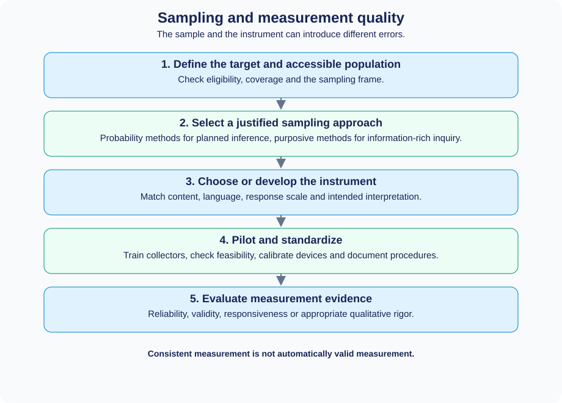

# Population, sampling, data collection and measurement rigor

**Candidate concept guide.** Sample selection aur measurement quality do different issues hain. Dono ko check karna zaroori hai.

## Population and sample

Target population woh group hai jiske baare mein inference chahiye. Accessible population woh eligible group hai jahan recruitment practical hai. Sampling frame available selection units ka operational list hai. Incomplete frame undercoverage create kar sakta hai. Larger sample random uncertainty reduce kar sakta hai but systematic exclusion fix nahi karta.

Simple random sampling mein specified units chance-based select hote hain. Systematic sampling mein random start aur fixed interval use ho sakta hai, lekin list periodicity check karo. Stratified sampling strata ke andar selection karta hai. Cluster sampling naturally grouped units select karta hai. Multistage sampling multiple selection levels combine karta hai. Unequal probability and clustering analysis mein appropriate design treatment demand kar sakte hain.

Convenience availability-based, purposive information-rich criteria-based, snowball referral-based, quota nonrandom target categories and consecutive sampling defined period mein eligible cases sequence se include karne ke methods ho sakte hain. Qualitative sample size information richness and methodological adequacy par depend kar sakti hai. Saturation ka use methodology-specific hona chahiye.

Sample size objective, effect or precision, variance, design, power and expected missingness par depend karti hai. Example: 144 analyzable participants and expected 80% retention, planned enrollment 144/0.8 = 180. Actual recruitment and retention monitor karo.

## Data collection and tool development

| Tool or method | Useful when | Caution |
|---|---|---|
| Structured questionnaire | Comparable prespecified responses | Wording, response options, missing data |
| Semi-structured interview | Core questions with flexible neutral probes | Leading prompts and interviewer influence |
| Direct observation | Observable practice assess karna | Reactivity and observer consistency |
| Record review | Existing documented events examine | Completeness, coding and recorded versus actual values |
| Physiological measure | Numerical physiological variable | Calibration and measurement conditions |
| Focus group | Participant interaction se shared or differing views | Confidentiality limits and dominance |

Double-barrelled and leading questions avoid karo. Translation and cultural adaptation planned process se karo. Cognitive interview intended respondents ki understanding evaluate karta hai. Pilot procedures feasibility identify karta hai, not definitive efficacy proof. Data collection staff train karo and source checks document karo.

## Validity, reliability and qualitative rigor

Reliability consistency hai. Test-retest time stability, inter-rater agreement assessors ke agreement and internal consistency scale items ki relationship examine karte hain. Cronbach alpha high hone se validity or unidimensionality automatically establish nahi hoti. Kappa categorical agreement beyond chance assess kar sakta hai, with relevant limitations.

Validity intended score interpretation ke liye evidence hai. Content evidence domain coverage, face impression apparent relevance, criterion comparison appropriate reference, convergent and discriminant evidence expected relationships examine karte hain. Responsiveness true change detect karne ki ability hai. Ceiling and floor effects extreme scores ke near differences hide kar sakte hain.

Qualitative trustworthiness mein credibility, transferability, dependability and confirmability discuss kiye ja sakte hain. Appropriate triangulation, rich context, audit trail, reflexivity and participant feedback methods depend on chosen approach. No single checklist guarantees rigorous interpretation.

## Practice

- [Sampling and sample size](../MCQs/03-Population-Sampling-and-Sample-Size-20-MCQs.md)
- [Data collection methods](../MCQs/04-Data-Collection-Methods-and-Research-Tools-20-MCQs.md)
- [Validity and reliability](../MCQs/05-Validity-Reliability-and-Research-Rigor-20-MCQs.md)

## Evidence notes

[CDC data collection](https://www.cdc.gov/field-epi-manual/php/chapters/collecting-data.html), [CDC data management](https://www.cdc.gov/field-epi-manual/php/chapters/data-collection-management.html), [MacEwan sampling](https://openbooks.macewan.ca/researchmethods/chapter/chapter-5-sampling/) and [COSMIN measurement terminology](https://pubmed.ncbi.nlm.nih.gov/20169472/) are relevant. CDC management HTML directly reviewed in Batch 03. Full measurement-property source and independent audit remain pending.
