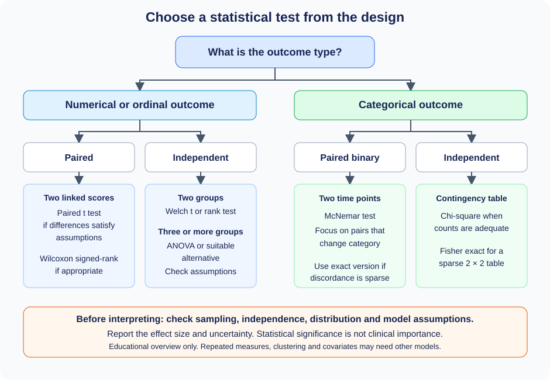

# Descriptive and inferential statistics — concept guide

**Study status:** Candidate notes for the original question banks. Learn the principle first, then solve the MCQs. These are educational examples, not patient-care recommendations or authenticated previous-year questions.

## 1. Descriptive statistics: data ko summarize karna

Descriptive statistics observed observations ko organize aur summarize karta hai. Frequency count hota hai. Relative frequency = category frequency / total observations. Percentage relative frequency × 100 hai. Rate mein suitable exposure denominator use hota hai. Example: 9 events in 3000 patient-days means 3 events per 1000 patient-days, not 3% of patients.

- **Mean:** sum of values / n. Extreme values mean ko influence kar sakti hain. Different group sizes ke combined mean mein weighted total use karo: (n1 × mean1 + n2 × mean2)/(n1+n2).
- **Median:** ordered data ke middle position ka summary. Even n mein two middle observations ka average. Skewed data mein often useful.
- **Mode:** most frequent value or category. Multiple modes possible hain.
- **Range:** maximum − minimum. Outliers ke liye sensitive hai.
- **Interquartile range:** Q3 − Q1. Middle 50% spread ko summarize karta hai. Quartile conventions software mein differ kar sakti hain.
- **Sample variance:** squared deviations from sample mean ka sum divided by n − 1. Population variance ka divisor N hota hai. SD variance ka square root hai, original measurement unit mein.
- **Coefficient of variation:** SD/mean × 100%. Positive ratio-scale measurements aur meaningful nonzero mean ke context mein relative variability compare kar sakte hain. Mean near zero ho toh CV unstable hota hai.

Example: Values 1, 3, 5 have mean 3. Squared deviations 4, 0, 4 ka sum 8 hai. Sample variance 8/2 = 4, SD 2. Population variance if these are the entire population = 8/3.

### Graph and distribution choice

| Data or aim | Suitable display | Important caution |
|---|---|---|
| Mutually exclusive category counts | Bar chart | Categories ke beech gaps |
| Continuous numerical distribution | Histogram | Equal width intervals mein frequency height meaningful hai |
| Ordered measurements across time | Line graph | Time order preserve karo |
| Two paired numerical variables | Scatter plot | Association causation nahi |
| Central spread and possible outliers | Box plot | Whisker convention check karo |

Right-skewed distribution ka longer tail higher observations ki taraf hota hai. Left-skewed ka tail lower observations ki taraf. Normal distribution symmetric model hai. Approximately 68%, 95%, 99.7% values respectively mean ke 1, 2, 3 SD ke andar hoti hain under normality. Z-score = (observed value − reference mean)/reference SD. Z-score relative position batata hai, diagnosis automatically establish nahi karta.

Conventional box-plot outlier fence Q1 − 1.5 × IQR and Q3 + 1.5 × IQR hai. Fence ke beyond observation potential outlier hai, automatic data error nahi. Investigate before any exclusion.

## 2. Inferential statistics: sample se population tak

Sampling-based inference model and assumptions ke under estimate ya test conduct karta hai. Sample mean population mean ka point estimate ho sakta hai. Sampling variability ko standard error quantify karta hai. Independent observations ke simple mean ke liye SE = s/√n. SD individuals ka spread hai, SE estimate ki uncertainty.

Confidence interval repeated-sampling procedure ki uncertainty reflect karta hai. A 95% confidence procedure repeated comparable samples mein approximately 95% intervals true parameter cover karne ke liye designed hoti hai. Observed interval ko individual patient prediction interval mat samjho. Difference measure ka null zero hai. Ratio measure ka null one hai.

Null hypothesis ke under observed statistic ya more extreme result ki probability p-value hai, specified testing assumptions ke under. Yeh null ki true hone ki probability nahi. Alpha prespecified Type I error threshold hai. Type I = true null reject. Type II = false null reject na karna for a specified alternative. Power = 1 − beta. Nonsignificant finding equivalence ka proof nahi.

### Test selection

Start with outcome scale and design. Paired and independent data ko interchange mat karo. Paired t test differences analyze karta hai, appropriate assumptions ke under. Welch independent t test unequal variances allow karta hai. One-way ANOVA independent group means compare karta hai under suitable assumptions. Significant omnibus ANOVA ka matlab at least one mean differs, every pair nahi. Pairwise conclusions ke liye appropriate adjusted comparisons use karo.

Chi-square independence categorical table ke observed versus expected counts compare karta hai. Sparse independent 2 × 2 tables mein Fisher exact suitable ho sakta hai. McNemar linked binary responses ke discordant pairs assess karta hai. Mann–Whitney independent ordinal or continuous ranks compare kar sakta hai. Median shift claim ke liye additional shape assumptions chahiye. Wilcoxon signed-rank paired differences ke liye suitable conditions mein use hota hai. Clustered, repeated and covariate-adjusted data more advanced methods require kar sakte hain.

Pearson r direction and strength of linear association describe karta hai. Regression slope predicted outcome change per predictor unit hai. Correlation dimensionless hai and slope units-dependent hai. Association causality prove nahi karti.

### Effect measures

For a harmful event, define intervention risk Ri and control risk Rc over the same follow-up.

- Risk ratio = Ri/Rc.
- Absolute risk reduction = Rc − Ri when treatment lowers risk.
- Relative risk reduction = (Rc − Ri)/Rc = 1 − RR.
- Number needed to treat for one additional beneficial outcome = 1/ARR with ARR as decimal, usually rounded upward for a whole-patient count. Time horizon, uncertainty and causal interpretation preserve karo.
- Odds = event probability/(1 − probability). Odds ratio = ratio of odds, not necessarily risk ratio. Case-control design mein exposure odds ratio calculate kar sakte hain.

Example: Event risk changes from 30% to 20% over one year. RR = 0.20/0.30 = 0.667 approximately. ARR = 0.10, ten percentage points. Relative risk reduction about 33.3%. NNT for one additional beneficial outcome = 10 over one year, if assumptions hold. Benefits and harms dono evaluate karo.

## 3. Exam traps and practical interpretation

- Large sample random uncertainty reduce kar sakta hai, biased measurement automatically fix nahi karta.
- Significant p-value small effect ko clinically worthwhile prove nahi karti.
- A wide interval may support several clinically different effects. Direction, size, precision and relevance report karo.
- Formula mein numerator, denominator and time horizon clearly check karo.
- Appropriate test selection depends on sampling, dependence, scale, assumptions and target estimand, not a keyword alone.

## Practice

- [20 original descriptive statistics MCQs](../MCQs/06-Descriptive-Statistics-20-MCQs.md)
- [20 original inferential statistics MCQs](../MCQs/07-Inferential-Statistics-20-MCQs.md)

## Evidence and limits

OpenStax Introductory Statistics, descriptive [graphs](https://openstax.org/books/introductory-statistics-2e/pages/2-2-histograms-frequency-polygons-and-time-series-graphs), [key terms](https://openstax.org/books/introductory-statistics/pages/2-key-terms), [paired samples](https://openstax.org/books/introductory-statistics-2e/pages/10-4-matched-or-paired-samples) and [hypothesis testing](https://openstax.org/books/introductory-statistics-2e/pages/9-introduction) directly retrieved. Additional chapters on tests and intervals were indexed. [Cochrane effect measures](https://www.cochrane.org/authors/handbooks-and-manuals/handbook/current/chapter-06) directly retrieved. Independent question-level review and specific video verification remain pending. Broad [question-bank video lead](https://www.youtube.com/watch?v=3x0yS9nGhjY) mentions both statistics topics in indexed description, direct access failed and exact item coverage is unverified.

