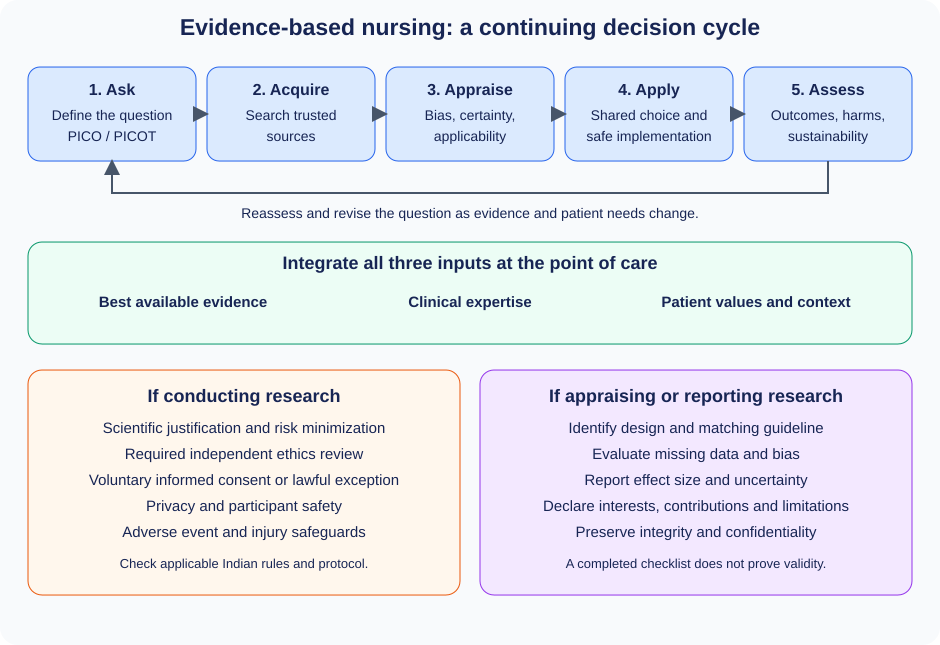

# Research ethics, evidence-based practice and appraisal — concept guide

**Study status:** Candidate study notes. Examples are educational, not patient-specific advice, ethics approval or a substitute for current institutional and regulatory requirements.

## 1. Research ethics in nursing

Research participant ek person hai, sirf data source nahi. Ethical research mein scientific value, fair selection, proportional risk-benefit, independent review, voluntary consent, privacy, safety monitoring and honest reporting all matter.

| Principle | Nursing research application |
|---|---|
| Autonomy and respect | Understandable information, free choice, questions and appropriate ongoing consent |
| Beneficence | Potential value promote karna without exaggerating benefit |
| Nonmaleficence | Avoidable research-related harm and burden minimize karna |
| Justice | Fair recruitment, no convenient exploitation of disadvantaged groups |
| Confidentiality | Access, storage, disclosure and permitted data use manage karna |

### Consent is a process

Consent form signed hona important documentation ho sakta hai, but understanding and voluntariness assess karni hoti hain. Purpose, procedure, foreseeable risks, possible benefits, alternatives, privacy, relevant costs or compensation, withdrawal arrangements aur contacts appropriately explain karo. Language and literacy needs accommodate karo. Capable adult ko decision karne ka genuine opportunity do. Refusal se routine care or employment penalty impose mat karo.

Vulnerability context-specific hai. Junior staff, children, fluctuating capacity and emergency circumstances require safeguards. Child assent and dissent appropriately consider karo. When capacity absent ho, applicable legally authorized representative and ethics-approved process follow karo. Capacity return ho toh participant ka own consent seek karo. Exceptional deferred consent sirf narrowly justified, applicable-law-compliant, prospectively approved pathways mein use ho sakta hai. Emergency alone automatic research consent waiver nahi hai.

### Governance and safety

Independent ethics committee review before required research activity, and approved amendments before planned material changes. Administrative permission separate hai. Risk minimize karo, consent updates appropriate ho toh obtain karo. Unexpected adverse events mein immediate clinical care first. Required investigator, committee and regulatory reporting follow karo. Research-related injury management and compensation requirements study category ke according verify karo. Privacy breach contain and report through appropriate channels.

Placebo use ethically conditional hai. Effective treatment withholding serious or irreversible harm create kare toh placebo-only design unacceptable ho sakta hai. Financial or professional interests disclose and manage karo. Post-trial provisions beneficial reasonably safe intervention ki continued need ko address kar sakti hain under Declaration of Helsinki 2024. Secondary sample use original consent, identifiability, approved protocol and applicable legal rules ke context mein assess karo.

India mein ICMR National Ethical Guidelines 2017 and later relevant addenda consult karo. Drug/device trials ke liye applicable current regulatory requirements and institutional procedures separately check karo. No universal timeline or compensation amount assume karo.

## 2. Evidence-based practice (EBP)

Evidence-based practice research evidence, clinical expertise and patient's informed values and circumstances integrate karta hai. Best available evidence automatically local practice mandate nahi karti. Population, setting, resource feasibility, harms, alternatives aur preference evaluate karo.

### Ask, acquire, appraise, apply, assess

- Ask: focused clinical question frame karo. PICO = population/problem, intervention, comparison, outcome. PICOT mein time frame add hota hai. Qualitative experiences ke liye population, phenomenon and context better fit ho sakte hain.
- Acquire: current guidelines, high-quality systematic reviews and relevant primary studies search karo. PubMed subject headings (MeSH) and free-text synonyms combine karo. OR synonyms broaden karta hai, AND different concepts intersect karta hai. Search limitations and selection criteria record karo.
- Appraise: study methods, risk of bias, effect size, uncertainty, patient relevance and feasibility examine karo. Evidence hierarchy question type par depend karti hai. Therapy efficacy, diagnosis, prognosis and lived experience different designs require kar sakte hain.
- Apply: appropriate clinical governance and shared decision-making ke through practice implement karo. Barriers identify karo. A resource limitation evidence false prove nahi karti, safe alternatives need ho sakte hain.
- Assess: baseline aur follow-up outcomes track karo. Process measures delivery adherence assess karte hain. Outcome measures patient results assess karte hain. Balancing measures unintended effects detect karte hain.

Example: A unit plans better discharge teaching. Process = eligible patients receiving standardized teaching. Outcome = correctly demonstrated self-care. Balancing measure = excessive discharge delays. Small PDSA test se learning gather karo, then refine and monitor. QI label ethics or governance review automatically waive nahi karta.

### Certainty, recommendations and relevance

GRADE evidence certainty ko outcome-by-outcome assess karta hai. Important concerns include risk of bias, unexplained inconsistency, indirectness, imprecision and publication bias. Pooling flawed studies underlying systematic errors automatically remove nahi karta. Recommendation strength certainty ke saath benefits, harms, values, resource and feasibility considerations par depend karti hai. Conditional recommendation ka matlab context and informed choice important ho sakta hai.

Audit and feedback timely, specific and improvement-focused hona chahiye. Nonadherence ko automatic individual blame mat banao. Workflow, knowledge and material barriers identify karo. De-implementation of low-value care evidence and exception review, approved transition and outcome monitoring require karta hai.

## 3. Appraisal and transparent research reporting

IMRaD = Introduction (why), Methods (how), Results (what found), Discussion (what it means). Results mein sample flow, denominator, estimates and uncertainty clear report karo. Discussion mein limitations, clinical importance and applicability. Reporting checklist completeness improves, bias absence prove nahi karti.

| Study or report | Reporting guideline |
|---|---|
| Randomized trials | CONSORT 2025 |
| Observational cohort, case-control, cross-sectional studies | STROBE |
| Systematic reviews | PRISMA 2020 |
| Diagnostic accuracy studies | STARD |
| Qualitative interviews and focus groups | COREQ |
| Healthcare improvement projects | SQUIRE 2.0 |

Appraisal ke time ask: Was design suitable? Were recruitment and measurement methods appropriate? Were outcomes prespecified? Were groups comparable? How much missing data and why? Are effect size and confidence interval reported? What alternative explanations remain? Can result reasonably apply to patient and setting?

Diagnostic accuracy mein index test aur reference standard distinguish karo. If only index-positive patients receive reference verification, true disease status selectively missing reh sakta hai. Partial verification bias test accuracy estimates distort kar sakta hai.

### Research integrity

Fabrication means data or observations invent karna. Falsification means genuine data, research materials or processes manipulate or omit karke misleading record banana. Plagiarism another person's words, ideas or results ko proper credit ke bina use karna hai. Honest mistakes ko evidence-based audit and transparent correction se handle karo, deliberate misconduct se distinguish karo.

Authorship contribution, drafting or critical revision, final approval and accountability criteria follow kare. Seniority or funding alone authorship guarantee nahi karta. Relevant interests disclose karo. Applicable clinical trial registration at or before first enrollment under ICMJE policy plan karo. Indian registration and regulatory obligations separately verify karo. Published errors journal policy ke according correct karo. Reproducibility ke liye methods and permissible code share karna useful hai, but participant confidentiality and lawful access preserve karo. Predatory journal warning signs independent verification demand karte hain.

## Practice

- [20 original research ethics MCQs](../MCQs/08-Research-Ethics-20-MCQs.md)
- [20 original evidence-based practice MCQs](../MCQs/09-Evidence-Based-Practice-20-MCQs.md)
- [20 original research appraisal and reporting MCQs](../MCQs/10-Research-Appraisal-and-Reporting-20-MCQs.md)

## Evidence and limits

- [ICMR ethics guidelines index](https://ethics.ncdirindia.org/ICMR_Ethical_Guidelines.aspx) directly retrieved, with 2017 guidance and addenda listed. Full individual PDF page review remains pending.
- [WMA Declaration of Helsinki, 2024](https://www.wma.net/policies-post/wma-declaration-of-helsinki/) directly retrieved.
- [OpenStax nursing EBP](https://openstax.org/books/medical-surgical-nursing/pages/1-4-evidence-based-practice) and [Cochrane GRADE](https://www.cochrane.org/authors/handbooks-and-manuals/handbook/current/chapter-14) directly retrieved.
- [EQUATOR reporting guideline directory](https://equator-network.org/index.html), [CONSORT](https://equator-network.org/reporting-guidelines/consort/), [STROBE](https://equator-network.org/reporting-guidelines/strobe/), [PRISMA 2020](https://www.prisma-statement.org/prisma-2020-statement) and [SQUIRE](https://equator-network.org/reporting-guidelines/squire/squire-checklist.html) indexed descriptions consulted. Several direct retrievals failed.
- [Partial verification bias abstract](https://pubmed.ncbi.nlm.nih.gov/35124189/) indexed text consulted.
- [ICMJE January 2026 recommendations](https://www.icmje.org/recommendations/) direct index retrieved. [Research misconduct definitions](https://ori.hhs.gov/definition-research-misconduct) directly retrieved for educational terminology, not Indian jurisdiction.
- Item-specific video and official historical exam coverage remains unverified. Full independent source and semantic audit pending.

