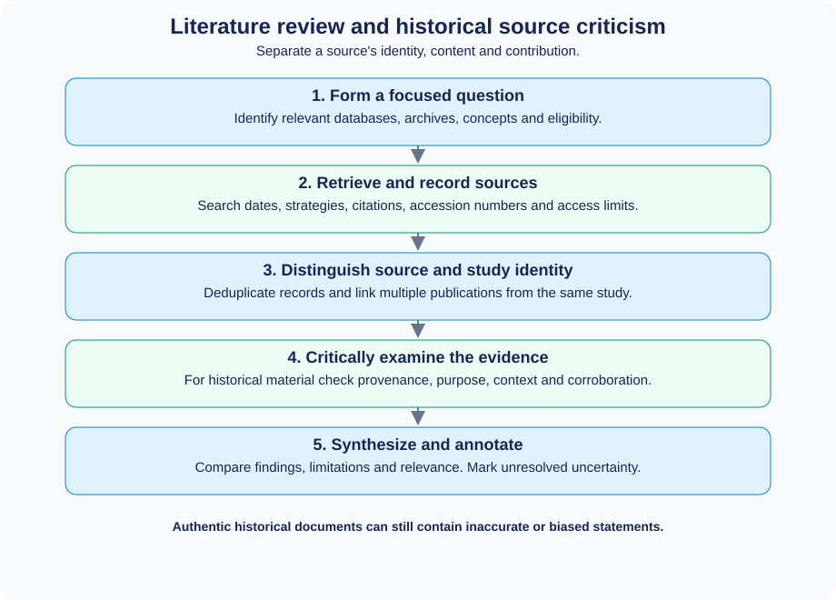

# Literature review, annotated bibliography and historical research

**Candidate concept guide.** INC revised BSc Nursing course Unit III and IV ke previously thin areas ko expand karta hai. Official extracted course outline printed pages 405–407 reviewed. Screenshot verification failed.

## Literature search and synthesis

Review ka purpose existing knowledge, methods, uncertainties and study rationale samajhna hai. Search question define karo, appropriate databases choose karo, concepts and synonyms combine karo, eligibility apply karo and exact search dates and strategies record karo. CINAHL nursing/allied health literature ke liye useful database hai. Cochrane Library evidence synthesis ke liye relevant hai. Different databases have different coverage.

Backward citation searching relevant work ki reference list follow karta hai. Forward citation searching later citing papers locate karta hai. Grey literature such as theses may be relevant depending on eligibility. Publication type alone validity determine nahi karta.

Database duplicate records ko deduplicate karo. Same underlying study ki multiple reports identify karo so same participants double-count na hon. Source access levels separate rakho: full report, abstract only, secondary citation or inaccessible lead. Specific numerical claim ko available evidence se verify karo. Inaccessible detail invent mat karo.

Annotated bibliography mein citation ke baad concise source description and evaluation hoti hai. Example structure: study purpose, design and sample, relevant finding, main limitation and relevance to proposed question. Reference list usually bibliographic identification provide karti hai. Evidence table studies ko common fields mein compare karti hai. Synthesis findings ke patterns, disagreements and gaps explain karti hai, individual summaries simply repeat nahi karti.

## Historical research

Historical nursing research past practices, education, institutions and policy changes ko surviving evidence se reconstruct and interpret karta hai. Original contemporary diary, letter, photograph or ledger primary historical evidence ho sakta hai. Later historian ki interpretation secondary source ho sakti hai. Source classification research question ke according depend karti hai.

External criticism asks whether source authentic hai: author, date, origin, physical characteristics and custody examine karo. Internal criticism asks whether content credible and meaningful hai: purpose, intended audience, bias, context, language and independent corroboration examine karo. Genuine source ka every statement true hona zaroori nahi.

| Problem | Appropriate response |
|---|---|
| Different sources disagree | Context and independent corroboration examine karo |
| Archived records mainly administrators ke hain | Missing bedside voices and survival bias acknowledge karo |
| Record silent about a practice | Absence of documentation ko proof of absence mat samjho |
| Old diagnostic or professional terminology changed | Contemporary meaning and comparability verify karo |
| Oral history recollection decades later | Memory and perspective evaluate karo |
| Unavailable evidence | Facts and inference distinguish karo, uncertainty disclose karo |

Timeline sequence establish kar sakti hai, but sequence alone cause prove nahi karti. Prescribed policy and actual implementation distinguish karo. Historical materials may contain sensitive information, so archive restrictions, privacy and applicable review follow karo.

## Practice and sources

- [Literature review MCQs](../MCQs/11-Literature-Review-and-Annotated-Bibliography-20-MCQs.md)
- [Historical research MCQs](../MCQs/12-Historical-Research-and-Source-Criticism-20-MCQs.md)
- [Cochrane Handbook chapter 4](https://www.cochrane.org/authors/handbooks-and-manuals/handbook/current/chapter-04), directly retrieved.
- [Cornell annotated bibliography](https://guides.library.cornell.edu/annotatedbibliography/home), indexed text, direct timeout.
- [Historical methodology in nursing](https://pubmed.ncbi.nlm.nih.gov/9433008/) and [historical source evaluation](https://pubmed.ncbi.nlm.nih.gov/21710912/), indexed abstracts.
- [American Association for the History of Nursing bibliography](https://www.aahn.org/bibliography), indexed source guidance.

Independent item audit and specific MCQ video verification remain pending.
