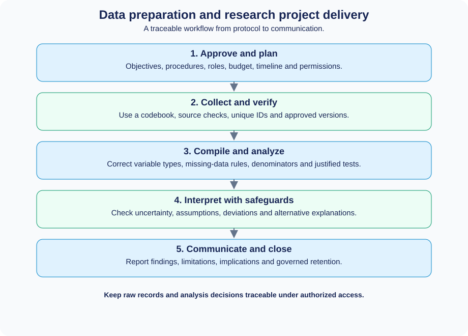

# Data compilation, statistical packages and research project execution

**Candidate concept guide.** INC course Units VI, VII and VIII ke practical data preparation, statistical-package application and research proposal competencies ka expansion.

## Data compilation and analysis

Codebook variable names, definitions, types, allowable values, missing codes and units record karta hai. Participant-level table mein one row per participant ho sakta hai, longitudinal table mein one row per participant-time observation. Stable participant ID and visit variable linkage preserve karte hain. Multiple-response items ko separate indicator columns mein store karna useful hai.

Data import ke baad row counts, types, labels, date and decimal conventions and selected values original source se verify karo. Range check impossible values identify karta hai. Logical check related fields compare karta hai. Double entry transcription errors identify kar sakti hai. Duplicate ID or record flag ko source verify kiye bina delete mat karo. Master dataset preserve karo and derived variables separately maintain karo.

Tabulation ke time denominator clearly label karo. Example: 12 positive responses among 40 daytime staff = 30%. Agar 10 staff ne item answer nahi kiya, valid denominator and missing count separately show karo. Multi-response percentages total 100% se exceed kar sakti hain. Grouped intervals nonoverlapping hone chahiye. Unequal histogram widths ke liye frequency density = frequency/width. Estimated grouped mean = sum of midpoint × frequency / total frequency. Cumulative count includes previous classes according to stated boundaries.

Qualitative analysis mein coding text segments ko meaningful labels deta hai. Themes related codes se broader patterns interpret karti hain. Contradictory cases examine karo and analytic decisions document karo. Quotes theme ko support kar sakti hain but analysis explanation still needed hai.

## Statistical packages and correlation

Statistical software analyst ko data processing, descriptive summaries, cross-tabulation and modeling mein help karta hai. Software output automatically correct nahi hota. Appropriate variable measurement type, missing handling, filters, weights, reference groups, assumptions and analysis sample verify karo. Derived scores separate columns mein create karo. Import identifiers as text if needed. Join tables using verified keys and cardinality. Raw records unchanged preserve karo. Intermediate calculations mein available precision use karo and final reporting appropriately round karo.

Pearson correlation linear association measure karta hai. Spearman rank correlation monotonic association examine karta hai and ordinal data ke liye useful ho sakta hai. No ties case mein standard shortcut rho = 1 − 6Σd²/[n(n² − 1)]. With ties, average ranks and rank correlation with appropriate inference use karo. Example: n = 6, Σd² = 10, rho = 1 − 60/210 = approximately 0.714. U-shaped pattern Pearson r near zero de sakta hai despite nonlinear association. Correlation causation prove nahi karti. Residual = observed − fitted.

## Proposal, project and dissemination

Proposal planned investigation justify karti hai. Background and literature review rationale establish karte hain. Objectives, design, eligibility, recruitment, outcome definitions, measurement schedule, analysis plan, ethical safeguards, personnel roles, resources and budget align karo. Timeline task dependencies account kare. Gantt chart planned activities across time show karta hai. Feasibility check mein eligible recruitment volume, refusal and follow-up constraints consider karo.

Required ethics approval and approved documents before enrollment use karo. Version control, permissions, deviation reporting, quality checks and authorized handover preserve karo. Actual data ko protocol mismatch hide karne ke liye alter mat karo. Project closure requires approved retention and access arrangements.

Oral presentation and written report question, methods, results, uncertainty, limitations and relevant implications communicate kare. Community-facing communication understandable language mein ho and confidentiality preserve kare. Recruitment target alone research completion establish nahi karta. Required outcomes, data quality, reporting and other agreed objectives evaluate karo.

## Practice and sources

- [Data compilation and qualitative analysis MCQs](../MCQs/13-Data-Compilation-Tabulation-and-Qualitative-Analysis-20-MCQs.md)
- [Statistical packages and correlation MCQs](../MCQs/14-Statistical-Packages-and-Correlation-Applications-20-MCQs.md)
- [Research proposal and project MCQs](../MCQs/15-Research-Proposal-Project-and-Communication-20-MCQs.md)
- [CDC data management](https://www.cdc.gov/field-epi-manual/php/chapters/data-collection-management.html), direct HTML retrieved.
- [WHO protocol format](https://www.who.int/groups/research-ethics-review-committee/recommended-format-for-a-research-protocol), direct HTML retrieved.
- [jamovi data tools](https://docs.jamovi.org/data/data_overview.html), [Penn State correlation](https://online.stat.psu.edu/stat509/Lesson07), [OpenStax regression](https://openstax.org/books/introductory-statistics-2e/pages/12-3-the-regression-equation), indexed descriptions.
- [BCcampus qualitative analysis](https://pressbooks.bccampus.ca/introductiontoresearch/chapter/qualitative-data-analysis/), indexed text, direct access failed.

Independent item source review and video mapping remain pending.
