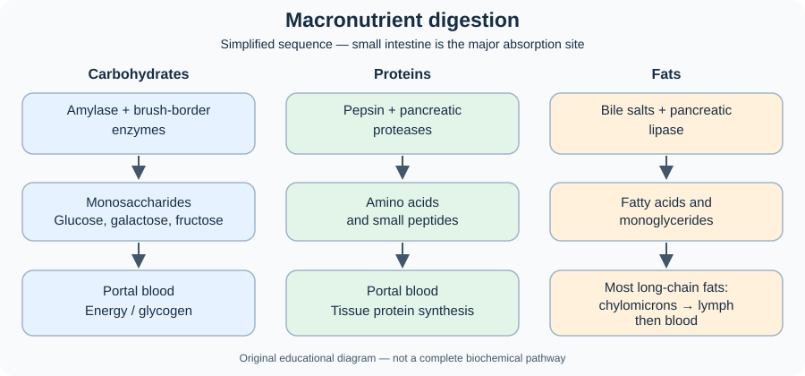

# Macronutrients — carbohydrates, proteins and fats

**Status:** Study-ready candidate, independent clinical review pending. Aapko is guide mein pehle digestion aur energy ka relation samajhna hai, phir topic-wise MCQs solve karne hain.

[Chapter](../README.md) · [Original MCQ inventory](../MCQs/Nutrition-Original-MCQ-Inventory.md)

## Carbohydrates

Hamare khane mein starch aur sugars alag forms mein hote hain. Rice, roti aur pulses mein starch milta hai, jabki milk mein lactose hota hai. Body ko in molecules ko smaller absorbable units mein todna padta hai. Mouth mein salivary amylase starch par kaam shuru karta hai, phir small intestine mein pancreatic amylase aur brush-border enzymes digestion complete karne mein help karte hain. Lactase lactose ko glucose aur galactose mein todta hai. Agar lactase kam ho toh undigested lactose bowel mein water khinch sakta hai aur bacteria gas bana sakte hain.

Meal ke baad glucose ki availability badhti hai. Liver aur muscle glucose ko glycogen ke form mein store kar sakte hain. Fasting ke shuruati phase mein liver glycogen breakdown se blood glucose support karta hai. Muscle glycogen mainly muscle ki apni energy needs ke liye use hota hai. Liver mein free glucose release karne ka mechanism hota hai, lekin skeletal muscle mein glucose-6-phosphatase ki required activity nahi hoti.

Fibre ka role bhi samajhna zaroori hai. Whole grains, legumes, vegetables aur fruits se fibre milta hai. Kuch fibre water ke saath gel form kar sakta hai aur kuch colon ke bacteria ferment karte hain. Fibre ko gradually badhana aur individual tolerance aur fluid restrictions consider karna chahiye. Diabetes mein food ka portion, available carbohydrate, medication aur activity saath mein review karne chahiye. Nurse teach-back se patient ki practical understanding assess karti hai.

Agar insulin lene wale patient ko hypoglycaemia ho aur woh alert ho aur safely swallow kar sake, toh approved protocol ke hisaab se fast-acting oral glucose diya ja sakta hai. Glucose recheck karna important hai. Unconscious patient ko oral drink nahi deni chahiye, kyunki aspiration ka risk hota hai. Emergency response aur appropriate non-oral rescue treatment local protocol ke according arrange karna chahiye.

## Proteins

Proteins amino acids se bane hote hain. Stomach acid protein ki structure open karta hai aur pepsin digestion shuru karta hai. Small intestine mein pancreatic proteases aur brush-border enzymes protein fragments ko smaller peptides aur amino acids mein todte hain. Absorption ke baad amino acids tissue repair, enzymes, antibodies aur other proteins banane mein use ho sakte hain.

Kuch amino acids body sufficient amount mein nahi bana sakti, isliye unhe essential amino acids kehte hain. Cereals aur pulses ki amino acid profiles ek doosre ko complement kar sakti hain. Dal aur rice ek practical example hain. Body ko sufficient total energy bhi chahiye, kyunki energy deficit mein amino acids ka use energy production ke liye badh sakta hai.

Nitrogen balance intake aur losses ko compare karta hai. Intake losses se zyada ho toh positive balance ka indication mil sakta hai. Severe illness mein catabolism aur nitrogen loss badh sakte hain. Burns aur recovery mein protein needs assess karni chahiye. Protein prescription ko illness, kidney function, dialysis status aur clinical nutrition assessment ke hisaab se individualize karna zaroori hai.

Albumin plasma oncotic pressure mein contribute karta hai, lekin low serum albumin ko akela malnutrition ka proof nahi maanna chahiye. Inflammation, fluid status aur organ function bhi albumin affect kar sakte hain. Nurse intake, weight trend, physical assessment aur wound healing jaise findings ko combine karti hai.

## Fats and lipids

Dietary fats concentrated energy provide karte hain. Bile salts fat droplets ko disperse karte hain aur micelles absorption mein help karte hain. Pancreatic lipase triglycerides ko smaller lipid products mein todta hai. Enterocytes most long-chain dietary lipids ko chylomicrons mein pack karte hain, jo lymph ke through blood tak pahunchte hain. Medium-chain fatty acids ka route comparatively direct portal absorption ho sakta hai, lekin special formulas dietitian aur clinical plan ke hisaab se use hote hain.

Saturated fatty acids mein carbon-carbon double bonds nahi hote. Monounsaturated fatty acids mein ek aur polyunsaturated fatty acids mein multiple double bonds hote hain. Linoleic aur alpha-linolenic acid diet se milne chahiye, kyunki body in essential fatty acids ko adequate form mein synthesize nahi kar sakti. Fats cell membranes, energy storage aur fat-soluble vitamin absorption mein bhi help karte hain.

Heart-healthy teaching mein saturated aur trans fats ko appropriate unsaturated sources se replace karna useful ho sakta hai. Oil add karne aur oil replace karne mein difference hai, kyunki extra oil se total calories badhti hain. Food label par serving size aur saturated fat amount dono check karein. Repeated high-temperature frying se oil degrade ho sakta hai.

Chronic fat malabsorption mein greasy bulky stool ho sakta hai, jise steatorrhoea kehte hain. Bile flow ya pancreatic digestion ki problem nutrient absorption ko affect kar sakti hai. Nurse symptoms, intake, weight aur possible deficiency risk assess karti hai aur clinician se plan coordinate karti hai.

| Nutrient | Approximate energy | Example |
|---|---:|---|
| Digestible carbohydrate | 4 kcal/g | Agar meal mein 50 g digestible carbohydrate hai, toh lagbhag 200 kcal aati hain. |
| Protein | 4 kcal/g | Agar meal mein 25 g protein hai, toh lagbhag 100 kcal aati hain. |
| Fat | 9 kcal/g | Agar meal mein 10 g fat hai, toh lagbhag 90 kcal aati hain. |

## Practice

- [Carbohydrate 20 MCQs](../MCQs/01A-Carbohydrates-20-MCQs.md)
- [Protein 20 MCQs](../MCQs/01B-Proteins-20-MCQs.md)
- [Fats and lipids 20 MCQs](../MCQs/01C-Fats-20-MCQs.md)

## References

[OpenStax carbohydrates](https://openstax.org/books/nutrition/pages/2-1-carbohydrates) · [OpenStax protein](https://openstax.org/books/nutrition/pages/2-3-protein) · [OpenStax fats](https://openstax.org/books/nutrition/pages/2-2-fats) · [ICMR-NIN Dietary Guidelines 2024](https://www.nin.res.in/dietaryguidelines/pdfjs/locale/DGI24thJune2024fin.pdf) · [ADA Standards of Care 2026 hypoglycaemia](https://doi.org/10.2337/dc26-s006)

Clinical treatment local protocol aur medical orders ke according individualize karna chahiye. Direct source access, independent clinical and comprehensive semantic review status is recorded in the chapter inventory.
