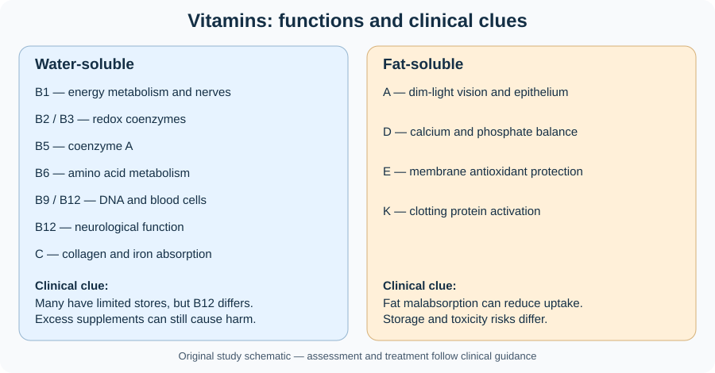

# Vitamins — water-soluble and fat-soluble

**Status:** Study-ready candidate, independent clinical review pending. Vitamin ko sirf deficiency disease ka naam yaad karne ke liye mat padhiye. Pehle samajhiye ki vitamin normal body function mein kya help karta hai aur deficiency ya excess se kaunsi problem ho sakti hai.

[Chapter](../README.md) · [Original MCQ inventory](../MCQs/Nutrition-Original-MCQ-Inventory.md)

## Water-soluble vitamins

Vitamin C aur B-complex vitamins generally water-soluble hote hain. Kai vitamins ka long-term storage limited hota hai, lekin vitamin B12 ek important exception hai kyunki liver mein substantial stores ho sakte hain. Water-soluble hone ka matlab unlimited supplements safe hona nahi hai.

Thiamine yani B1 carbohydrate metabolism aur nervous system ke liye important hai. Prolonged vomiting, poor intake aur harmful alcohol use mein deficiency ka risk badh sakta hai. Confusion, gait ataxia aur eye movement abnormalities Wernicke encephalopathy suggest kar sakti hain. Yeh urgent clinical concern hai. Agar symptomatic hypoglycaemia bhi ho toh emergency glucose correction delay nahi karni chahiye aur thiamine bhi promptly approved protocol ke according arrange karni chahiye.

Riboflavin yani B2 se FAD aur FMN coenzymes bante hain. Niacin yani B3 NAD aur NADP ke liye important hai. Pantothenic acid yani B5 coenzyme A ka component hai. Yeh sab energy metabolism mein support karte hain, lekin khud meal ki calories replace nahi karte. Vitamin B6 amino acid metabolism aur nervous system mein role rakhta hai. Isoniazid lene wale susceptible patients ko prescribed pyridoxine di ja sakti hai, jabki excessive chronic supplemental B6 khud neuropathy cause kar sakti hai.

Folate DNA synthesis aur rapidly dividing cells ke liye important hai. Pregnancy se pehle recommended folic acid shuru karne ka reason yeh hai ki neural tube pregnancy ke early weeks mein close ho jati hai. Dose aur duration local guidance aur individual risk ke according honi chahiye.

Vitamin B12 ka normal absorption stomach ke intrinsic factor aur terminal ileum par depend karta hai. Total gastrectomy aur extensive ileal resection ke baad deficiency risk assess karna chahiye. Strict vegan diets mein reliable fortified food ya suitable supplement zaroori ho sakta hai. B12 aur folate deficiency dono megaloblastic anaemia de sakti hain, lekin B12 deficiency neurological abnormalities bhi cause kar sakti hai. Unexplained anaemia mein folate alone dene se pehle B12 deficiency assess karna important hai.

Vitamin C collagen formation aur non-haem iron absorption support karta hai. Dal jaise plant iron sources ke saath lemon ya guava jaisa vitamin C-rich food useful ho sakta hai. Vegetables ko prolonged boiling aur water discard karne se kuch water-soluble vitamins lose ho sakte hain. Short cooking aur kam water use karne se retention improve ho sakti hai. High-dose biotin use laboratory ko batana chahiye, kyunki kuch tests mein interference ho sakta hai.

## Fat-soluble vitamins

Vitamins A, D, E aur K fat-soluble vitamins hain. Intestinal lipid handling inke absorption mein important hai. Malabsorption ke cases mein targeted assessment zaroori ho sakti hai. Vitamin A aur D jaise vitamins body mein retain ho sakte hain, isliye excess intake bhi clinically important hai.

Vitamin A dim light vision aur epithelial health ko support karta hai. Retina mein retinal-containing visual pigment ka normal function vitamin A se related hai. Deficiency mein night blindness aur severe cases mein corneal damage ho sakta hai. Sight-threatening ocular findings mein urgent clinical assessment chahiye. Carrots aur orange-fleshed sweet potatoes provitamin A carotenoids provide kar sakte hain. Pregnancy mein unsupervised high-dose preformed vitamin A fetal harm ka risk badha sakta hai.

Vitamin D calcium aur phosphate absorption aur bone mineralization mein help karta hai. Liver vitamin D ko 25-hydroxyvitamin D mein convert karta hai aur kidney active form banane mein important role rakhti hai. Vitamin D status assess karne ke liye usually serum 25-hydroxyvitamin D use hota hai. Active form routine nutritional marker nahi hota. Growing children mein defective mineralization se rickets aur adults mein osteomalacia ho sakti hai. Excess supplemental vitamin D hypercalcaemia aur kidney-related harm cause kar sakta hai.

Vitamin E lipid-phase antioxidant ki tarah membrane lipids ko oxidative damage se protect karne mein help karta hai. Severe deficiency, especially prolonged fat malabsorption ke context mein, neurological symptoms cause kar sakti hai. Nuts aur seeds dietary vitamin E sources ho sakte hain. High-dose supplement aur anticoagulant combination ka bleeding risk clinician ke saath review karna chahiye.

Vitamin K factors II, VII, IX aur X aur proteins C aur S ki normal gamma-carboxylation mein important hai. Newborns mein limited vitamin K stores ki wajah se vitamin K deficiency bleeding ka risk ho sakta hai, isliye routine prophylaxis local clinical protocol ke according di jati hai. Warfarin lene wale patients ko all leafy vegetables band karne ki jagah consistent vitamin K intake aur INR monitoring ki teaching deni chahiye. PT ya INR prolongation vitamin K deficiency mein ho sakti hai, lekin liver disease aur anticoagulants jaise other causes bhi consider karne chahiye.

## Practice

- [Water-soluble vitamins 20 MCQs](../MCQs/01D-Water-Soluble-Vitamins-20-MCQs.md)
- [Fat-soluble vitamins 20 MCQs](../MCQs/01E-Fat-Soluble-Vitamins-20-MCQs.md)

## References

[OpenStax vitamins](https://openstax.org/books/nutrition/pages/3-1-vitamins) · [NIH ODS thiamin](https://ods.od.nih.gov/factsheets/Thiamin-HealthProfessional/) · [Folate](https://ods.od.nih.gov/factsheets/Folate-HealthProfessional/) · [Vitamin C](https://ods.od.nih.gov/factsheets/VitaminC-HealthProfessional/) · [Vitamin A](https://ods.od.nih.gov/factsheets/vitamina-HealthProfessional/) · [Vitamin D](https://ods.od.nih.gov/factsheets/VitaminD-HealthProfessional/).

Direct B12, B6, E and K fact-sheet access was blocked during this run. Drug interactions, newborn prophylaxis, pregnancy and disease-specific recommendations require direct local guideline and independent clinical review. Doses intentionally not universalized.
