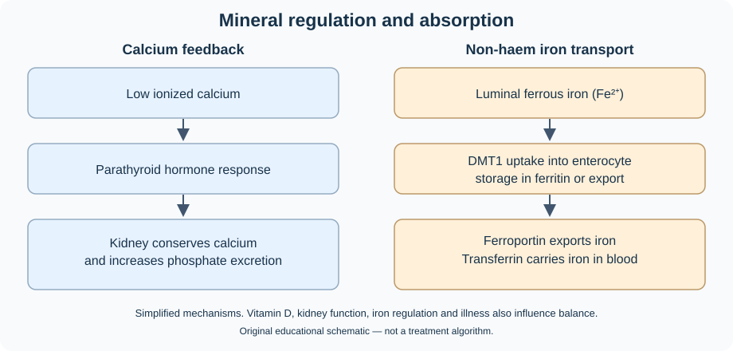

# Calcium, phosphorus, iron and iodine — mineral nutrition

**Status:** Advance-preparation candidate. Independent clinical and publication review pending.

[Chapter](../README.md) · [Run 2 inventory](../MCQs/Nutrition-Run-02-Inventory.md)

## Calcium and phosphorus

Hamare bones aur teeth sirf hard structure nahi hain. Inmein calcium aur phosphate mineral crystals ke form mein stored rehte hain. Blood mein free ionized calcium ka chhota regulated fraction muscle contraction, nerve signaling aur clotting mein kaam karta hai. Isliye blood calcium low hone par tingling, muscle spasm aur ECG changes ho sakte hain. Severe symptoms mein urgent clinical assessment chahiye. Rapid blood transfusion mein citrate free calcium bind kar sakta hai. Severe magnesium deficiency PTH release aur response ko bhi affect kar sakti hai. Aise cases mein nurse lab trend, symptoms aur prescribed treatment monitor karti hai.

PTH low calcium ke response mein calcium conservation aur phosphate excretion badhane mein help karta hai. Kidney aur vitamin D ke functions bhi mineral balance mein important hain. Advanced CKD mein phosphate retention aur mineral-bone problems ho sakti hain. Meal-associated phosphate binders gut mein dietary phosphate bind karte hain, isliye prescribed food timing follow karein. Severe phosphate depletion mein cellular energy metabolism impair ho sakta hai aur respiratory muscles weak ho sakti hain. ATP aur DNA mein phosphate ka structural role hai.

Dairy foods, labelled fortified soy beverages, low-oxalate greens aur safe edible fish bones calcium provide kar sakte hain. Food mein calcium present hone aur actually absorb hone mein difference hota hai. Spinach mein oxalate calcium bind kar sakta hai. Agar supplement prescribed hai toh formulation samajhna useful hai. Calcium carbonate usually food ke saath better absorb hota hai, jabki calcium citrate acid par comparatively kam depend karta hai. Calcium levothyroxine jaise drugs ke absorption ko affect kar sakta hai, isliye prescribed interval check karein. Calcium oxalate stone ke patient ko bina specialist advice all dietary calcium band karne ki salah nahi deni chahiye. Appropriate meal calcium intestinal oxalate bind kar sakta hai. Bone health ke liye fall prevention, exercise as appropriate, vitamin D aur osteoporosis care bhi important hain.

## Iron

Iron haemoglobin ka important component hai, lekin iska kaam sirf blood tak limited nahi hai. Myoglobin muscle mein oxygen handling support karta hai. Dietary iron haem aur non-haem forms mein milta hai. Animal muscle sources mein haem iron hota hai, jabki plants aur commonly fortified staples non-haem iron dete hain. Non-haem ferrous iron enterocyte mein DMT1 se enter kar sakta hai aur ferroportin ke through blood ki taraf export hota hai. Transferrin circulating iron ko tissues tak le jaata hai. Ferritin storage marker hai, lekin inflammation se bhi increase ho sakta hai. Isliye Hb, ferritin aur clinical context alag-alag samajhna chahiye. Stores low hone ke bawajood early deficiency mein Hb normal reh sakta hai.

Body iron recycle karti hai aur intestinal absorption regulate karti hai. Large-scale regulated iron excretion limited hai, isliye unnecessary supplements safe nahi maan sakte. Pregnancy mein maternal red-cell mass expand hota hai aur fetus aur placenta ko iron chahiye. Complementary feeding age par infant ko suitable iron-rich foods ki zaroorat badhti hai. Prescribed treatment ya preventive supplement ka dose local programme aur clinical needs ke according decide hota hai.

Food mein phytate iron bioavailability reduce kar sakta hai. Controlled soaking, germination ya fermentation kuch phytate reduce kar sakti hai. Meat-containing mixed meal non-haem iron absorption ko support kar sakta hai, lekin vegetarian patient ke preferences respect karna zaroori hai. Affordable dal, chana, appropriate fortified staples aur varied foods practical choices ho sakte hain. Nutrition education mein food accessibility aur culturally acceptable meal planning bhi assess karein.

India mein fortified rice aur wheat flour mein added iron, folate aur vitamin B12 ho sakte hain. Double-fortified salt mein iron aur iodine hote hain. Fortification ka matlab sodium intake badhana nahi hai. Product identity colour ke bajay verified labelling aur supply information se check karein. Community programme coverage actual targeted household consumption se assess ki ja sakti hai. Anaemia prevalence improve hone se encouraging outcome milta hai, lekin anaemia ke sabhi cases iron deficiency se nahi hote. Iron-specific markers aur other causes ka evaluation separately useful hai.

## Iodine

Iodine thyroid hormones T3 aur T4 ka structural part hai. Thyroid follicular cells sodium-iodide symporter se iodide uptake karte hain. Thyroid peroxidase thyroglobulin tyrosine residues ki iodination aur coupling mein help karta hai. Agar iodine supply long term inadequate ho toh thyroid hormone synthesis compromise ho sakti hai aur TSH stimulation se gland enlarge ho sakti hai. Lekin goitre ke multiple causes hote hain. Individual thyroid function assess karne ke liye TSH aur free T4 clinical context ke saath interpret karte hain.

Pregnancy ke early phase mein maternal thyroid hormone fetal brain development ke liye important hai. Adequate iodine zaroori hai, lekin high-dose kelp ya iodine supplement bhi susceptible people mein thyroid dysfunction cause kar sakta hai. Seaweed content variable hota hai. Amiodarone iodine-rich drug hai aur thyroid monitoring chahiye. Radioiodine treatment ke liye temporary low-iodine diet sirf treating team ki advice ke according follow karein.

Indian NIDDCP programme adequately iodized household salt ka 15 ppm benchmark use karta hai. Salt ko dry closed container mein rakhein aur excessive sodium consumption avoid karein. WHO population monitoring mein school-age children ka median urinary iodine use karta hai. Median 100–199 micrograms/L adequate range hai. Yeh population statistic hai, har child ka diagnostic cutoff nahi. Individual spot urine result day-to-day intake ke saath fluctuate kar sakta hai.

## Practice

- [Calcium and phosphorus](../MCQs/02A-Calcium-and-Phosphorus-20-MCQs.md)
- [Iron nutrition](../MCQs/02B-Iron-Nutrition-20-MCQs.md)
- [Iodine nutrition](../MCQs/02C-Iodine-Nutrition-20-MCQs.md)

## References and limits

[NIH ODS calcium](https://ods.od.nih.gov/factsheets/Calcium-HealthProfessional/) · [NIH ODS iron](https://ods.od.nih.gov/factsheets/Iron-HealthProfessional/) · [NIH ODS phosphorus](https://ods.od.nih.gov/factsheets/Phosphorus-HealthProfessional/) · [WHO iodine indicators](https://www.who.int/data/nutrition/nlis/info/iodine-deficiency) · [DGHS NIDDCP](https://dghs.mohfw.gov.in/niddcp.php) · [FSSAI fortified food](https://www.fssai.gov.in/citizen/fortified-food) · [Iron absorption review](https://pubmed.ncbi.nlm.nih.gov/24994858/) · [NIDDK stone nutrition](https://www.niddk.nih.gov/health-information/urologic-diseases/kidney-stones/eating-diet-nutrition) · [American Thyroid Association low-iodine diet](https://www.thyroid.org/low-iodine-diet/).

Calcium, iron, WHO iodine, DGHS and NIDDK direct HTML was retrieved. Phosphorus and iodine ODS direct access was blocked, with indexed information available. FSSAI, thyroid guideline, DMT1 review and clinical guidance are indexed leads. Clinical protocol, independent clinical and comprehensive source validation remain pending.
