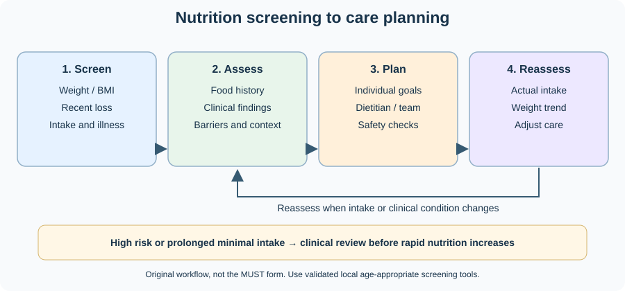

# Zinc, other trace minerals and nutritional screening

**Status:** Advance-preparation candidate. Independent clinical and publication review pending.

[Chapter](../README.md) · [Run 2 inventory](../MCQs/Nutrition-Run-02-Inventory.md)

## Zinc and related trace minerals

Zinc small quantity mein required hota hai, lekin cellular growth, enzymes, protein aur DNA synthesis, immune function aur taste mein important role rakhta hai. Agar patient ki intake low ho aur wound healing slow ho toh zinc status clinical context mein consider kar sakte hain. Sirf wound dekhkar deficiency diagnose nahi karni chahiye, kyunki infection, perfusion, protein intake aur other diseases bhi healing affect karte hain. High-phytate diet zinc absorption reduce kar sakti hai. Food variety aur processing useful ho sakte hain.

Extra zinc hamesha extra benefit nahi deta. Chronic excessive supplementation copper absorption reduce kar sakti hai aur anaemia ya neutropenia ka risk badh sakta hai. Zinc tetracycline jaise kuch antibiotics ke saath absorption interaction bhi kar sakta hai, isliye medication timing pharmacist se confirm karein. Acrodermatitis enteropathica inherited zinc malabsorption disorder hai jisme periorificial dermatitis, alopecia aur diarrhoea ho sakte hain. Specialist confirmation aur treatment important hai.

Childhood diarrhoea mein rehydration, continued feeding aur breastfeeding clinically important hain. Oral zinc protocol ke according adjunct ho sakta hai, lekin ORS ka replacement nahi hai. WHO 2024 guideline mein zinc dose revision report hui hai. Isliye kisi old exam dose ko current Indian protocol ke bina universal rule mat samajhiye. Dehydration signs, persistent diarrhoea aur blood in stool par timely clinical assessment chahiye.

Copper ceruloplasmin jaise enzymes ka component hai aur iron handling mein help karta hai. Bariatric surgery ya excessive zinc ke baad copper deficiency anaemia aur neurological symptoms de sakti hai. Wilson disease mein problem opposite ho sakti hai, kyunki inherited copper handling defect se accumulation hota hai. Dono mein treatment individualized specialist advice se hota hai.

Selenium glutathione peroxidases aur iodothyronine deiodinases jaise selenoproteins mein important hai. Selenium deficiency aur excess dono clinically relevant ho sakte hain. Hair loss, brittle nails aur garlic-like breath after excessive supplements selenosis ka concern raise kar sakte hain. Keshan disease historically low-selenium regions mein associated cardiomyopathy hai, lekin deficiency alone har case explain nahi karti.

Fluoride appropriate exposure mein enamel remineralization support kar sakta hai. Developing teeth mein excess exposure dental fluorosis aur long-term excessive water exposure skeletal fluorosis se associated ho sakti hai. Community prevention ke liye source water test karna aur safe water access arrange karna important hai. Molybdenum sulfite oxidase jaise enzymes ke cofactor ka part hai. Manganese enzyme function mein role rakhta hai, lekin cholestasis aur long-term parenteral nutrition mein biliary excretion impaired hone se accumulation risk ho sakta hai. Trace element parenteral formulations pharmacy aur clinical specialist review ke according individualize karni chahiye.

## Nutritional screening and assessment

Screening aur assessment ka difference samajhna important hai. Screening jaldi se risk identify karti hai, jabki detailed assessment cause, severity aur care needs samajhne mein help karta hai. Adult hospital admission par local validated screening policy follow karni chahiye. Agar risk identify ho toh dietitian ya clinical nutrition team ko timely involve karein. Low screening score future risk ko permanently exclude nahi karta, isliye condition change hone par repeat screen useful hai.

BMI nikalne ke liye weight kg mein aur height metre mein chahiye. Weight ko height ke square se divide karte hain. Weight-loss percentage calculate karne ke liye usual weight se current weight subtract karke usual weight se divide karte hain aur 100 se multiply karte hain. Agar usual weight 80 kg tha aur current 72 kg hai toh loss 8 kg hai, yani 10 percent.

MUST adult risk screening ka ek example hai. Ismein BMI, recent unplanned weight loss aur acute illness ke saath more than five days no nutritional intake ka effect consider hota hai. Source calculator ka current scoring follow karein. Agar BMI 19.2 aur weight loss 7 percent ho, aur acute-disease effect absent ho, toh respective scores 1 aur 1 se total 2 aata hai. Yeh high-risk screening result hai, definitive diagnosis nahi. Infant aur child assessment ke liye adult cutoffs apply nahi karte. WHO age- aur sex-specific growth standards, serial measurements aur feeding assessment relevant hain.

Weight trend interpret karte waqt scale, clothing, bedding, devices aur timing record karna chahiye. Dialysis aur fluid retention se weight rapidly change ho sakta hai. High BMI bhi adequate muscle mass guarantee nahi karta. Muscle bulk, function, intake aur disease factors ko together assess karein. Agar safe standing height possible nahi hai toh validated alternative estimate aur limitation document karein.

Food-intake chart mein delivered food aur actual consumed amount alag record karna zaroori hai. Agar breakfast 400 kcal ka tha aur patient ne half khaya, toh estimated 200 kcal consume hui. Agar lunch 800 kcal ka tha aur one quarter khaya, toh additional 200 kcal hui, assuming portions energy distribution represent karte hain. Ek single 24-hour recall usual intake ka exact representation nahi hota. Multiple days, snacks, beverages aur supplements ko consider karna useful hai.

Patient se nonjudgmental questions poochhein. Chewing, access, mood, medication effects, cultural food choices aur meal interruptions intake affect kar sakte hain. Protected mealtimes nonurgent interruptions reduce karne mein help kar sakte hain, lekin urgent care delay nahi karni chahiye. Poor intake prolonged ho toh rapid unrestricted feeding se pehle refeeding risk, electrolyte status aur clinical plan review zaroori hai. Evaluation mein actual intake goals ke against compare karein aur persistent barriers ke hisaab se plan adjust karein.

## Practice

- [Zinc and trace minerals](../MCQs/02D-Zinc-and-Trace-Minerals-20-MCQs.md)
- [Nutritional screening and assessment](../MCQs/02E-Nutritional-Screening-and-Assessment-20-MCQs.md)

## References and limits

[NIH ODS zinc](https://ods.od.nih.gov/factsheets/Zinc-HealthProfessional/) · [Copper](https://ods.od.nih.gov/factsheets/Copper-HealthProfessional/) · [Selenium](https://ods.od.nih.gov/factsheets/selenium-HealthProfessional/) · [Molybdenum](https://ods.od.nih.gov/factsheets/Molybdenum-HealthProfessional/) · [WHO 2024 childhood diarrhoea guideline](https://www.who.int/india/publications/i/item/9789240103412) · [ESPEN micronutrient guidance](https://www.sciencedirect.com/science/article/pii/S0261561424000414) · [NICE CG32](https://www.nice.org.uk/guidance/cg32/chapter/Recommendations) · [BAPEN MUST calculator](https://www.bapen.org.uk/must-and-self-screening/must-calculator/) · [WHO child growth standards](https://www.who.int/tools/child-growth-standards/standards).

Zinc direct HTML retrieved. Copper, selenium, NICE and BAPEN direct access blocked or verification challenge, with indexed content available. WHO paediatric and ESPEN references indexed, not full direct guideline or PDF visual review. Individual doses and specialist treatments deliberately not universalized. Local protocols and independent clinical review are pending.
