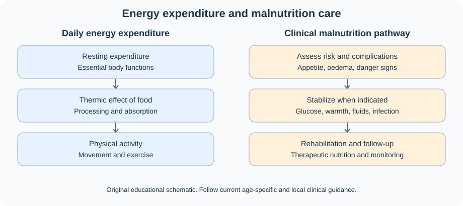

# Energy requirements, BMR and protein-energy malnutrition

**Status:** Original candidate study notes. Independent clinical review and publication gates pending.

## Energy expenditure

Body ko sirf exercise ke liye energy nahi chahiye. Jab hum physically rest karte hain tab bhi heart, brain, breathing aur cellular metabolism kaam karte hain. Basal metabolic rate (BMR) strict rested, awake, postabsorptive aur thermoneutral conditions mein minimum energy expenditure represent karta hai. Ordinary resting energy expenditure measurement ke conditions thode different ho sakte hain. Recent food, physical activity aur temperature stress basal measurement ko influence karte hain.

Total daily energy expenditure mein resting expenditure, food processing ki energy cost aur activity expenditure contribute karte hain. Meal digest, absorb aur metabolize karne ke additional expenditure ko thermic effect of food kehte hain. FAO factorial method mein healthy nonpregnant, nonlactating adults ke liye daily expenditure estimate BMR multiplied by physical activity level (PAL) hota hai. PAL ko TEE/BMR ke ratio ke roop mein samajh sakte hain. Agar BMR 1400 kcal/day aur PAL 1.6 ho, toh estimated expenditure 2240 kcal/day hai. Yeh example calculation hai, patient-specific treatment prescription nahi.

Indirect calorimetry oxygen consumption aur carbon dioxide production measure karti hai. VCO2/VO2 respiratory exchange ratio hai. Steady-state pure carbohydrate oxidation ka respiratory quotient roughly 1 aur fat oxidation ka about 0.7 hota hai. Clinical RER aur cellular RQ nonsteady conditions mein differ kar sakte hain. Critically ill patients mein machine measurement technically valid hona chahiye, kyunki leaks, oxygen settings aur instability results affect kar sakte hain. Predictive equations useful hain lekin exact measured expenditure ka guarantee nahi. Age, body composition, illness aur physical activity ko consider karein.

Growth mein new tissue deposition ke liye energy chahiye aur lactation mein milk production ki energy cost hoti hai. Illness aur fever metabolic demand alter kar sakte hain. In sab situations mein ek fixed multiplier sabke liye use nahi karna chahiye. Energy density food ke kcal per gram ko describe karti hai. Water-rich foods ka mass zyada ho sakta hai even when total calories same hon. Prolonged energy excess net tissue storage contribute kar sakta hai, lekin weight fluid aur body composition se bhi affected hai. Critically ill patient mein excessive energy provision respiratory carbon dioxide production badha sakti hai. Nutrition aur respiratory care team milkar plan evaluate karti hai.

## Protein-energy malnutrition

Jab food energy aur essential nutrients body needs ke comparison mein insufficient hote hain, toh undernutrition develop ho sakti hai. Classical marasmus mein muscle aur subcutaneous fat wasting prominent hoti hai. Classical kwashiorkor mein nutritional oedema important finding hai. Kwashiorkor ka mechanism complex hai. Sirf protein shortage se every case explain nahi hota. Oedema se measured weight increase ho sakta hai even when body tissues depleted hon. Skin, hair, clinical history aur other medical causes bhi assess karein.

Children 6–59 months mein severe wasting ka WHO criterion WHZ/WLZ below -3 ya MUAC below 115 mm hai. Bilateral nutritional pitting oedema bhi full assessment ka indication hai. Appetite test aur clinical assessment decide karte hain ki structured outpatient therapeutic care appropriate hai ya inpatient referral required hai. Poor appetite, danger signs, severe generalized oedema ya medical complications inpatient care ke important indications hain. Stable child with appetite aur no inpatient indication local programme ke according outpatient care receive kar sakta hai.

Complicated severe acute malnutrition mein initial stabilization ka goal life-threatening metabolic aur medical problems manage karna hai. Hypoglycaemia, hypothermia, infection, fluid balance aur electrolyte issues ko promptly assess karte hain. Starter feed jaise F-75 stabilization support kar sakta hai. Rapid unrestricted feeding initial unstable phase mein appropriate nahi hai. Appetite aur complications improve hone par clinician protocol ke according rehabilitation feeding consider karta hai. Hypoglycaemia with reduced consciousness urgent care demand karti hai aur oral feeding unsafe ho sakti hai. Severe malnutrition mein usual dehydration signs less reliable ho sakte hain, isliye specialized fluid protocol follow karein.

Treatment ke dauran oedema decrease hone par early weight fall retained fluid loss reflect kar sakta hai. Caregiver ko therapeutic ration, safe feeding, follow-up aur danger signs samjhana important hai. Food insecurity ko blame karne ke bajay practical support aur nutrition programme linkage arrange karein. Repeated infection aur inadequate nutrition ek doosre ko worsen kar sakte hain, isliye hygiene, illness care aur accessible nutrient-rich food long-term prevention ka part hain.

## Practice

- [Energy requirements and BMR](../MCQs/03A-Energy-Requirements-and-BMR-20-MCQs.md)
- [Protein-energy malnutrition](../MCQs/03B-Protein-Energy-Malnutrition-20-MCQs.md)

## References

[FAO energy requirements](https://www.fao.org/4/Y5686E/y5686e04.htm) · [National Academies energy expenditure](https://www.ncbi.nlm.nih.gov/books/NBK591031/) · [WHO 2023 acute malnutrition](https://www.ncbi.nlm.nih.gov/books/NBK601655/) · [WHO inpatient identification](https://www.who.int/tools/elena/interventions/sam-identification-inpatient) · [WHO hypoglycaemia](https://www.who.int/tools/elena/interventions/hypoglycaemia-sam) · [India F-IMNCI 2023](https://nhm.gov.in/images/pdf/programmes/child-health/guidelines/Revised-F-IMNCI-Modules-2023/FIMNCI-Participant-Module-2023.pdf). WHO and National Academies direct HTML reviewed. FAO and Indian module indexed only. Current local clinical protocol and independent review remain necessary.
