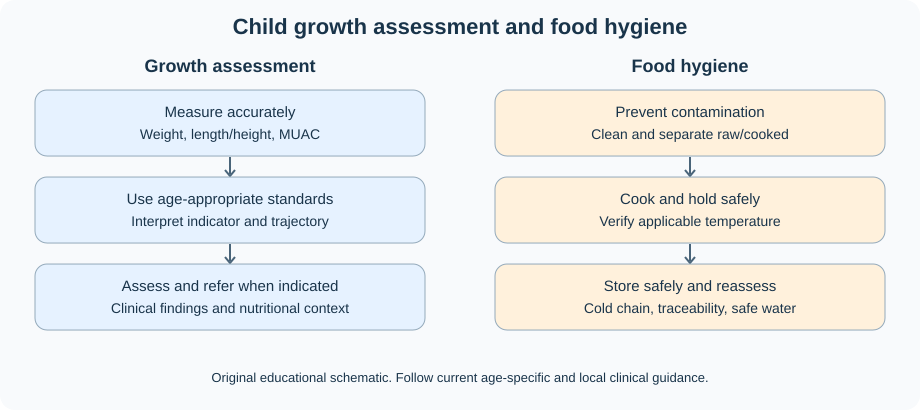

# Child growth, balanced diets and food safety

**Status:** Original candidate study notes. Independent clinical review and publication gates pending.

## Child growth and anthropometry

Growth assessment mein sirf ek body weight dekhkar conclusion nahi nikalna chahiye. Child ki accurate age, sex aur appropriate growth standard identify karein. WHO standards length/height-for-age, weight-for-age, weight-for-length/height aur BMI-for-age jaise indicators offer karte hain. Low height-for-age stunting suggest karta hai. Low weight relative to length/height wasting suggest karta hai. Weight-for-age underweight indicate kar sakta hai, lekin stunting aur wasting differentiate karne ke liye additional indicators chahiye. Low z-score exact disease cause establish nahi karta. Growth trajectory, diet, recurrent illness aur clinical assessment together interpret karein.

Infantometer mein small child ko safely lying position mein measure karein. Head fixed board ke against align hota hai aur legs gently extend karke foot board adjust kiya jata hai. Usually under two years recumbent length aur two years or older standing height use hoti hai. Agar under-two child ka standing measurement use karna pade toh WHO guidance 0.7 cm add karke length equivalent banati hai. Older child ki recumbent measurement se standing equivalent ke liye 0.7 cm subtract karte hain. Method record karna important hai. Weight scale zero aur calibration check karein. Movement ya attached items unreliable reading de sakte hain. Head circumference maximum occipitofrontal circumference par nonstretchable tape se measure karein. Preterm child ke liye gestation aur appropriate corrected age chart guidance consider karein.

MUAC upper arm ke acromion aur olecranon midpoint par measure hoti hai. Tape snug rakhein lekin tissue compress na karein. WHO 2023 guidance mein 6–59 months children ke liye MUAC 115 mm se below severe wasting criterion hai. 115 se below 125 mm moderate wasting range hai, if severe criteria ya nutritional oedema absent hon. WHZ/WLZ below -3 severe wasting criterion hai aur -3 inclusive to below -2 moderate range hai. Bilateral nutritional pitting oedema ko normal-range MUAC exclude nahi karta. Referral aur medical causes ka assessment zaroori hai.

Serial measurements mein trend important hai. Agar chart point wrong birth date ke saath plot hua ho toh age correct karein aur measured value preserve karein. Survey prevalence valid measured cases divided by valid denominator times 100 se estimate hoti hai. Missing aur implausible measurements ko transparent data-quality rules se handle karein, automatic normal classification na dein.

## Balanced diets and food groups

Balanced diet mein adequate energy ke saath essential nutrients aur food variety chahiye. ICMR-NIN Dietary Guidelines for Indians 2024 mein cereals and millets, pulses, seasonal vegetables including green leafy vegetables, fruits, dairy, nuts and seeds, oils, roots and tubers, flesh foods and spices/herbs jaise groups explain kiye gaye hain. My Plate for the Day 2000-kcal reference pattern ke through daily food-group proportion samjhati hai. Yeh sabke liye exact meal prescription nahi. Age, activity, pregnancy, clinical disease aur dietary preference se food amounts change ho sakte hain.

General balanced-diet guidance cereal/millet calories ko 45 percent tak limit karne ka principle batati hai. Hypothetical 2000 kcal reference mein 45 percent 900 kcal hoti hai. Remaining diet mein different nutrient sources include karne hote hain. Food group ko brand, flavour ya volume se identify na karein. Fruit-flavoured candy whole fruit equivalent nahi hai. Milk aur water ka equal volume nutrient equivalence prove nahi karta. Raw grain weight aur cooked grain weight water absorption ke karan differ kar sakte hain. Budget-friendly local seasonal foods, pulses aur grains ki variety useful hai. Dietary beliefs ko respect karke acceptable nutrient sources identify karein. Young child ke liye safe texture aur allergy assessment bhi food planning ka part hai.

## Food safety and hygiene

Food contamination biological, chemical ya physical hazard se ho sakti hai. WHO five key principles clean handling, raw aur cooked foods ka separation, thorough cooking, safe holding temperature aur safe water/materials emphasize karte hain. Raw poultry ko sealed container mein ready-to-eat items se below aur separate rakhein. Cutting board aur utensil clean aur sanitize karein ya dedicated separate equipment use karein. Gloves hand hygiene ka substitute nahi. Raw task se cooked food task par shift karte waqt contaminated gloves remove karein aur clean handling follow karein.

Cooking safety verify karne ke liye food-specific approved internal temperature aur calibrated thermometer use karein. WHO educational danger zone 5–60°C hai, jabki CDC home guidance roughly 4–60°C use karti hai. Is difference ko source context ke saath yaad rakhein aur local food-service standard follow karein. Cooked food ko shallow containers mein divide karke promptly refrigerate karein. Frozen poultry refrigerator mein contained thawing se safer handle ho sakti hai. Rice ko overnight room temperature par chhodne ke baad reheating toxin risk reliably reverse nahi karti. Smell aur taste food safety verify nahi karte.

Hospital kitchen mein expiry, package integrity, storage temperature aur batch traceability maintain karein. Bulging ya leaking container reject karein. Symptomatic food handler ko local illness-exclusion policy ke according food duties se remove karein. Food allergy mein invisible cross-contact bhi reaction cause kar sakta hai, isliye safe alternative verify karein. Suspected meal-related outbreak mein affected patients ki clinical assessment aur local reporting pathway activate karein. Suspect batch isolate karein aur records preserve karein. Food safety checklist mein critical control fail ho toh approved corrective action aur verification ke bina food release nahi karna chahiye. Caregiver demonstration se food hygiene teaching ki practical understanding assess kar sakte hain.

## Practice

- [Child growth and anthropometry](../MCQs/03C-Child-Growth-and-Anthropometry-20-MCQs.md)
- [Balanced diets and food groups](../MCQs/03D-Balanced-Diets-and-Food-Groups-20-MCQs.md)
- [Food safety and hygiene](../MCQs/03E-Food-Safety-and-Hygiene-20-MCQs.md)

## References

[WHO growth standards](https://www.who.int/tools/child-growth-standards/standards) · [WHO growth assessment training](https://www.who.int/publications/i/item/9789241595070) · [WHO malnutrition indicators](https://www.who.int/data/nutrition/nlis/info/malnutrition-in-children) · [WHO 2023 wasting guidance](https://www.ncbi.nlm.nih.gov/books/NBK601655/) · [ICMR-NIN Dietary Guidelines 2024](https://www.nin.res.in/dietaryguidelines/pdfjs/locale/DGI24thJune2024fin.pdf) · [WHO Five Keys](https://www.who.int/activities/promoting-safe-food-handling/five-key-to-safer-food/) · [CDC food safety](https://www.cdc.gov/food-safety/prevention/) · [FSSAI home safety](https://fssai.gov.in/flipbook.php?bookid=31). WHO and CDC direct HTML reviewed. NIN PDF extracted text retrieved, screenshot cache miss. Detailed local standards, preterm protocol and independent review pending.
