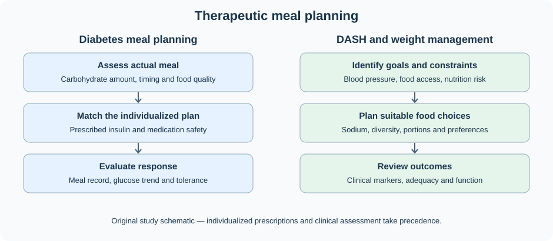

# Diabetes, DASH and weight-management therapeutic nutrition

**Status:** Advance-preparation candidate. Independent clinical and semantic validation pending. General reference patterns are not individual medical prescriptions.

## Therapeutic diets ka basic idea

Therapeutic diet normal balanced diet ka clinically planned modification hoti hai. Disease, symptoms, nutritional status, medicines aur patient preference ke according nutrient amount, food choice, consistency, meal timing aur feeding route change ho sakte hain. Nurse ko sirf diet ka naam yaad nahi rakhna chahiye. Prescribed goal samajhna, actual food intake assess karna aur nutrition team ke saath follow-up karna important hai.

## Diabetes meal planning

Diabetes mein meal ka carbohydrate amount aur timing important hai, lekin sirf carbohydrate count se complete food quality decide nahi hoti. Protein, fat, fibre, micronutrients, physical activity aur prescribed medicines bhi glucose response aur long-term health affect karte hain. ADA ek universal macronutrient percentage prescribe nahi karti. Clinical goals aur individual preferences ke according plan banta hai.

CDC plate method teaching ke liye approximately 9-inch reference plate use karta hai. Half portion nonstarchy vegetables, one-quarter protein food aur one-quarter carbohydrate food ke roop mein samjhaya ja sakta hai. Milk, fruits, grains aur pulses mein bhi carbohydrate ho sakta hai. Yeh visual planning method detailed carbohydrate counting se alag hai. Food exchange list similar selected nutrient contributions wale defined portions substitute karne mein help karti hai, lekin sab exchange foods ka complete nutrient profile identical nahi hota.

Carbohydrate counting mein ek reference carb serving about 15 g carbohydrate hoti hai. Agar 45 g carbohydrate hai toh approximately three carb servings hain. Homemade dish ki total recipe carbohydrate count ko equal portions mein divide karein. Four equal portions mein 120 g carbohydrate ho toh one and a half portions mein 45 g aayengi. Calculation actual ingredients aur portion accuracy par depend karti hai.

Insulin-to-carbohydrate ratio prescribed individualized rule hai. Hypothetical ratio one unit per 12 g par 60 g carbohydrate ke liye carbohydrate-coverage component five units hoga. Yeh full insulin dose prescription nahi hai. Correction, active insulin, current glucose, food tolerance aur care protocol separately consider hote hain. Wrong tray, meal delay ya changed intake ko ignore karke insulin administer karna unsafe ho sakta hai. Type 1 diabetes mein basal insulin ki need prandial intake se alag hoti hai.

High-fat/protein meals postprandial glucose timing affect kar sakte hain. Glucose trend, meal details aur medication timing saath mein review karein. Alcohol insulin ya secretagogue users mein delayed hypoglycaemia risk badha sakta hai. SGLT2 inhibitor ke saath very-low-carbohydrate or ketogenic pattern at-risk patients mein ketoacidosis concern create karta hai even without very high glucose. Religious fasting, acute illness aur significant diet change se pehle patient-specific safety plan discuss karein.

## Hypertension and DASH

DASH ka full form Dietary Approaches to Stop Hypertension hai. Yeh overall eating pattern hai jisme vegetables, fruits, whole grains, low-fat dairy, beans, nuts aur appropriate protein foods include hote hain. High saturated fat, sugary beverages aur excess sodium limit karne par focus hota hai. NHLBI ke 2000-kcal reference mein vegetables aur fruit each 4–5 servings daily, low-fat dairy 2–3 daily aur nuts/seeds/dry beans/peas 4–5 weekly diye gaye hain. Actual targets energy need, tolerance aur restrictions ke according adjust karte hain.

DASH ke commonly described sodium levels 2300 mg/day aur 1500 mg/day hain. Lower sodium option further BP reduction support kar sakta hai. Sodium mass aur table salt mass same nahi hain. Sodium target ko actual food and condiment label mg ke saath compare karein. Agar prescribed limit 1800 mg hai aur two meals 520 aur 680 mg provide karte hain, toh remaining allowance 600 mg hai. Packaged soup, pickles, sauces aur seasonings mein hidden sodium ho sakta hai even when table salt add nahi hota.

Herbs, lemon aur suitable spices taste maintain karne mein help kar sakte hain. Lower-sodium base family meal ko practical bana sakta hai. WHO 2025 potassium-containing lower-sodium salt substitute population recommendation adults ke liye conditional hai. Pregnancy, children aur compromised potassium excretion wale individuals is recommendation ke stated scope se excluded hain. Kidney dysfunction aur potassium-affecting medicines ke context mein clinician review necessary hai. DASH automatic fluid restriction nahi hai. Symptoms, serial BP aur prescribed therapy review important hain.

## Weight management and underweight

Weight management respectful aur individualized hona chahiye. Patient ki permission se health goals, prior attempts, medical history, food access, medicines aur mental wellbeing assess karein. Scale weight alone se health status establish nahi hota. Suitable clinical outcomes mein metabolic markers, functional ability, dietary adequacy aur patient priorities bhi include ho sakte hain.

NICE adults with BMI below 35 mein waist-to-height ratio as an additional central adiposity estimate recommend karti hai. Same units mein waist divide by height karte hain. For example 84 cm divided by 168 cm equals 0.50. Aisa measure standalone diagnosis nahi hai. Local risk criteria, body composition aur medical conditions consider karein.

Energy needs substantial body weight change ke saath reassess karni pad sakti hain. Medication review clinically appropriate situations mein weight-promoting drugs identify kar sakta hai. Patient ko independent medicine discontinuation advise nahi karni chahiye. Sarcopenia, acute illness, eating disorder symptoms aur paediatric growth mein ordinary adult restrictive approach copy na karein. Very-low-energy diets selected specialist plans mein monitoring aur nutritional completeness ke saath use hoti hain, routine unsupervised or long-term restriction nahi.

Underweight ya unexplained loss mein medical cause assess karna important hai. Early satiety mein smaller frequent nutrient-rich meals useful ho sakti hain. Bariatric surgery ke baad long-term protein, vitamin aur mineral monitoring aur prescribed supplements important rehte hain even if weight stable ho. NICE specialist follow-up se discharge ke baad at least annual nutritional monitoring in shared care recommend karti hai. Individual regimen clinical team decide karti hai.

## Practice

- [Diabetes meal planning](../MCQs/04A-Diabetes-Therapeutic-Meal-Planning-20-MCQs.md)
- [Hypertension and DASH](../MCQs/04B-Hypertension-and-DASH-20-MCQs.md)
- [Weight management](../MCQs/04C-Weight-Management-Therapeutic-Nutrition-20-MCQs.md)

## References

[ADA nutrition standards 2026](https://doi.org/10.2337/dc26-S005) · [CDC carb counting](https://www.cdc.gov/diabetes/healthy-eating/carb-counting-manage-blood-sugar.html) · [CDC plate method](https://www.cdc.gov/diabetes/healthy-eating/diabetes-meal-planning.html) · [NHLBI DASH](https://www.nhlbi.nih.gov/health/dash-eating-plan) · [WHO salt substitutes 2025](https://www.who.int/publications/i/item/9789240105591) · [NIDDK weight maintenance](https://www.niddk.nih.gov/health-information/weight-management/adult-overweight-obesity/eating-physical-activity) · [NICE NG246](https://www.nice.org.uk/guidance/ng246) · [ADA weight management 2026](https://doi.org/10.2337/dc26-S008). Direct CDC, NHLBI, NIDDK pages and WHO overview retrieved. ADA/NICE recommendations indexed, direct full guideline verification and independent clinical review remain pending.
