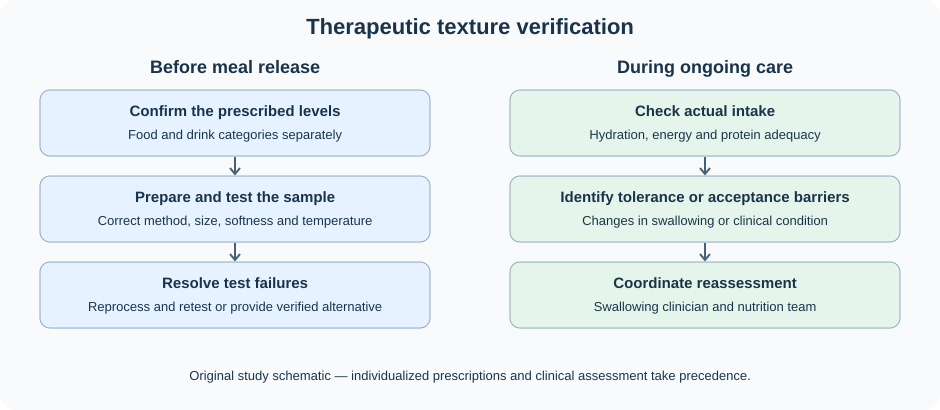

# GI, liver and texture-modified therapeutic diets

**Status:** Advance-preparation candidate. Specialist clinical, current IDDSI definitions and rendered publication review pending.

## Gastrointestinal diets

GI disease mein food modification ka goal symptoms reduce karna aur nutritional adequacy maintain karna hai. Coeliac disease mein wheat, barley aur rye ke gluten se immune-mediated intestinal injury ho sakti hai. Confirmed coeliac disease mein lifelong gluten-free pattern required hota hai even when symptoms absent hon. Suspected disease mein diagnostic testing se pehle gluten restriction shuru karne se test accuracy affect ho sakti hai, isliye diagnostic plan clinician se discuss karein. Naturally gluten-free rice aur other appropriate grains use ho sakte hain but cross-contact avoid karna important hai. Oats ka verified gluten-free source aur tolerance assess karein. Fibre, iron, calcium and overall nutrient quality monitor karein.

Gastroparesis mein stomach emptying slow hoti hai. Large meals, excess fat aur coarse high-fibre food some patients mein tolerance reduce kar sakte hain. Smaller frequent meals, appropriate low-fat or low-fibre modifications and liquid or small-particle nutrition clinician guide kar sakta hai. Adequate fluid aur nutrient intake monitor karein. Persistent vomiting aur poor intake medical assessment demand karte hain.

Dumping syndrome mein gastric surgery ke baad nutrients intestine mein rapidly enter kar sakte hain. Meal size aur concentrated simple sugar load symptoms affect kar sakte hain. Small frequent meals, clinician-guided complex carbohydrates and protein, aur fluids between meals when advised help kar sakte hain. Hydration maintain karna essential hai. GERD mein nocturnal symptoms ke liye approximately three-hour meal-to-lying interval useful ho sakta hai. Personal symptom triggers identify karein rather than every possible food unnecessarily remove karna.

Uncomplicated acute diarrhoea mein appetite return hone par normal tolerated food resume karna often appropriate hai. Sugar alcohols jaise sorbitol poorly absorbed ho sakte hain aur osmotic water retention increase kar sakte hain. Hydration and danger signs separately assess karein. Stable diverticular disease mein nuts aur seeds ki universal lifelong avoidance generally necessary nahi. Acute episode aur chronic stable care differ karte hain. Patient-specific fibre advice follow karein.

## Liver and pancreatic nutrition

Cirrhosis mein reduced glycogen storage aur accelerated fasting response muscle protein breakdown contribute kar sakti hai. Long overnight fasting shorten karne ke liye late-evening snack clinician recommend kar sakta hai. Adequate daily energy aur protein intake important hai. Hepatic encephalopathy mein routine prolonged protein restriction avoid karne ka principle samjhein, but individual clinical plan always follow karein. Ascites meal volume limit kar sakti hai. Smaller nutrient-dense meals and snacks prescribed sodium and other restrictions ke andar plan kiye ja sakte hain. Agar sodium restriction ki wajah se intake markedly poor ho, liver team palatability, adequacy aur target reassess karti hai.

Exocrine pancreatic insufficiency mein pancreatic enzymes ki inadequate supply digestion compromise karti hai. Prescribed pancreatic enzyme replacement meal aur snack ke saath coordinate hota hai, product instructions ke according. Symptoms, weight and micronutrient risks follow-up mein assess karein. Unsupervised dose changes or extreme fat restriction avoid karein.

## Texture-modified diets and IDDSI testing

Dysphagia diet mein food texture aur drink thickness prescribed swallowing assessment se decide hoti hain. IDDSI framework numbered categories use karta hai: drinks level 0–4 aur foods level 3–7. Same number ka food and drink descriptor different ho sakta hai. Patient ka exact order verify karein. Kitchen testing food properties batata hai, patient ke swallow function ko directly test nahi karta.

Reference flow test compatible 10-mL syringe par zero to 10-mL markings ka distance 61.5 mm check karta hai. Gravity flow ko 10 seconds par stop karte hain aur remaining amount read karte hain. For non-boundary examples, 0.5 mL remaining thin level 0, 6 mL level 2 mildly thick, aur 9 mL with some flow level 3 moderately thick support karte hain. Level 1 slightly thick intermediate range hai. No flow alone level 4 compliance confirm nahi karta. Lumps ya obstruction check karein aur appropriate fork-drip or spoon-tilt test use karein. Intended serving temperature, preparation time aur homogeneity relevant hain.

Pureed food cohesive but excessively sticky nahi honi chahiye. Adult Level 5 Minced and Moist mein particle width about 4 mm benchmark hai. Adult Level 6 Soft and Bite-Sized mein pieces approximately 1.5 by 1.5 cm maximum size hone chahiye and adequate softness meet karni chahiye. Level 7 Easy to Chew same fixed particle-size limit nahi rakhta, isliye prescribed Level 6 ka automatic substitute nahi. Fork pressure test physical deformation assess karta hai. Correct size but hard texture fails relevant requirements. Separated thin liquid mixed consistency concern create kar sakti hai. Transitional foods moisture or temperature se texture change karte hain. Frozen dessert melt hone par final liquid consistency patient ke prescribed level se compare karni chahiye.

Texture compliance ke saath hydration, protein and energy adequacy bhi monitor karein. Thickened drinks poorly accepted hon toh suitable verified alternatives aur swallowing team reassessment arrange karein. Unsupervised dilution ya independent prescription change unsafe ho sakta hai. Current IDDSI site indexes detailed definitions v2.2 and testing methods v2.0. Testing methods text accessible tha but latest definitions direct access and visual review pending hain. Local protocols and trained swallowing clinician decision take precedence.

## Practice

- [GI and liver therapeutic diets](../MCQs/04D-Gastrointestinal-and-Liver-Therapeutic-Diets-20-MCQs.md)
- [Texture-modified diets and IDDSI testing](../MCQs/04E-Texture-Modified-Diets-and-IDDSI-20-MCQs.md)

## References

[NIDDK coeliac disease](https://www.niddk.nih.gov/health-information/digestive-diseases/celiac-disease/eating-diet-nutrition) · [Gastroparesis](https://www.niddk.nih.gov/health-information/digestive-diseases/gastroparesis/eating-diet-nutrition) · [Dumping syndrome](https://www.niddk.nih.gov/health-information/digestive-diseases/dumping-syndrome/eating-diet-nutrition) · [Diarrhoea](https://www.niddk.nih.gov/health-information/digestive-diseases/diarrhea/eating-diet-nutrition) · [Diverticular disease](https://www.niddk.nih.gov/health-information/digestive-diseases/diverticulosis-diverticulitis/eating-diet-nutrition) · [PERT](https://www.niddk.nih.gov/health-information/digestive-diseases/exocrine-pancreatic-insufficiency/treatment) · [ACG liver nutrition](https://pmc.ncbi.nlm.nih.gov/articles/PMC12191863/) · [ESPEN liver guideline](https://pmc.ncbi.nlm.nih.gov/articles/PMC6686849/) · [IDDSI current documents](https://www.iddsi.org/resources/framework-documents) · [IDDSI testing methods](https://www.iddsi.org/images/Publications-Resources/DetailedDefnTestMethods/English/V2TestingMethodsEnglish31july2019.pdf). IDDSI terms attributed to the International Dysphagia Diet Standardisation Initiative. Original commentary and diagrams, not reproduction of its framework poster. Extracted testing-method PDF text reviewed, screenshots cache miss. Specialist review pending.
