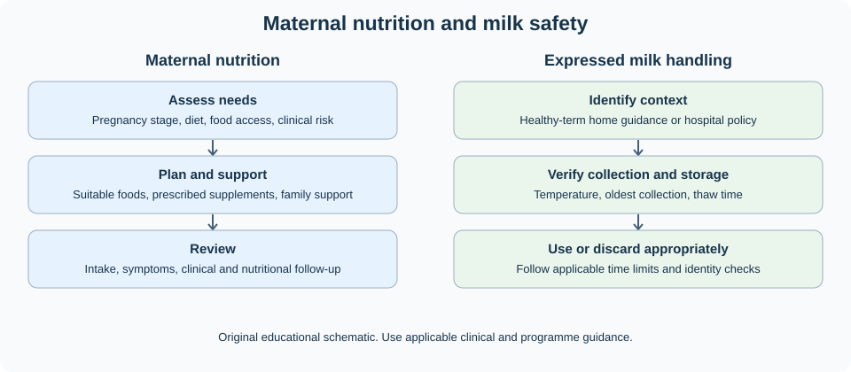

# Pregnancy, lactation and human milk nutrition

**Status:** Draft candidate study notes. Independent clinical, India-specific protocol and publication review pending.

## Pregnancy nutrition

Pregnancy mein fetus, placenta aur maternal tissues develop karte hain, isliye nutrient needs change hoti hain. Lekin eating for two ka meaning har meal double karna nahi hai. Starting BMI, gestational stage, singleton ya multiple pregnancy, food access aur current health ko saath mein assess karna chahiye. Gestational weight gain ko serially review karein. Sudden weight gain aur oedema ko sirf extra calories ka result assume na karein, kyunki clinical complications bhi ho sakti hain.

Undernourished populations mein WHO balanced energy-protein supplementation recommend karti hai. Is definition mein supplement ki total energy ka less than 25% protein se aata hai. Example: 400 kcal supplement with 20 g protein gives 80 kcal from protein. 80 divided by 400 times 100 equals 20%. Yeh composition calculation hai, universal prescription nahi. High-protein supplementation ko balanced supplementation ka equivalent na samjhein. Local Anganwadi and maternal health programme access aur individualized counselling practical barriers address kar sakte hain.

Nausea ke dauran smaller frequent tolerated meals helpful ho sakte hain. Agar fluid bhi retain na ho, urine markedly kam ho ya dizziness ho, toh urgent clinical assessment important hai. Heartburn mein individual triggers aur meal timing review karein. Constipation mein fibre, fluids, activity, medicines and warning signs assess karein. Pregnancy mein dieting for weight loss ya blanket food restrictions suitable default nahi hain.

Safe food choices fetal health ke liye important hain. Cooked lower-mercury fish suitable local advice ke according nutritious choice ho sakti hai. Unpasteurized foods se Listeria concern aur undercooked meat se toxoplasmosis exposure ho sakta hai. Alcohol ka safe pregnancy amount established nahi hai. Caffeine total all beverages and other sources se calculate karein, actual maternity guidance follow karein. For a hypothetical 200 mg limit, 80 mg plus 110 mg intake leaves 10 mg. Yeh example individual prescription nahi.

Iron, calcium aur folic acid maternal nutrition mein important hain, but dose, duration and timing programme and clinical situation par depend karte hain. Prescribed iron and calcium ki timing separate karne ki advice ho sakti hai. Persistent anaemia prophylaxis ke bawajood ho toh cause, severity, adherence and treatment pathway assess karein. Clay ya soil ingestion pica ka concern raise kar sakta hai. Respectful assessment mein toxic exposure aur nutritional status consider karein. Vegan diet, bariatric surgery aur multiple pregnancy mein broader nutrient assessment and specialist follow-up useful hai.

## Lactation nutrition

Milk production ki intensity, maternal activity and nutritional status additional needs determine karte hain. Maternal diet ka effect milk ke sab nutrients par identical nahi hota. Evidence suggests maternal omega-3 intake milk DHA and EPA concentrations affect kar sakta hai. Iodine concentration bhi maternal status se influenced ho sakti hai. CDC US reference lactating women ke liye choline 550 mg/day aur iodine 290 micrograms/day describe karta hai. Yeh named US reference values hain, Indian individual supplement doses nahi. Choline cell membrane phospholipids and acetylcholine synthesis mein involved hai.

Maternal B12 inadequacy infant nutrition affect kar sakti hai, particularly restrictive diets mein. Infant with developmental or feeding concerns needs prompt assessment, sirf maternal diet advice se wait nahi karna chahiye. Breast milk alone generally infant vitamin D need fully cover nahi karti. Infant-specific supplementation advice follow karein, maternal high-dose alternative only clinician review se. Caffeine milk mein transfer ho sakti hai, especially young infant symptoms ke context mein total maternal intake review karein.

Breastfeeding mothers ko routine broad food restrictions generally zaroori nahi. Adequate diet, hydration and household food access important hain. Excess water force karne se milk production guaranteed increase nahi hoti. Herbal milk-promoting products effective milk removal aur adequate meals ka substitute nahi. Postpartum blood loss ke baad anaemia severity and treatment plan review karein. Family meal allocation, food security aur maternal preferences nonjudgmentally discuss karein.

## Expressed human milk: context-specific storage

CDC healthy-term home guidance mein fresh milk refrigerator at 4°C or colder mein generally up to four days, completely thawed milk refrigerator mein 24 hours, aur infant ke offered bottle ka leftover feed finish hone ke two hours within use kiya jata hai. Frozen ice packs ke saath insulated cooler transport up to 24 hours described hai. Warmer ambient temperatures, poor handling, premature or hospitalized infant policies may require more restrictive limits. NICU policy ko home guidance se replace na karein.

Fresh warm milk ko older chilled milk se mix karne se pehle cool karein. Combined batch ke liye older collection time consider karein. Complete thaw time se 24-hour refrigerated clock start hoti hai. Microwave heating uneven hot spots create kar sakti hai. Label collection date and child identity when appropriate, oldest suitable milk first use karein. Storage history unclear ho toh current safety protocol follow karein.

## Practice

- [Pregnancy nutrition](../MCQs/05A-Pregnancy-Nutrition-20-MCQs.md)
- [Lactation nutrition and human milk](../MCQs/05B-Lactation-Nutrition-and-Human-Milk-20-MCQs.md)

## References and limits

[WHO balanced energy-protein supplementation](https://www.who.int/tools/elena/interventions/energy-protein-pregnancy) · [RCOG pregnancy nutrition](https://www.rcog.org.uk/for-the-public/browse-our-patient-information/healthy-eating-and-vitamin-supplements-in-pregnancy/) · [ICMR-NIN DGI 2024](https://www.nin.res.in/dietaryguidelines/pdfjs/locale/DGI24thJune2024fin.pdf) · [CDC maternal diet](https://www.cdc.gov/breastfeeding-special-circumstances/hcp/diet-micronutrients/maternal-diet.html) · [CDC infant vitamin D](https://www.cdc.gov/breastfeeding-special-circumstances/hcp/diet-micronutrients/vitamin-d.html) · [CDC milk storage](https://www.cdc.gov/breastfeeding/breast-milk-preparation-and-storage/handling-breastmilk.html) · [CDC storage FAQ](https://www.cdc.gov/breastfeeding/php/guidelines-recommendations/faqs.html) · [Maternal intake and milk composition review](https://pubmed.ncbi.nlm.nih.gov/38053371/). Direct WHO, RCOG and CDC HTML retrieved. NIN PDF text retrieved, screenshot cache miss. Systematic review indexed abstract, direct CAPTCHA. India-specific clinical and neonatal policy, independent clinical and item-level audit remain pending.
