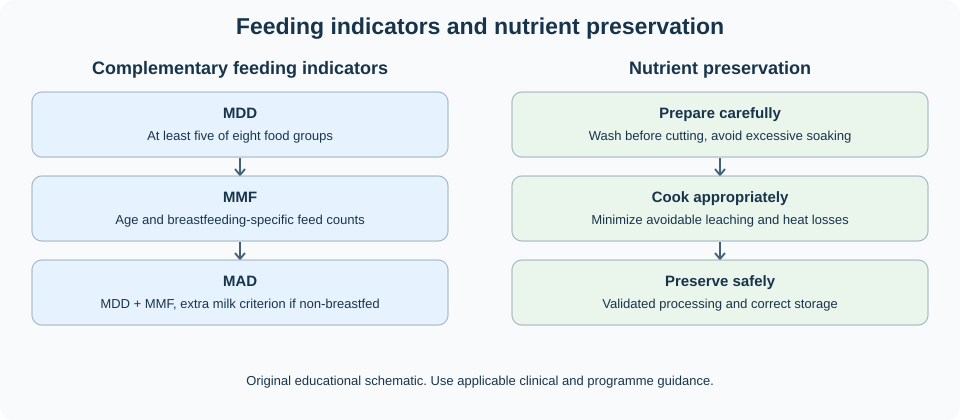

# Complementary feeding, adolescent nutrition and nutrient preservation

**Status:** Draft candidate study notes. Independent clinical, food science, regulatory and publication review pending.

## Complementary feeding

WHO 2023 recommends starting complementary foods at six months (180 days) while breastfeeding continues to two years or beyond. Breast milk continues to contribute nutrients while appropriate solid, semisolid and soft foods meet increasing needs. Weaning ka matlab six months par automatically breastfeeding stop karna nahi hai. Safe feeding readiness mein head control, posture and oral skills assess karein. Child ko age-appropriate texture gradually offer karein. Hunger cues par food offer karein aur fullness cues par pause karein. New foods gently reoffer kar sakte hain. Force feeding avoid karein. Severe eczema ya allergy concerns mein specific introduction advice clinician se lein.

Honey under 12 months avoid karein because infant botulism risk ho sakta hai. WHO sugary beverages, high-sugar/salt/trans-fat foods and non-sugar sweeteners avoid karne ko kehti hai. Suitable nutrient-rich foods and safe water use karein. Daily animal-source foods where feasible and safe, fruits, vegetables, pulses and other suitable foods diversity support karte hain. Context-specific fortified foods or micronutrient powder normal varied diet replace nahi karte. WHO ordinary follow-up formulas 12–23 months mein routinely recommend nahi karti for children receiving milk other than breast milk. Special medical indications and applicable local guidance separately consider karein.

### Population monitoring indicators

MDD, MMF and MAD survey indicators hain, individual diagnosis ya full nutrient adequacy guarantee nahi.

- Minimum dietary diversity (MDD): previous day at least five of eight defined food groups. Groups: breast milk, grains/roots/tubers/plantains, pulses/nuts/seeds, dairy, flesh foods, eggs, vitamin-A-rich fruits/vegetables, and other fruits/vegetables. For example breast milk, rice, dal, egg and vitamin-A-rich pumpkin represent five groups.
- Minimum meal frequency (MMF): breastfed 6–8 months at least two solid/semisolid/soft feeds, breastfed 9–23 months at least three. Nonbreastfed 6–23 months at least four feeds including milk, but at least one must be solid/semisolid/soft. Four milk feeds alone fail this condition.
- Minimum acceptable diet (MAD): breastfed children meet MDD and MMF. Nonbreastfed children meet MDD and MMF and receive at least two milk feeds during the reference day.

Agar 120 eligible children mein 84 meet MDD, observed proportion 84/120 times 100 equals 70%. Sampling and valid denominators population interpretation guide karte hain. Illness recovery mein additional suitable feeding opportunities and follow-up growth assessment useful ho sakte hain.

## Adolescent nutrition

WHO adolescence 10–19 years define karti hai. Growth spurt, pubertal stage, menstruation, activity and food access ke hisaab se nutrition needs differ karte hain. Adequate calcium and vitamin D skeletal mineral accrual support karte hain. Heavy menstrual bleeding with fatigue mein iron status and bleeding cause clinically assess karein. WHO 5–19 BMI-for-age reference thinness below −2 SD, severe thinness below −3 SD, overweight above +1 SD and obesity above +2 SD define karta hai. Reference age and sex specific hai, adult cutoffs automatically use nahi karne chahiye.

Indian WIFS programme school-going adolescent girls and boys aur out-of-school adolescent girls ko include karta hai. Supervised IFA, deworming, counselling and referral programme components hain. Older NHM WIFS page 100 mg elemental iron list karti hai, whereas 2018 AMB adolescent prophylaxis table 60 mg elemental iron lists. These are different named documents, not doses to combine. Current state and national implementation verify karein. Suspected moderate/severe anaemia requires appropriate clinical assessment rather than prophylaxis only. Distributed tablets versus actually consumed doses separate indicators hain.

Intensively training adolescents mein low energy availability bone health, endocrine function and performance affect kar sakti hai. Relative energy deficiency in sport athletes of any sex mein possible hai. Recurrent stress injuries, menstrual disruption or declining performance deserve clinical assessment. Energy drinks sleep and balanced meals ka replacement nahi. Social-media body pressures and restrictive eating symptoms nonjudgmentally assess karein. Nutrition programmes mein adolescent participation, affordable food and water access aur out-of-school outreach important hain.

## Cookery and preservation of nutrients

Food prepare karte waqt hygiene aur nutrition retention both important hain. Produce potable water se wash before cutting, unnecessary repeated washing or prolonged soaking avoid karein. Cut surfaces oxidation exposure increase karti hain. Steaming direct water contact reduce karke water-soluble nutrient leaching limit kar sakti hai, though some heat losses possible hain. Properly cooked pulses ka suitable cooking liquid retain karna folate losses reduce kar sakta hai unless a clinical or safety reason requires discarding. Agar raw batch 60 mg vitamin C aur corresponding cooked batch 45 mg contain kare, retention 45/60 times 100 equals 75%. Concentration per 100 g alone moisture change ki wajah se misleading ho sakti hai.

Preservation methods microbial growth and deterioration control karte hain. Blanching before some validated freezing processes enzyme activity reduce karti hai. Pasteurization controlled heat se target organisms reduce karti hai, all spores destroy karna guaranteed nahi. Freezing microorganisms necessarily kill nahi karti. Drying and dissolved sugar available water decrease kar sakte hain. Fermentation acidification se susceptible organisms inhibit kar sakti hai. Freeze-drying ice sublimation use karti hai. Approved irradiation food radioactive nahi banati. Low-acid sealed foods improperly processed hon toh botulism serious concern ho sakta hai. Always use validated procedures, not improvised recipes. Repeated high-temperature oil exposure degradation products create kar sakti hai.

## Indian food standards

Food Safety and Standards Act 2006 consolidated food safety legislation hai. Section 97 and Second Schedule older PFA Act repeal framework contain karte hain. FSSAI science-based food standards and regulatory oversight mein statutory role rakhti hai, states enforcement mein participate karte hain. Permitted food additive authorized purpose and applicable limits ke andar use ho sakta hai. Natural origin automatic legal permission nahi. Rapid adulteration screening abnormal ho toh validated laboratory and official procedures se confirmation seek karein. +F logo regulated fortified food identification se related hai, complete dietary adequacy ya allergen-free guarantee nahi. Current amendments and applicable commodity standards verify karein before regulatory decisions.

## Practice

- [Complementary feeding](../MCQs/05C-Complementary-Feeding-and-Weaning-20-MCQs.md)
- [Adolescent nutrition](../MCQs/05D-Adolescent-Nutrition-20-MCQs.md)
- [Cookery and food standards](../MCQs/05E-Nutrient-Preservation-and-Food-Standards-20-MCQs.md)

## References and limits

[WHO 2023 complementary feeding](https://www.ncbi.nlm.nih.gov/books/NBK596423/) · [MDD](https://www.who.int/data/gho/data/indicators/indicator-details/GHO/minimum-dietary-diversity-6-23-months) · [MMF](https://www.who.int/data/gho/data/indicators/indicator-details/GHO/minimum-meal-frequency-6-23-months) · [MAD](https://www.who.int/data/gho/data/indicators/indicator-details/GHO/minimum-acceptable-diet-6-23-months) · [WHO adolescent nutrition](https://www.who.int/publications/i/item/9789241513708) · [WHO BMI-for-age](https://www.who.int/tools/growth-reference-data-for-5to19-years/indicators/bmi-for-age) · [NHM WIFS](https://nhm.gov.in/guidelines/index1.php?lang=1&level=3&lid=388&sublinkid=1024) · [AMB 2018](https://nhm.gov.in/images/pdf/Nutrition/AMB-guidelines/Anemia-Mukt-Bharat-Operational-Guidelines-FINAL.pdf) · [ICMR-NIN DGI](https://www.nin.res.in/dietaryguidelines/pdfjs/locale/DGI24thJune2024fin.pdf) · [FAO preservation](https://www.fao.org/4/x0209e/x0209e06.htm) · [CDC irradiation](https://www.cdc.gov/radiation-health/food-irradiation/) · [FSS Act](https://www.indiacode.nic.in/bitstream/123456789/2027/1/AFOOD.pdf) · [FSSAI fortification](https://southregion.fssai.gov.in/Food-Fortification.php). WHO indicator pages, BMI cutoffs, WIFS, FAO, CDC irradiation direct HTML. AMB and FSSAI regulatory details indexed, NIN and Act extracted PDF text retrieved but screenshots cache miss. Current regulatory amendments, clinical and local programme protocols remain pending.
