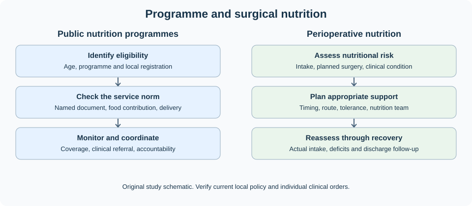

# National nutrition programmes and perioperative nutrition

**Status:** Unattempted isolated candidate study notes. Independent clinical and current programme verification pending.

## National nutrition programmes: exam context and nurse's role

India mein nutrition programmes ka objective sirf food distribution nahi hai. Food access, growth monitoring, micronutrient deficiencies, clinical referral, education and programme accountability saath mein important hain. Anganwadi supplementary nutrition and school meals different target groups cover karte hain. Programme ration ko total daily nutrient requirement ya clinical therapeutic feeding prescription mat samjho.

### Saksham Anganwadi and Poshan 2.0

Ministry of Women and Child Development ke 2022 operational guidelines supplementary food, early childhood care, Anganwadi infrastructure and nutrition outreach ko ek integrated framework mein address karte hain. Registered young children, pregnant and lactating mothers, and specified adolescent girls benefit groups mein hain. Named 2022 document mein ordinary child aged 6–72 months ka supplementary norm 500 kcal and 12–15 g protein, severe malnutrition category 800 kcal and 20–25 g, and pregnant/nursing mothers and specified adolescent girls 600 kcal and 18–20 g listed hai. Table itself notes revision is anticipated, so current notified norms and local implementation verify karna essential hai. These are additional food norms, not individualized therapeutic prescriptions.

Younger registered children generally take-home ration receive karte hain, while age 3–6 years standard category cooked meal plus morning snack receive karti hai. The document allows appropriate implementation alternatives. Nutrition service days at least 300 per calendar year listed hain. Specified adolescent girl component 14–18 years in Aspirational Districts and North Eastern Region describe karta hai. Poshan Tracker registration and service monitoring mein help karta hai. Nurse growth deterioration, clinical warning signs and service gaps detect karke health team referral coordinate kare.

### PM POSHAN and national micronutrient programmes

PM POSHAN school meal programme ka focus classroom hunger reduce karna, school participation and supplementary nutrition support karna hai. Published 2022 guidelines and NFSA Schedule II ke named meal norms primary class 450 kcal and 12 g protein, upper primary 700 kcal and 20 g protein hain. Raw food grain norm respectively 100 g and 150 g per child per meal day hai. Example: 80 upper-primary students times 150 g equals 12 kg grain. These are programme procurement and meal contribution figures, not total daily requirements. Actual food quality, attendance, delivery, acceptance, and accountable records all matter. Social audit community participation and transparency support karta hai.

NHM vitamin A prophylaxis programme 9–59 months age group describe karta hai. Routine age-based programme aur clinical deficiency treatment different contexts hain. Anaemia Mukt Bharat 6×6×6 approach includes prophylactic IFA, periodic deworming, communication, haemoglobin testing and appropriate management, fortified foods, and non-nutritional causes of anaemia. Every anaemia iron deficiency nahi hoti. WIFS dose-source discrepancy earlier 05D bank mein explicitly discussed hai. Current local protocols verify karein. NIDDCP surveys, supply and periodic laboratory monitoring se iodine deficiency prevention evaluate karta hai. Household salt coverage and urinary iodine population indicators are separately covered in 02C. Nurse surveillance, counselling, appropriate referral and follow-up coordinate kare.

ICMR-NIN nutrition research and dietary guidance, CSIR-CFTRI food science/processing research, FAO food/agriculture and hunger reduction, and UNICEF maternal-child nutrition support ke distinct roles hain. FSSAI food regulatory standards ke liye relevant body hai, not same as research institutions. Keep agency roles separate in exam preparation.

## Hospital and perioperative nutrition

Hospital food medical care ka component hai. Standard diet generally lower-risk patients ke liye appropriate ho sakti hai. ESPEN hospital nutrition 2021 R13 recommends reviewing this indication after three to five days. R14 moderate/high-risk or malnourished inpatients ke liye protein-energy enriched hospital diet describes when oral feeding appropriate ho. Therapeutic diet medically indicated honi chahiye. Unnecessary restrictions can reduce intake. Clinical goals, actual consumption, allergy communication, acceptable food and appropriate energy/protein provision assess karein. Clear liquids prolonged use mein usually complete nutrition nahi provide karti.

Major surgery se pehle nutritional risk assess karein. ESPEN 2025 R20 severe malnutrition or high risk mein preoperative nutrition optimization, possibly 10–14 days and surgical delay, consider karta hai. Urgency and actual timing surgeon and clinical nutrition team decide karte hain. If oral/enteral route unsuitable in this selected high-risk setting, PN can be indicated. Low-risk elective anaesthesia clear-liquid timing recommendation two hours before start of anaesthesia hai, but always follow authorized anaesthesia plan and special aspiration-risk precautions. Selected carbohydrate loading surgical insulin resistance and comfort support kar sakti hai. Suspected gastroparesis and severe diabetes require review, not blanket loading.

Postoperatively stable, conscious patients mein approved oral or enteral feeding early resume karna often useful hai. Prolonged oral inability or insufficient intake warrants early nutritional therapy. ESPEN 2025 R9 expected inability for at least five days or intake below half the energy target for more than seven days identifies need for therapy. R28 early EN within 24 hours targets appropriate patients with inadequate or unavailable oral intake. R10 persistent less-than-half combined intake within three to four days can warrant supplemental PN assessment. These are named guideline recommendations, not universal orders. Refeeding risk, surgical anatomy, bowel function and instability can change route and pace.

Selected major tumour surgery patients may receive immunonutrition containing arginine, omega-3 fatty acids and nucleotides. ESPEN R25 GI cancer preoperative context describes a five-to-seven-day course. Product and indication must be specialist-approved. Discharge ke baad nutritional deficit persist ho toh follow-up and supplementation arrangements needed hain.

## Sources and practice

[National programmes MCQs](../MCQs/06A-National-Nutrition-Programmes-and-Agencies-20-MCQs.md) · [Hospital and perioperative MCQs](../MCQs/06B-Hospital-and-Perioperative-Nutrition-20-MCQs.md)

[MWCD 2022 Poshan 2.0 guidelines](https://wcd.gov.in/documents/uploaded/Mission%20Saksham%20Anganwadi%20and%20Poshan%202.0%20scheme%20guidelines.pdf?v=1) · [PM POSHAN guidelines](https://pmposhan.education.gov.in/Files/Guidelines/2023/Guidelines%20on%20PM%20POSHAN%20SCHEME.pdf) · [NHM nutrition](https://nhm.gov.in/nhm/about-nhm/index1.php?lang=1&level=2&lid=796&sublinkid=1446) · [ICMR-NIN](https://www.nin.res.in/aboutus.html) · [CFTRI](https://www.cftri.res.in/profile/index.php/csir) · [FAO](https://www.fao.org/about/about-fao) · [UNICEF India](https://www.unicef.org/india/reports/nutrition-children) · [ESPEN surgery 2025](https://aspen.espen.org/files/ESPEN-Guidelines/ESPEN-guideline-on-clinical-nutrition-in-surgery-Update-2025.pdf) · [ESPEN hospital nutrition 2021](https://15.espen.org/files/ESPEN-Guidelines/ESPEN_guideline_on_hospital_nutrition.pdf). Programme and ESPEN PDF text retrieved. PM POSHAN beneficiary screenshot viewed, other screenshots failed. Agency and NHM pages indexed. No independent clinical certification or exact video timestamps. [National nutritional programme teaching lead](https://www.youtube.com/watch?v=nvrk7Z9XRdI), title/description indexed only, not verified question practice.
