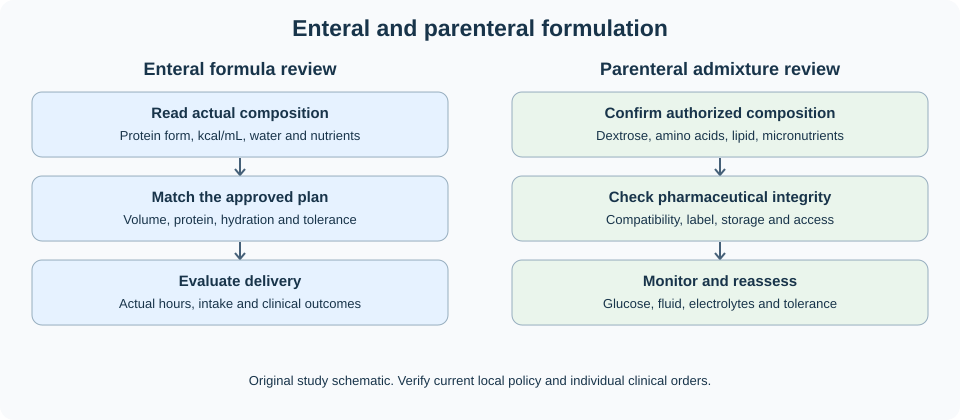

# Enteral and parenteral nutrition formulation

**Status:** Isolated study candidate. Educational arithmetic assumes hypothetical authorized orders. It is not clinical dosing or compounding instruction.

## Enteral formulation selection

Enteral nutrition mein patient ko nutrients gastrointestinal tract ke through milte hain. Jab oral intake adequate nahi hai lekin GI tract use karna clinically suitable hai, tab specialist team enteral nutrition consider kar sakti hai. Formula patient ki needs, digestion, fluid balance, tolerance aur actual product composition ke hisaab se select hoti hai.

| Formula | Protein source aur clinical difference |
|---|---|
| Polymeric | Intact protein hota hai. Suitable digestive function wale patient mein standard commercial formula use ho sakti hai. |
| Semi-elemental | Protein partially hydrolysed hota hai. Chhote peptides ke form mein nitrogen milta hai. Specific digestive problems mein team is option ko consider kar sakti hai. |
| Elemental | Free amino acids nitrogen source hote hain. Har patient ko elemental formula ki zaroorat nahi hoti. |
| Modular supplement | Ek selected nutrient, jaise protein, provide karta hai. Isse complete balanced formula automatically nahi banti. Product ke calories, nutrient type aur preparation instructions bhi check karne hote hain. |

MCT-containing products selected maldigestion contexts mein relevant ho sakte hain, lekin MCT alone essential fatty acid needs poori nahi karta. Modified ya hydrolysed formula automatic better nahi hoti. Clinical indication aur tolerance assess karna zaroori hai.

### Energy, protein aur water calculations

Neeche calculations hypothetical authorized orders ko samajhne ke liye hain. Inhe new patient prescription na samjhein.

- Energy density 1.5 kcal/mL aur prescribed target 1500 kcal ho toh required theoretical volume 1500 ÷ 1.5 = 1000 mL hota hai.
- Agar formula mein 7 g protein per 100 mL hai toh 1000 mL se 70 g protein milta hai. Independent target 80 g ho toh 10 g ki kami hai. Sirf calorie target poora hona protein adequacy prove nahi karta. Team formula ya modular supplement review karegi, kyunki additional protein bhi energy contribute kar sakta hai.
- Same 1800 kcal ke liye 1.2 kcal/mL formula ka volume 1500 mL aur 1.8 kcal/mL formula ka volume 1000 mL hoga. Volume difference 500 mL hai, lekin water difference manufacturer ke actual water content se hi pata chalega.
- Agar label 82 mL water per 100 mL formula batata hai toh 1250 mL formula se 1250 × 0.82 = 1025 mL water milta hai. Total fluid balance mein oral intake, flushes, IV fluids aur losses bhi assess karte hain.
- Complete formula bhi stated minimum volume se kam deliver ho toh vitamins aur minerals ki kami ho sakti hai. Supplement independently add nahi karna chahiye. Team actual nutrient gap assess karti hai.

### Prescribed versus delivered intake

1200 mL ko 20 actual feeding hours mein deliver karne ke hypothetical constant-rate order ka result 60 mL/h hai. Agar feed 50 mL/h par 17 recorded hours chali aur energy density 1.2 kcal/mL thi, toh actual delivered volume 850 mL aur energy 1020 kcal hai. Nurse prescribed aur actual delivered quantity alag record karti hai. Unapproved dilution ya interrupted feeding actual nutrient delivery kam kar sakti hai. Product preparation instructions aur ordered delivery plan follow karna zaroori hai.

### Clinical selection aur safe handling

ESPEN HEN 2022 ke R43 mein stable home-enteral patients ke liye specialist direction mein standard commercial formula ka approach diya gaya hai. R41 constipation mein suitable fibre-containing formula support karta hai. Hydration, medicines aur bowel causes bhi assess hote hain. Suspected obstruction ya acute deterioration mein pehle appropriate clinical assessment zaroori hai. R42 selected diabetes patients mein modified carbohydrate aur unsaturated-fat profile consider karne ki conditional recommendation deta hai, mandatory product choice nahi. Medicines aur glucose monitoring ko feeding plan ke saath review karna hota hai.

Homemade blended feeds mein nutrient composition, viscosity, contamination aur tube blockage ka risk ho sakta hai. ESPEN R48–49 routine homemade blenderized HEN ko discourage karta hai. Patient ki cultural preferences discuss karein, commercial whole-food alternatives consider karein, aur exceptional use ke liye qualified team se specific justification aur validated plan lein.

Sealed ready-to-hang formula ko directly approved giving set se connect karne par closed-system handling possible hoti hai. Agar formula decant, reconstitute ya modify ki jaati hai toh open-system handling requirements apply hoti hain. HSE sections 3.3.9.5 aur 3.3.10 mein open feeding system mein modular units add karne ke against caution bhi hai. Isliye classification change ko admixture permission na samjhein. Team product-specific instructions, infection-control requirements aur suitable separate delivery ka option review kare. Nurse independently modular products add nahi karti. Fixed universal hang time assume na karein.

Actual nutrient intake, hydration, GI tolerance, nutritional status aur agreed clinical outcomes monitor karein. NICE CG32 1.7.3 ke according adequate oral intake established hone par enteral tube feeding stop ki ja sakti hai. Team ko sustained adequacy, swallowing safety aur clinical condition verify karni hoti hai. Ek single good meal sufficient evidence nahi hai.

### Enteral practice and evidence

[06C Enteral Nutrition Formulations MCQs](../MCQs/06C-Enteral-Nutrition-Formulations-20-MCQs.md)

- [ESPEN HEN 2022](https://www.espen.org/files/ESPEN-Guidelines/ESPEN_practical_guideline_Home_enteral_nutrition.pdf): retrieved recommendation text, printed p479 Figure 10 visually checked. R39, R41–43, R44–45 and R48–49 relevant.
- [HSE National Guideline on Adult Home Enteral Nutrition](https://assets.hse.ie/media/documents/ncr/National_Guideline_on_Adult_Home_Enteral_Nutrition.pdf): sections 3.3.9.5–3.3.10 retrieved, screenshot unavailable.
- [NICE CG32 recommendations](https://www.nice.org.uk/guidance/cg32/chapter/Recommendations) and [MSD enteral nutrition](https://www.msdmanuals.com/professional/nutritional-disorders/nutritional-support/enteral-nutrition): indexed content checked, direct HTML retrieval failed.
- [RegisteredNurseRN calculation practice](https://www.youtube.com/watch?v=CwfJ-sQ-xOQ): publisher description supports volume, feeding-time and dilution practice for Q9/Q17 at topic level. Exact item and playback pending.
- [Level Up RN enteral nutrition teaching and quiz](https://www.youtube.com/watch?v=Fj5hrFsUPQc): publisher description and chapter markers checked for general tube feeding and nursing care. Not certified for specific formulation questions. Other item-specific videos remain pending.

## Parenteral formulation and pharmaceutical safety

Parenteral nutrition (PN) ka matlab hai ki patient ko nutrients vein ke through diye jaate hain jab clinical team ko oral ya enteral route se zaroorat poori karna mumkin ya safe nahi lagta. Ismein dextrose se energy, amino acids se protein banane ke liye material aur lipid emulsion se energy aur essential fatty acids milte hain. Essential fatty acids woh fats hain jinhe body khud sufficient amount mein nahi bana sakti. Fluid, electrolytes, vitamins aur trace elements ki zaroorat bhi alag se assess ki jaati hai.

Three-in-one ya all-in-one (AIO) bag mein dextrose, amino acids aur lipid emulsion ek compatible final admixture mein hote hain. Ready-to-use multi-chamber product har patient ke liye automatically suitable nahi hota. Agar standard product se patient ki individual needs safely poori nahi ho rahi hain, toh nutrition team customized prescription consider karti hai. Pharmacy team formulation ki compatibility aur stability verify karti hai. Nurse current prescription aur patient identity ke saath label check karti hai.

### Exam arithmetic

Ye examples sirf calculation practice ke liye hain. Inse kisi patient ki dose ya safe rate prescribe nahi hota.

| Calculation | Samajhne ka tarika |
|---|---|
| IV dextrose energy | Question mein 3.4 kcal/g diya ho toh 180 g × 3.4 = 612 kcal milti hain. Oral carbohydrate ka 4 kcal/g factor yahan use mat karo. |
| Amino acid energy | Agar 4 kcal/g assume karte hain toh 80 g × 4 = 320 kcal hoti hain. Yeh energy total calorie calculation mein count hoti hai. |
| IV lipid energy | Agar specific product label 2 kcal/mL batata hai toh 250 mL × 2 = 500 kcal hoti hain. Har lipid product ka label alag se check karna hai. |
| Nonprotein energy | Dextrose aur lipid ki energy add karo. Amino acids ki energy total energy mein count hogi lekin nonprotein energy mein nahi. |
| Nitrogen estimate | Agar question 6.25 g protein-equivalent per gram nitrogen ka approximate factor deta hai toh 96 ÷ 6.25 = 15.36 g nitrogen hota hai. Actual PN product ka nitrogen content label se confirm karo. |

Glucose infusion rate (GIR) ka matlab hai ki patient ke har kg body weight ko har minute kitne mg glucose mil rahe hain. Formula mein dextrose grams ko 1000 se multiply karke mg banaate hain, phir body weight in kg aur infusion minutes ke product se divide karte hain. For example, 180 g dextrose, 60 kg weight aur 24 hours ke hypothetical order mein GIR = 180000 ÷ (60 × 1440) = 2.08 mg/kg/min. Agar same daily mass aadhe infusion time mein mile toh average during-infusion GIR double ho jaata hai. Yeh sirf arithmetic hai. Clinical tolerance aur safe infusion schedule qualified team decide karti hai.

### Formulation integrity

Calcium aur phosphate ko ek formulation mein rakhne par kuch conditions mein insoluble particles ban sakte hain. Isko precipitation kehte hain. Yeh particles vascular harm kar sakte hain. Isliye pharmacy team salt, pH, concentration aur poori admixture ki stability verify karti hai. Nurse independently bedside par additives ya medicines mix nahi karti.

Lipid emulsion mein fat droplets uniformly dispersed hone chahiye. Agar bag mein alag oil layer, oily droplets ya visible particles dikhein toh bag ko use na karo. Pharmacy ko batao aur authorized replacement ya disposal procedure follow karo. Sirf bag hilaane ya saline add karne se safety establish nahi hoti. Customized PN ki refrigerated transport conditions break hui hon toh exposure ka time aur temperature document karo, bag ko quarantine karo aur pharmacy assessment lo.

Patient-specific label se identity, ingredients ke amounts, storage aur infusion instructions verify karne mein madad milti hai. Label order checks ka substitute nahi hai. Peripheral PN mein vein irritation aur formulation compatibility important hain. NICE CG32 recommendation 1.8.9 selected short-term need (14 din se kam) aur separate central access indication na hone par peripheral route consider karti hai. Iske liye catheter, pH, tonicity aur compatibility bhi check karni hoti hain.

### Lipid tolerance, fluid balance and cyclic PN

Triglycerides blood mein circulate karne wale fats ka ek measured form hain. IV lipid dene par body ko us lipid ko metabolize aur clear karna hota hai. Agar triglycerides badh rahe hain toh nutrition team lipid product, rate, total dextrose aur energy delivery, medicines aur clinical condition review karti hai. Nurse timely escalation kare aur applicable product-specific hold ya stop protocol follow kare. Example ke liye Intralipid 20% ke retrieved adult label mein 400 mg/dL se upar infusion rokne ka instruction hai. Is cutoff ko har IV lipid product ya pediatric patient par automatically apply mat karo. Product label aur local policy verify karna zaroori hai.

Agar patient ki GI losses badh jaati hain toh fluid aur kuch electrolytes ki requirement change ho sakti hai. Iska matlab yeh nahi hai ki saare macronutrients double kar dene chahiye. Nurse losses, urine output, hydration aur laboratory trends document karti hai. Nutrition team PN aur separate replacement fluids ko individual assessment ke mutabik plan karti hai.

Cyclic PN mein infusion har din limited hours mein di jaati hai. Infusion khatam hote hi glucose delivery kam ho sakti hai jab insulin ka effect abhi reh raha ho. Isse kuch patients mein low blood glucose ho sakta hai. Agar hypoglycaemia ho toh approved treatment protocol follow karo aur team ko inform karo. Team prescribed taper aur glucose/insulin management reassess kar sakti hai. Nurse khud infusion rate ya insulin change nahi karti.

[Q1–8: PN calculations](../MCQs/06D-Parenteral-Nutrition-Formulations-20-MCQs.md#q1-a-hypothetical-pn-admixture-includes-180-g-of-intravenous-dextrose-using-34-kcal-per-gram-how-much-energy-does-this-component-provide) · [Q9–20: formulation decisions](../MCQs/06D-Parenteral-Nutrition-Formulations-20-MCQs.md)

**Clinical references:** [Saudi MOH adult PN 2024, sections 5.6.1–5.6.5](https://www.moh.gov.sa/en/Ministry/MediaCenter/Publications/Documents/CPG_Adult_PARENTERAL_NUTRITION_with_Appendix_Sept2024.pdf) (extracted text), [ESPEN HPN 2023, recommendations 43–59](https://www.espen.org/files/ESPEN-Guidelines/ESPEN_practical_guideline_Home_parenteral_nutrition.pdf) (extracted text), [NICE CG32 section 1.8](https://www.nice.org.uk/guidance/cg32/resources/guidance-nutrition-support-in-adults-pdf-975383198917) (extracted text), [DailyMed Intralipid 20% sections 2.2 and 5.7](https://dailymed.nlm.nih.gov/dailymed/drugInfo.cfm?setid=48c12fbe-c5e8-a1fc-e063-6294a90a15ae) (direct label retrieved), and [Parenteral Nutrition Overview](https://pmc.ncbi.nlm.nih.gov/articles/PMC9659055/) (indexed nitrogen-factor extract, direct retrieval blocked). The dedicated TPN MCQ video below is a title/description-level lead only. Specific question coverage and teaching video remain pending.

## Practice and evidence

[Enteral formulations](../MCQs/06C-Enteral-Nutrition-Formulations-20-MCQs.md) · [Parenteral formulations](../MCQs/06D-Parenteral-Nutrition-Formulations-20-MCQs.md)

[ESPEN HEN 2022](https://www.espen.org/files/ESPEN-Guidelines/ESPEN_practical_guideline_Home_enteral_nutrition.pdf) · [ESPEN HPN 2023](https://www.espen.org/files/ESPEN-Guidelines/ESPEN_practical_guideline_Home_parenteral_nutrition.pdf) · [NICE CG32](https://www.nice.org.uk/guidance/cg32/resources/guidance-nutrition-support-in-adults-pdf-975383198917) · [MSD Enteral Nutrition](https://www.msdmanuals.com/professional/nutritional-disorders/nutritional-support/enteral-nutrition?ruleredirectid=743autoredirectid%3D25240) · [PN energy factors](https://pmc.ncbi.nlm.nih.gov/articles/PMC3064749/) · [Dietitians Australia manual](https://member.dietitiansaustralia.org.au/Common/Uploaded%20files/DAA/Resource_Library/2020/DAA_Enteral_nutrition_manual_NSIG_2018.pdf). ESPEN and NICE PDF text retrieved. HPN management/indication screenshot viewed, HEN/NICE screenshot not usable. MSD and energy-factor references indexed. Product-specific and independent clinical pharmacy review pending. [VS Nursing Academy TPN MCQ session, Ritika Mam](https://www.youtube.com/watch?v=5qK9EhBaV0M) indexed title and description confirm dedicated practice, exact question mapping and playback not verified. No historical attribution.
