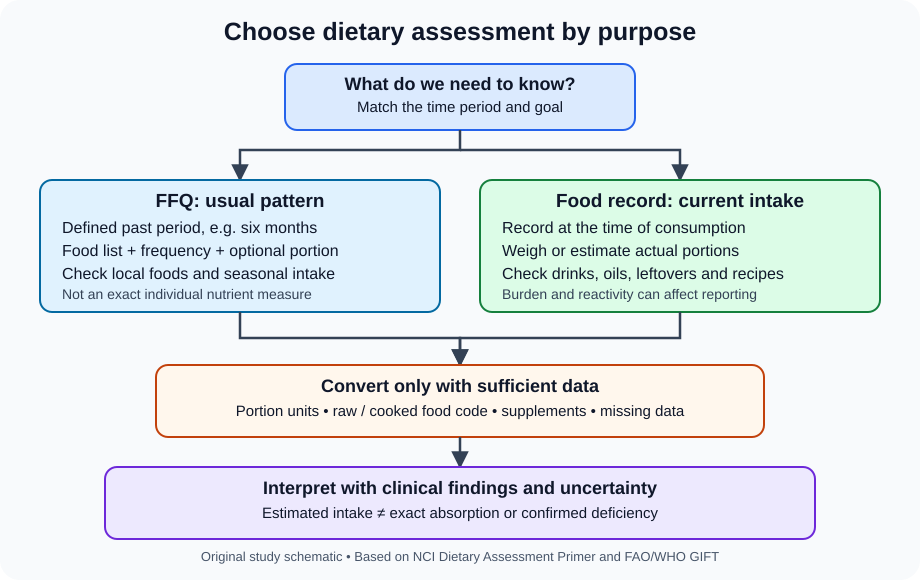

# Dietary assessment — food frequency questionnaires and food records

**Status:** Study-ready isolated draft. Yeh content nursing exam preparation ke liye hai, studied ya independently certified nahi hai.

[Chapter](../README.md) · [07A original MCQs](../MCQs/07A-Food-Frequency-Questionnaires-and-Dietary-Records-20-MCQs.md) · [Previous Year Questions](../Previous-Year-Questions/Nutrition-and-Dietetics-Past-Paper-Research-Register.md)

## Contents

- [Assessment ka purpose](#assessment-ka-purpose)
- [Food frequency questionnaire](#food-frequency-questionnaire)
- [Prospective food record](#prospective-food-record)
- [Worked calculations](#worked-calculations)
- [Common interpretation errors](#common-interpretation-errors)
- [Practice and evidence](#practice-and-evidence)

## Assessment ka purpose

Nutrition assessment mein nurse yeh samajhne ki koshish karti hai ki patient kya khata hai, kitni quantity mein khata hai, aur kya us intake se nutritional requirements poori ho rahi hain. Dietary intake assessment se risk ya possible nutrient gap identify ho sakta hai. Lekin actual deficiency diagnose karne ke liye clinical examination, anthropometry, relevant laboratory findings aur patient's medical history ko bhi dekhna padta hai.

Sabse pehle decide karo ki humein kya jaana hai. Agar long-term usual eating pattern chahiye, toh FFQ relevant ho sakti hai. Agar patient abhi kya aur kitna kha raha hai, yeh detail chahiye, toh food record useful ho sakta hai. Existing [screening and assessment bank 02E](../MCQs/02E-Nutritional-Screening-and-Assessment-20-MCQs.md) mein single 24-hour recall aur ward intake calculation already covered hain. Yahan prospective record aur long-term frequency methods ko alag se samjhenge.

Diagram mein pehle assessment purpose decide hota hai. Phir matching method choose karte hain. Dono methods se aayi information ko correct units, food description, nutrient composition aur uncertainty ke saath interpret karna hota hai.

## Food frequency questionnaire

Food frequency questionnaire (FFQ) ek structured dietary tool hai jismein specific foods ya drinks ki list hoti hai. Patient batata hai ki ek defined past period, jaise last six months, mein normally woh food kitni baar consume karta tha. Kuch FFQs sirf frequency leti hain, jabki semi-quantitative FFQ usual portion size ki information bhi collect kar sakti hai.

Socho do log week mein four times dal khate hain. Ek har baar chhoti katori aur doosra badi katori leta hai. Frequency same hai, lekin total grams different ho sakte hain. Agar form portion collect nahi karta, toh dono ka exact protein ya iron intake equal nahi maan sakte.

### Reference period aur regional food list

FFQ ka reference period assessment ke objective se match karna chahiye. Agar patient ne teen hafte pehle low-sodium diet start ki hai, toh previous twelve months ka FFQ mostly old pattern include kar sakta hai. Recent change evaluate karne ke liye current dietary record ya appropriate recent-period method zyada relevant ho sakta hai. Date of change document karna helpful hota hai.

Local food habits bhi matter karti hain. Kisi doosre region se li gayi list mein local fermented pulse dish ya seasonal fruit missing ho sakta hai. Agar consumed dish form mein available nahi hai toh intake underestimate ho sakti hai. Local food description, preparation aur usual portion ko appropriate item ke saath map karo. Adapted tool ko intended population ke liye review karwana chahiye.

Seasonal intake mein yeh poochna zaroori hai ki food kitne mahine available aur consumed hota hai. Sirf harvest season ki frequency ko poore saal ka daily pattern assume nahi karte. Agar objective sirf sugary drinks ki habit assess karna hai, toh brief beverage-frequency screener useful ho sakta hai. Us limited list se full diet ki nutrient adequacy calculate nahi karni chahiye.

### Frequency se quantity tak

Agar form frequency per week collect karta hai aur portion grams per occasion deta hai, toh pehle units consistent karo. Weekly frequency ko seven se divide karne par average daily occasions milte hain. Daily occasions ko grams per occasion se multiply karne par estimated grams/day milte hain. Relevant food-composition value ke saath estimated nutrient contribution nikala ja sakta hai.

Frequency aur serving ko double count mat karo. Agar ek tea occasion par do cups consume hote hain aur form occasions alag se record karta hai, toh usual cups per occasion ko frequency se multiply karte hain. Agar form already total cups record karta hai, toh dobara portion multiplier lagane ki zaroorat nahi hoti.

FFQ mein food categories ko bhi dhyan se code karna hai. Example ke liye agar questionnaire standalone dal aur mixed rice-pulse dishes ko mutually exclusive categories mein rakhta hai, toh ek khichdi meal ko dono entries mein count nahi karna chahiye. Participant se actual meal clarify karo aur instrument ki inclusion instructions follow karo. Agar nutrient calculation recipe ingredients ke basis par karte hain, toh poori dish ka nutrient total usi ingredient total mein dobara add mat karo. Confirmed duplicate ko hi correct karo, baaki genuine intake ko preserve karo.

## Prospective food record

Food record ya food diary mein person food consume karte samay ya uske turant baad uski details note karta hai. Isliye yeh prospective method hai. Twenty-four-hour recall mein person previous day ki intake memory se report karta hai. Food record ka advantage yeh hai ki amount, preparation aur actual intake real time document ki ja sakti hai. Lekin record complete karna time-consuming ho sakta hai aur person apni eating habits bhi badal sakta hai.

| Entry field | Nurse ko kyun chahiye |
|---|---|
| Food or beverage name | Actual item identify karne se correct nutrient code select hota hai. |
| Portion and unit | Gram, mL ya familiar household measure se quantity estimate kar sakte hain. |
| Preparation method | Raw, boiled, fried ya mixed dish ka nutrient profile different ho sakta hai. |
| Brand or package information | Same naam ke products mein serving size aur nutrient composition alag ho sakti hai. |
| Time and context | Actual meal pattern aur unusual illness day ko interpret karne mein help milti hai. |
| Recipe, additions and leftovers | Oil, sauces, drinks aur bache hue food ko include karne se consumed quantity ka better estimate milta hai. |
| Supplements | Product ka labelled nutrient amount aur actual frequency record karne se food aur supplement intake alag assess ho sakti hai. |

### Weighed versus estimated record

Weighed food record mein suitable scale se served aur leftover food ka weight record kiya ja sakta hai. Agar plate same hai aur kuch food spill, add ya share nahi hua, toh served aur remaining readings ka difference consumed weight batata hai. Agar ye assumptions satisfy nahi hoti hain toh actual amount clarify karna chahiye.

Estimated record mein katori, glass, spoon ya food photographs se portion estimate karte hain. Yeh practical ho sakta hai, lekin household measures ka gram equivalent food aur utensil ke hisaab se change ho sakta hai. Limited literacy wale patient ko agreed audio entry, supported recording ya familiar household measures ka option diya ja sakta hai. Trained review se unclear entries clarify hoti hain.

### Mixed dishes

Ghar ki khichdi, dal ya curry mein multiple ingredients ho sakte hain. Agar patient ne 180 g cooked dish khayi hai, toh uske andar har ingredient ki quantity estimate karne ke liye total cooked recipe weight aur original ingredients ki quantity chahiye. Cooking ke dauran water uptake ya evaporation se weight change ho sakta hai. Isliye raw food weight ko cooked food weight ke barabar assume nahi karna chahiye.

Recipe mein added oil bhi energy supply karta hai. Agar whole recipe ka oil pata hai toh actual consumed fraction ke hisaab se estimate kar sakte hain, where appropriate. Agar mixture homogeneous nahi hai ya person shared plate se kha raha hai, toh simple proportional allocation less accurate ho sakti hai. Uncertainty document karna zaroori hai.

## Worked calculations

Ye teaching examples hypothetical hain. Inse kisi patient ka required intake ya nutrient deficiency prescribe nahi hoti.

**Example 1 — FFQ frequency, portion and nutrient density (Q3).** Three occasions per week × 140 g per occasion = 420 g/week. Daily average = 420 ÷ 7 = 60 g/day. Agar given composition 80 mg per 100 g hai toh estimated contribution 60 × 80 ÷ 100 = 48 mg/day hota hai. Yeh reported food contribution hai, absorbed amount nahi.

**Example 2 — weighed intake (Q11).** Same plate par served food ke saath reading 460 g aur remaining food ke saath 290 g hai. Agar nothing was added, shared or spilled, toh consumed weight = 460 − 290 = 170 g. Plate weight dono mein common hone se cancel ho jaata hai.

**Example 3 — recipe portion (Q12).** Final homogeneous cooked dish 600 g hai aur raw lentils 60 g the. Patient 180 g cooked dish khaata hai. Portion fraction = 180 ÷ 600 = 0.30. Dry-lentil equivalent = 60 × 0.30 = 18 g. Yeh raw ingredient allocation hai, direct cooked lentil weight nahi. Nutrient values calculate karte waqt relevant preparation and retention information bhi chahiye ho sakti hai.

**Example 4 — weighted weekly pattern (Q17).** Five weekdays ke typical 1800 kcal/day aur two weekend days ke 2500 kcal/day ko given assumptions ke under combine karein. Weekly estimate = 9000 + 5000 = 14000 kcal. Seven se divide karne par 2000 kcal/day milta hai. Yeh estimated intake hai, prescribed energy target nahi.

## Common interpretation errors

- FFQ ki frequency ko exact grams mat samjho. Portion aur correct conversion ke bina precise intake estimate nahi milta.
- Cooked rice ke grams ko uncooked rice composition se directly multiply mat karo. Suitable database code ya appropriate yield calculation chahiye.
- Food diary ke day par illness hui ho toh actual record preserve karo aur context note karo. Agar goal habitual recovery intake hai toh representative days baad mein collect karo.
- Patient diary fill karne ke liye snack avoid kar sakta hai. Isse reactivity kehte hain. Record ke dauran altered behavior ko previous habitual intake ka exact measure mat samjho.
- Missing package size ya ingredient ko zero mat maan lo. Patient se clarify karo aur unresolved uncertainty record karo.
- Food se aayi nutrient quantity aur supplement contribution separately document karo. Total reported intake absorption ya diagnosis ka proof nahi hai.

**Exam clue:** FFQ usual pattern ke liye, food record current actual intake ke liye. Dono estimates mein bias ho sakta hai. Nurse method ko clinical objective aur patient ki ability ke hisaab se select karti hai.

## Practice and evidence

[Q1–9: FFQ method and interpretation](../MCQs/07A-Food-Frequency-Questionnaires-and-Dietary-Records-20-MCQs.md) · [Q10–20: food records and calculations](../MCQs/07A-Food-Frequency-Questionnaires-and-Dietary-Records-20-MCQs.md)

| Evidence | Verification |
|---|---|
| [NCI FFQ profile](https://epi.grants.cancer.gov/dietary-assessment-primer/profiles/questionnaire/) | Direct retrieved text. |
| [NCI Food Record profile](https://epi.grants.cancer.gov/dietary-assessment-primer/profiles/record/) | Direct retrieved text. |
| [NCI FFQ calculation method](https://epi.grants.cancer.gov/dietary-assessment-primer/learn/software.html) | Direct retrieved text on daily frequency, grams and food composition. |
| [NCI Measurement Error](https://epi.grants.cancer.gov/dietary-assessment-primer/concepts/error/) | Direct retrieved text. |
| [FAO/WHO GIFT recipes and data quality](https://www.fao.org/gift-individual-food-consumption/methodology/data-collation-harmonisation-and-sharing/) | Direct retrieved text on mixed dishes and missing data. |
| [INC gazette listing](https://www.indiannursingcouncil.org/gazette-notification) | Official listing retrieved. Linked full 2020 curriculum notification exceeded retrieval limit. [Indexed Unit XI reproduction](https://www.legitquest.com/act/indian-nursing-council-revised-regulations-and-curriculum-for-bsc-nursing-program-regulations-2020/CBD2) explicitly includes FFQ. Full official BSc, GNM and PB BSc depth review pending. |

**Teaching resources:** [MRC Dietary Assessment Videos](https://measurement-toolkit.org/dietary-assessment-videos) retrieved page lists FFQ and 24-hour recall teaching. [Nutritional Assessment — Methods for Assessing Food Consumption](https://www.youtube.com/watch?v=LjCNnCi7DT0) indexed description covers FFQ and diary, but channel, playback and exact teaching coverage remain pending.

**Dedicated MCQ practice:** Verification pending for Q1–20. Teaching videos are not counted as dedicated question-solving resources. No historic exam label or exact PYQ claim. Full independent review and rendered website verification remain outstanding.

[Practice MCQs](../MCQs/07A-Food-Frequency-Questionnaires-and-Dietary-Records-20-MCQs.md) · [Chapter](../README.md)
