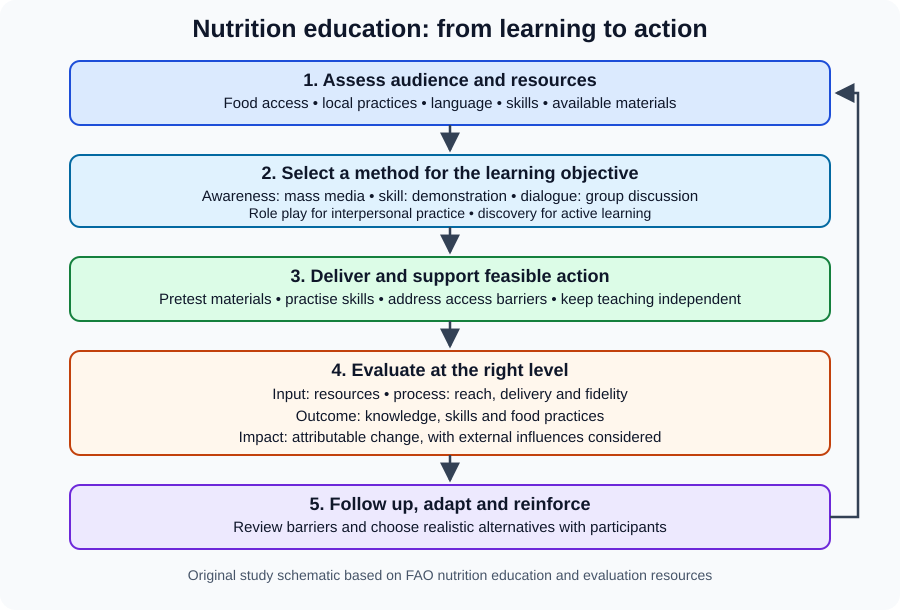

# Nutrition education and counselling

**Status:** Study-ready isolated candidate, unattempted. Independent clinical, semantic and curriculum-depth review pending. General education does not replace individualized therapeutic nutrition prescriptions.

[Chapter](../README.md) · [07B original MCQs](../MCQs/07B-Nutrition-Education-and-Counselling-20-MCQs.md)

## Purpose and principles

Nutrition education ka purpose sirf nutrients ke naam ya healthy foods ki list yaad karwana nahi hai. Patient aur community ko evidence-based information ke saath practical skills aur support chahiye, taaki woh apni circumstances ke hisaab se food choices aur preparation improve kar sakein. FAO nutrition education ko food practices, selection, preparation aur safe storage ki skills se jodta hai.

Nutrition counselling mein individual ya family ki particular situation ko samajhkar two-way discussion hoti hai. Nurse food practices, resources, preference aur access barriers explore karti hai aur appropriate practical action plan banane mein support karti hai. Group education mein common messages share ho sakte hain, lekin individual disease-specific needs ke liye clinical team aur qualified dietitian ke plan ka respect karna hota hai.

**Example:** Agar factory workers healthy snack choices jaante hain par canteen mein woh options available nahi hain, toh ek aur lecture alone sufficient nahi hoga. Canteen management se feasible alternatives discuss karna aur workers ki feedback lena useful hoga.

## Planning cycle

1. Audience ki food practices, food access, preferred language, literacy aur local resources samjho.
2. Learning objective decide karo. Knowledge, practical skill aur sustained behaviour alag objectives hain.
3. Objective ke according teaching method select karo. Materials ko target audience ke saath test karo.
4. Programme deliver karo aur learners ko realistic action aur practical support do.
5. Input, process aur outcomes assess karo. Follow-up mein new barriers identify karke plan adapt karo.

## Teaching methods

| Method | Appropriate nutrition education use | Main limitation |
|---|---|---|
| Lecture or talk | Common information introduce, explain ya summarize karna | Learner ko actual skill practise karne ka enough opportunity nahi mil sakta. |
| Method demonstration | Food preparation ke steps ko actual local ingredients aur utensils se dikhana | Safe materials, planning aur practice time chahiye. |
| Group discussion | Local food concerns aur possible solutions collectively explore karna | Large group mein kuch log discussion dominate kar sakte hain. |
| Discussion-decision | Alternatives ke benefits, limitations aur feasibility compare karke group action select karna | Facilitator ko sab participants ki contribution support karni hoti hai. |
| Role play | Food-related conversation, misinformation aur negotiation handle karna | Real setting ke behaviour ka direct proof nahi hai. |
| Inquiry-discovery | Learners ko packages, food examples ya situations examine karke conclusion nikalne dena | Task aur facilitation thoughtfully design karna padta hai. |
| Mass communication | Large dispersed population tak initial awareness message pahunchana | Message exposure alone individual understanding ya sustained behaviour change prove nahi karta. |

**Exam trap:** Finished dish dikhana aur actual cooking steps dikhana same nahi hai. Agar objective procedure sikhana hai toh method demonstration appropriate hai. Agar objective shared choice aur consensus hai toh facilitated discussion-decision zyada relevant hai.

### Accessible and culturally appropriate materials

Poster ke colour aur symbols ka intended meaning local audience ke actual interpretation se match hona chahiye. Small representative group mein materials pretest karo aur confusing parts revise karo. Preferred local language, spoken explanation, tested pictures ya accessible formats select karo. Literacy issue ko sirf handout ki copies badhaakar solve nahi kar sakte. ICMR-NIN education resources mein different languages aur accessible materials listed hain.

Hostel residents aur independently living older adults ki cooking facilities, shopping access aur daily routines different ho sakti hain. Core evidence-based nutrition principle consistent rakho, lekin example aur action feasible banane ke liye audience ke according adapt karo.

### Independent teaching and conflicts of interest

Commercial funding programme resources improve kar sakti hai, lekin sponsor ke financial interest ki wajah se teaching content biased nahi hona chahiye. Agar sponsor apne product ko sole healthy option endorse karne ki condition rakhta hai toh conflict identify, disclose aur manage karo. Institution ki policy follow karo aur misleading promotional condition accept na karo. Disclosure alone unsupported claims ko accurate nahi bana deta.

## Evaluation: resources, delivery and outcomes

| Evaluation question | Indicator example |
|---|---|
| Formative: materials audience ko samajh aa rahe hain? | Poster ke symbols aur message ko target participants ke saath pretest karna. |
| Input: resources sufficient hain? | Educator training, utensils, safe water, materials aur practice time check karna. |
| Process: planned programme actually deliver hua? | Completed sessions, unique households reached aur implementation fidelity. |
| Outcome: participant learning ya food practice change hui? | Relevant knowledge test, observed skill ya appropriately collected food-practice data. |
| Impact: observed improvement mein intervention ka contribution kitna hai? | Suitable evaluation design aur other influences ko consider karke attributable change assess karna. |

Evaluation terminology framework ke hisaab se vary kar sakti hai. Question mein stated objective aur indicator ko carefully match karo. FAO evaluation material observed gross outcome aur intervention-attributable net outcome ko distinguish karta hai.

### Worked example: household reach

Target 240 eligible households aur 156 distinct eligible households ne at least one session attend kiya. Reach = 156 ÷ 240 × 100 = **65%**. Unreached households = 84, ya 35%. Yeh coverage indicator hai. Isse 65% households ne apni diet improve kar li, aisa conclusion nahi nikal sakte.

### Implementation fidelity

Agar dono educators six sessions complete karte hain lekin ek planned hands-on exercise ko lecture se replace karta hai, toh attendance ya session count same ho sakta hai. Required practical exercises actually kitni baar deliver hui, woh measure fidelity difference identify karega. Adaptation kabhi appropriate ho sakti hai, lekin changes ko document aur evaluate karna zaroori hai.

### Knowledge, behaviour and external factors

Workshop ke immediately baad knowledge score improve ho toh measured knowledge gain ka evidence milta hai. Sustained shopping, cooking ya eating practice verify karne ke liye suitable later assessment chahiye. Programme ke dauran new market khulne ya food prices kam hone se observed consumption bhi improve ho sakti hai. Before-after improvement ko poora education programme ka causal effect assume mat karo.

## Counselling, training and follow-up

Learners aur families ke feedback ko respectfully include karo. Agar ingredient unavailable hone par initial practice stop ho gayi hai, toh non-use ko automatically refusal label mat karo. Suitable locally available alternative identify karne mein support do aur original nutritional objective maintain karne ki koshish karo. Complex therapeutic needs mein existing clinician aur dietitian plan se coordination chahiye.

Community volunteers ko independent demonstration dene se pehle supervised practice aur essential teaching aur food-safety steps ka observation helpful hai. Training attendance competence prove nahi karti. Feedback ke basis par repeat practice aur readiness review ki ja sakti hai.

## Practice and evidence

[20 original questions with individual Roman Hinglish explanations](../MCQs/07B-Nutrition-Education-and-Counselling-20-MCQs.md)

- [FAO nutrition education and consumer awareness](https://www.fao.org/nutrition/capacity-development/nutrition-education-and-consumer-awareness/en/): direct text on practical food skills and behaviour.
- [FAO training needs for nutrition educators](https://www.fao.org/4/W3733E/w3733e05.htm): direct text on learner context, practical solutions, communication and follow-up.
- [FAO evaluation of nutrition education programmes](https://www.fao.org/4/W0795T/w0795t05.htm): direct text on input, process and gross versus net outcomes.
- [IGNOU Unit 9, Presentation of selected communication media](https://egyankosh.ac.in/bitstream/123456789/44230/3/Unit-9.pdf): extracted teaching-method text. Screenshot unavailable. Use for method selection, not as a current clinical feeding guideline.
- [ICMR-NIN nutrition education resources](https://www.nin.res.in/NICE.html): direct accessible-resource and video listing. Individual video playback pending.
- [FAO evidence platform recommendation 3.5.3.b](https://www.fao.org/evidence-platform-agri-food-systems-nutrition/recommendations/detail/3.5.3.b/en): direct conflict-of-interest safeguards text.
- [INC-hosted curriculum PDF](https://indiannursingcouncil.org/uploads/pdf/17320137691715709711673c6ec999354.pdf): extracted text includes health education, communication, IEC/BCC, counselling and nutrition menu budgeting. Screenshot unavailable. Exact programme/version and full current BSc/GNM/PB BSc depth not certified.

**Practice video:** [Complete Nutrition MCQs and Concepts, Voogly by Sahu Sir](https://www.youtube.com/watch?v=6t6nwvW56l4) is an indexed broad practice lead only. No verified item-level coverage or playback for Q1–20. Dedicated evidence remains pending.

No authenticated PYQ claim. Full independent review and final website rendering gates remain outstanding.
