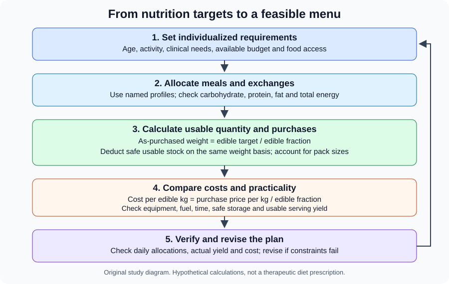

# Food exchange, menu and budget planning

**Status:** Isolated study-ready candidate, unattempted. All examples and prices are hypothetical. Exchange values are approximate and list-specific, not therapeutic prescriptions. Independent dietetic/clinical and cross-chapter semantic review pending.

[Chapter](../README.md) · [07C practice questions](../MCQs/07C-Food-Exchange-Menu-and-Budget-Planning-20-MCQs.md)

## 1. Food exchange system

Food exchange list meal planning ka ek tool hai. Ismein foods ko approximate nutrient contribution ke basis par group kiya jaata hai. Specified serving size follow karne par planner ek group ke different foods ki planned nutrient contribution estimate kar sakta hai. Lekin har food ka exact nutrient composition same nahi hota. Preparation, brand, serving size aur exchange list ke convention se value change ho sakti hai.

| Reference group | Carbohydrate per listed serving | Protein | Fat and energy |
|---|---:|---:|---|
| Starch | Approximately 15 g | Approximately 3 g | 0–1 g fat, about 80 kcal |
| Fruit | Approximately 15 g | Negligible | Negligible fat, about 60 kcal |
| Milk or yogurt | Approximately 12 g | Approximately 8 g | Fat and calories vary with product type |

These are the named University of Illinois Extension reference profiles, not universal Indian serving sizes or an individualized diabetes meal plan. Exact product labels and approved local exchange lists take precedence for clinical calculations.

**Exam clue:** General 15-g carbohydrate counting unit ko automatically har food-group exchange par apply mat karo. Milk-group reference mein 12 g carbohydrate ho sakta hai.

### Cross-group and added-fat reconciliation

Agar authorized worksheet mein ek 80-kcal starch serving ko 60-kcal fruit serving se replace kiya jaata hai, toh listed energy 20 kcal reduce hoti hai. Carbohydrate contribution approximate same hone ke bawajood protein aur overall energy equal nahi hote. Is arithmetic ka matlab yeh nahi hai ki different groups freely interchangeable hain. Full nutrient targets aur clinical context review karna zaroori hai.

Boiled potato ka starch contribution added butter ya oil se disappear nahi hota. Agar specified plan mein potato one starch exchange hai aur added fat one fat exchange hai, toh dono separately enter karo. Isi tarah milk products ke carbohydrate aur protein comparable ho sakte hain lekin fat aur energy different ho sakti hain.

Protein count karte waqt sirf meat ya pulses ko include karna enough nahi hai. Do starch exchanges, each 3 g protein, aur one milk exchange with 8 g protein together 14 g protein contribute karte hain. Other foods ka protein phir separately add karna hai.

## 2. Menu planning workflow

Menu plan banane se pehle age, activity, physiological state, clinical needs, preferences, food access, budget aur preparation facilities assess karo. ICMR-NIN 2024 dietary guidance food quantity ko individual requirements ke context mein describe karti hai. Ek standard adult menu ko har household member par automatically apply nahi karna chahiye.

Meal aur snack allocations ka full-day sum check karo. Agar hypothetical daily cereal allocation 240 g hai aur breakfast 60 g, lunch 90 g, dinner 70 g aur snack 40 g planned hain, toh total 260 g hoga. Specified allocation se 20 g zyada hai. Dinner aur snack ki combined allocation ko 20 g reduce karke worksheet reconcile ki ja sakti hai. Yeh hypothetical target hai, recommended daily cereal requirement nahi.

### Practical feasibility

- Lunch preparation ke liye equipment unavailable ho toh safe available food options select karke nutrient totals recheck karo.
- Cycle menu mein multiple dishes ko same scarce vessel ki simultaneous need ho toh preparation sequence revise karo. Unsafe room-temperature holding ko scheduling solution mat banao.
- One-time donated perishable stock ko safe usable period mein appropriate menu mein include karo. Future weeks mein supply automatically available assume nahi karo.
- Standard recipe planned ingredient quantities, yield aur serving size establish karti hai. Actual production record compare karne se losses, portion variation aur cost deviations identify ho sakte hain.

## 3. Edible yield and purchasing

As-purchased (AP) weight ka matlab gross purchase quantity. Edible portion (EP) usable quantity hai after specified trimming or other stated loss. Yield fraction ko decimal mein express karo, for example 75% = 0.75. Raw edible yield aur cooking yield separate concepts hain. Calculations mein weight basis clearly identify karo.

| Calculation | Formula |
|---|---|
| Edible quantity | AP weight × edible fraction |
| Purchase requirement | Required edible weight ÷ edible fraction |
| Cost per edible kg | AP price per kg ÷ edible fraction |
| Net purchase | Required quantity − usable stock on the same weight basis |
| Number of sealed packs | Net purchase ÷ pack size, round upward if whole packs required |
| Actual ingredient cost per serving | Batch ingredient cost ÷ actual usable servings |

### Worked example 1: purchase weight

Kitchen ko 900 g trimmed vegetables chahiye. Supplier edible yield 75% deta hai. Assuming no additional loss, purchase = 900 ÷ 0.75 = 1200 g. Agar sirf 900 g purchase karenge toh 675 g edible milega, jo target se kam hai.

### Worked example 2: edible cost comparison

Supplier X costs ₹48/kg AP and yields 60% edible. Cost per edible kg = 48 ÷ 0.60 = ₹80. Supplier Y costs ₹60/kg AP and yields 90% edible. Cost per edible kg = 60 ÷ 0.90 ≈ ₹66.67. Given comparable usable quality and other costs, supplier Y cheaper hai even though gross purchase price higher hai.

### Worked example 3: stock-adjusted procurement

Seven-day menu needs 2.4 kg dry pulses and safe usable existing stock is 0.9 kg. Net purchase = 1.5 kg. Each sealed pack is 0.5 kg, so three packs required. Existing stock aur new purchase same dry weight basis par compare hue hain.

### Worked example 4: actual serving cost

Batch ingredients cost ₹240. Planned yield 12 portions thi, lekin actual usable servings 10 hain. Ingredient cost per actual serving = 240 ÷ 10 = ₹24. Planned yield par ₹20 aata, jo actual loss ko ignore karta. Fuel, labour aur other costs included nahi hain unless explicitly stated.

## 4. Budget and affordability

Food budget allocate karte waqt already planned costs subtract karo. Hypothetical weekly budget ₹1500, rice and pulses ₹480, vegetables ₹320 and dairy ₹280. Allocated total ₹1080, remaining ₹420. Remaining amount se appropriate other food needs plan karne honge.

Nutrient cost compare karne ke liye price aur nutrient density same basis par convert karo. Hypothetical pulse A costs ₹80/kg and provides 20 g protein per 100 g. One kg mein 200 g protein, so ₹4 per 10 g protein. Pulse B costs ₹100/kg and provides 25 g per 100 g. One kg mein 250 g protein, so also ₹4 per 10 g. Equal protein cost ka matlab equal overall nutrient quality nahi hai. Actual preparation, digestibility, acceptability aur other nutrients bhi relevant hain.

FAO healthy-diet affordability methodology essential non-food expenses ko consider karti hai. Household ki total income ko automatically food budget assume karna inaccurate ho sakta hai. Local availability, ingredient cost, safe storage, cooking fuel, time aur other necessary resources feasible menu ko affect karte hain.

**Exam trap:** Sabse sasta gross kilogram hamesha sabse sasta edible kilogram nahi hota. Cheapest calorie source hamesha healthy balanced diet nahi hoti.

## 5. Practice and evidence

[20 original 07C questions and individual Roman Hinglish rationales](../MCQs/07C-Food-Exchange-Menu-and-Budget-Planning-20-MCQs.md)

- [University of Illinois Extension, Carbohydrates and Diabetes](https://extension.illinois.edu/diabetes/carbohydrates-and-diabetes): directly retrieved reference starch, fruit and milk serving profiles.
- [ADA diabetes terms](https://diabetes.org/about-diabetes/common-terms): direct text on carbohydrate counting and exchange concepts.
- [ICMR-NIN Dietary Guidelines for Indians 2024](https://www.nin.res.in/dietaryguidelines/pdfjs/locale/DGI07052024P.pdf): retrieved Guideline 1 text on varying needs and balanced food-group patterns. Screenshot request failed.
- [FAO Practical Nutrition for Field Workers](https://www.fao.org/4/x3996e/x3996e05.htm): directly retrieved principles on local foods, cost, preparation and seasonal availability. Kitchen scenarios are educational applications, not source-specific procurement protocols.
- [FAO/INFOODS conversion guidelines](https://www.fao.org/4/i3089e/i3089e.pdf): retrieved text on edible portion and yield. Screenshot unavailable.
- [FAO Cost and Affordability of Healthy Diets methodology](https://www.fao.org/in-action/coahd/methods/en): directly retrieved definition of affordability and healthy diet cost.

**Teaching video leads:** [Food Exchange System in Hindi](https://www.youtube.com/watch?v=KKZEtqSPBC0) and [BSc Nursing Menu Planning](https://www.youtube.com/watch?v=ykMGUcDsFws) were indexed. Exact playback and topic coverage not verified. No dedicated item-level MCQ video certified for Q1–20.

No historical examination provenance is asserted. Full INC programme-specific curriculum coverage, independent clinical/dietetic review, comprehensive semantic review and final website/CI gates remain outstanding.
