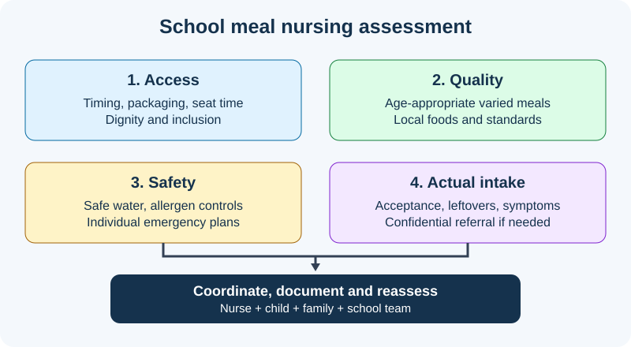

# School-age nutrition and school meals

**Status:** Study-ready draft candidate for independent review, not studied or live-certified.

[Chapter](../README.md) · [20 original MCQs](../MCQs/07D-School-Age-Nutrition-and-School-Meals-20-MCQs.md) · [Previous Year Questions research](../Previous-Year-Questions/Nutrition-and-Dietetics-Past-Paper-Research-Register.md)

## 🟠 Growth, school-day intake and recovery

School-age baccha sirf apna current weight maintain nahi karta. Uske muscles, bones aur doosre tissues develop ho rahe hote hain. Isliye usko regular meals mein energy, protein, vitamins aur minerals ki zarurat hoti hai. ICMR-NIN ke sample menus reference children ke liye banaye gaye hain. Nurse unhe individual prescription ki tarah copy nahi karti. Bacche ki growth, activity, clinical condition aur available local foods dekhkar family aur dietitian ke saath plan banati hai.

Jab school bus bahut jaldi aati hai, toh baccha breakfast miss kar sakta hai. Family ek suitable breakfast pehle se arrange kar sakti hai ya approved school breakfast service use kar sakti hai. Sirf sugary drink poore meal ki jagah nahi le sakta. Lunch mein staple food ke saath suitable protein source aur fruit ya vegetables include karne se variety badhti hai. Safe water bhi available hona chahiye.

Jab short illness ke baad appetite kam ho jaati hai, toh stable bacche ko chhoti aur frequent nutrient-rich servings dena helpful ho sakta hai. Baccha jitna tolerate kar sake, uske hisab se normal diet ki taraf badhte hain. Agar poor intake, weakness ya weight loss continue ho toh clinical assessment zaroori hai. Severe malnutrition, dehydration ya swallowing difficulty ke liye separate clinical protocol follow karte hain.

## 🟠 School meal access and dignity

Meal provide kar dena aur bacche ka actually kha pana do alag baatein hain. Agar container bahut tight hai ya serving counter bus arrival se pehle band ho jaata hai, toh nutritious food available hone ke baad bhi baccha usse access nahi kar pata. Nurse ko actual situation observe karke practical barrier address karna chahiye. Bacchon ko punishment ke liye khane se rokna ya financial assistance lene wale bacchon ko publicly identify karna bhi meal participation ko affect kar sakta hai.

CDC ka school lunch benchmark kam se kam 20 minutes ka actual seated eating time hai. Ye US quality recommendation hai, Indian statutory norm nahi. Agar lunch break 30 minutes ka hai aur queue aur walking mein 14 minutes lagte hain, toh bacche ke paas khane ke liye 16 minutes hain. Is example mein 4 minutes ka deficit hai. School team queue management aur scheduling improve kar sakti hai.

Is workflow mein nurse food quality ke saath access, safety aur actual consumption check karti hai. Jo barrier milta hai uske hisab se family aur school team ke saath plan banakar follow-up karti hai.

## 🔴 Water and food-allergy safety

School sports ke time sweating se fluid loss ho sakta hai. Bacchon ko safe drinking water tak pahunch aur suitable drinking breaks milne chahiye. Agar water source unsafe declare ho jaata hai, toh usko authorized clearance tak use nahi karna chahiye. School ko safe alternate supply arrange karni chahiye.

Food allergy mein recipe ka ingredient check karna kaafi nahi ho sakta. Cross-contact ka matlab hai ki ek allergen cooking utensil ya surface se doosri dish mein pahunch jaata hai. Peanut allergy wale bacche ko shared uncleaned utensil se bana food serve karna unsafe ho sakta hai. Allergy-safe substitute ka nutrient contribution bhi individualized diet plan ke saath check karo. School trip ke liye safe meal, trained responsible staff aur clinician-approved emergency plan ke mutabik prescribed medicine ki immediate access arrange karo. Suspected severe reaction mein local emergency protocol follow karna chahiye.

## 🟠 School food environment and follow-up

WHO school food guidance mein actual food provision, food standards aur supportive changes in choice environment cover hote hain. Nudge ka matlab choice ko healthier direction mein guide karna hai, jaise fruit ko eye level par rakhna, bina permitted options ko remove kiye. Nutrition standards actual served ya sold foods ke criteria set karte hain. Local guidance aur authority ke hisab se standards apply karte hain.

Agar planned menu nutritious hai lekin bacche vegetable dish repeatedly discard karte hain, toh nurse intake aur acceptability investigate karti hai. Sirf meals served count karna consumption prove nahi karta. School garden mein supervised activity se bacche familiar edible foods ko identify karna aur safe meals choose karna seekh sakte hain. Garden lesson actual meal service ka replacement nahi hai.

Agar baccha bullying, persistent food restriction ya fatigue report kare, toh nurse private conversation mein reason aur safety assess karti hai. Caregiver aur appropriate clinical team ke saath follow-up arrange karna useful hai. Appearance se eating disorder diagnose nahi karte aur bacche ko public weight targets nahi dete.

## Evidence and video status

| Scope | Evidence retrieved | Teaching video | Dedicated MCQ video |
|---|---|---|---|
| Growth, normal feeding, recovery | [ICMR-NIN DGI 2024, Guideline 5](https://www.nin.res.in/dietaryguidelines/pdfjs/locale/DGI24thJune2024fin.pdf), PDF text retrieved, screenshot cache miss | Specific school-age lecture not verified | Specific item verification pending |
| School food environment | [WHO guideline recommendations](https://www.ncbi.nlm.nih.gov/books/NBK620641/) | Not separately verified | Specific item verification pending |
| School meal service | [CDC lunch time](https://www.cdc.gov/school-nutrition/school-meals/time-for-lunch.html) · [CDC school nutrition strategies](https://www.cdc.gov/whole-school-community-child/strategies/strategies-nutrition.html) | Not separately verified | Specific item verification pending |
| Safe water | [CDC water access](https://www.cdc.gov/school-nutrition/water-access/index.html) | Not separately verified | Specific item verification pending |
| Allergy safety | [AAP family guidance](https://www.healthychildren.org/English/ages-stages/gradeschool/school/Pages/managing-food-allergies-at-school-information-for-families.aspx) · [AAP clinical report](https://doi.org/10.1542/peds.2025-073168), clinical report indexed, direct access blocked | Not separately verified | Specific item verification pending |

Evidence checked 28 November 2026. General nursing introduction videos were found but not treated as school-age teaching or question-practice verification. Full official INC version and depth reconciliation, historical exam evidence, independent clinical and semantic review, and UI rendering remain pending.

[Chapter](../README.md) · [Practice these 20 original questions](../MCQs/07D-School-Age-Nutrition-and-School-Meals-20-MCQs.md)
