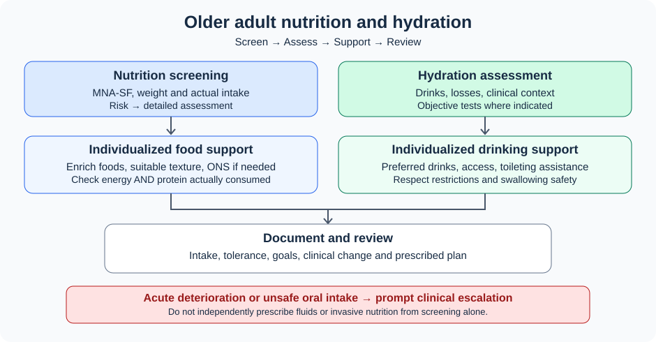

# 17 Elderly nutrition and hydration

**Status:** PR35 isolated draft. Nursing exam-oriented concept guide, not an individualized clinical prescription.

[Chapter](../README.md) · [20 original questions](../MCQs/07E-Elderly-Nutrition-and-Hydration-20-MCQs.md)



## 1. Nutrition screening versus diagnosis

Older adults mein low intake, illness aur functional barriers ke karan malnutrition risk ho sakta hai. Validated screening se risk identify karo, phir detailed assessment, clinical context aur individualized goals ke according care plan banao. MNA-SF ka total 0–14 hota hai. 12–14 normal, 8–11 at risk aur 0–7 malnourished screening classification hai. Screening alone se cause, severity of acute illness ya feeding route decide nahi hota. BMI unavailable ho to validated calf circumference alternative use karo, BMI aur calf scores dono add mat karo. Alternative item mein less than 31 cm scores zero and 31 cm or more scores three.

## 2. Energy, protein and oral support

ESPEN practical geriatric guidance (2022) suggests at least 1 g protein/kg/day as a guiding value, individualized for nutritional status, disease, activity and tolerance. Agar 60 kg stable older adult 42 g protein daily le raha hai aur 60 g guiding minimum applicable hai, to gap 18 g hai. Yeh independent prescription nahi hai.

Food enrichment aur dietary counselling pehle optimize karo. Community-dwelling malnourished older adults with chronic conditions may benefit from appropriate oral nutritional supplements (ONS) when these measures are insufficient. The ESPEN geriatric ONS guiding contribution is at least 400 kcal and at least 30 g protein/day. Both values check karo. Efficacy at least monthly review karo during a course of at least one month, with earlier review for deterioration or intolerance. Preference, texture, flavour and timing adapt karo and actual consumed quantity record karo.

Where oral intake is expected to remain below half of requirements for more than a week despite interventions, or oral intake is impossible for more than three days, enteral nutrition may be considered in older adults with a reasonable prognosis. Benefits, burdens, consent, swallowing, gastrointestinal function and goals of care must be considered by the clinical team. It is not an automatic bedside order. Suitable finger foods may support independent eating when the proposed food texture is safe.

## 3. Hydration assessment

Low-intake dehydration aur extracellular volume depletion same concept nahi hain. ESPEN identifies directly measured serum osmolality above 300 mOsm/kg as an action threshold for low-intake dehydration. When direct testing is unavailable, the calculated osmolarity screening equation uses mmol/L values:

```
1.86 × (Na + K) + 1.15 × glucose + urea + 14
```

A calculated value above 295 mmol/L warrants action according to the guidance, not an automatic final diagnosis. Example: Na 143, K 4, glucose 5 and urea 7 gives 300.17 mmol/L. Calculated osmolarity and measured osmolality must not be assigned the same units. Solute abnormalities, including glucose and urea, and clinical context matter.

Skin turgor, mouth dryness and urine colour alone are not reliable tests of low-intake dehydration in older adults. Do not dismiss clinical signs. Vomiting and hypotension require assessment of volume depletion even if serum osmolality is normal.

## 4. Support and escalation

ESPEN guiding drinks provision is at least 1.6 L/day for older women and 2.0 L/day for older men, unless clinical conditions require a different approach. These are drinks volumes, not total water including foods. Individualized restrictions, swallowing safety and treating-team prescriptions take priority. Offer suitable preferred drinks, ensure access, and provide toileting support. Document actual intake and changes. An acutely unwell older person unable to meet fluid requirements safely by mouth needs prompt clinical assessment for supervised replacement, not a fixed independent IV order.

## 5. Evidence and verification

- [ESPEN practical guideline: Clinical nutrition and hydration in geriatrics (2022)](https://www.espen.org/files/ESPEN-Guidelines/ESPEN_practical_guideline_Clinical_nutrition_and_hydration_in_geriatrics.pdf), particularly recommendations 2, 5, 26, 29–32 and 59–74, directly retrieved guideline text. Guideline PDF pages on supplements and hydration were visually checked.
- [MNA-SF official user guide](https://www.mna-elderly.com/sites/default/files/2021-10/mna-guide-english-sf.pdf), directly retrieved scoring text. Full instrument not reproduced.
- [MNA official screening form](https://www.mna-elderly.com/sites/default/files/2024-10/MNA_AU2.0_eng-USori.pdf), scoring text retrieved. PDF page screenshot access not confirmed.
- Concept video candidate: [Level Up RN — Nutrition for Older Adults](https://www.youtube.com/watch?v=ofMa8iAK4U8). Search-indexed candidate only, not full playback or item-level validation.
- Dedicated question-practice video verification, independent clinical/pharmacy review, exhaustive semantic review and complete INC mapping remain pending.

[Return to the 20 questions](../MCQs/07E-Elderly-Nutrition-and-Hydration-20-MCQs.md)
