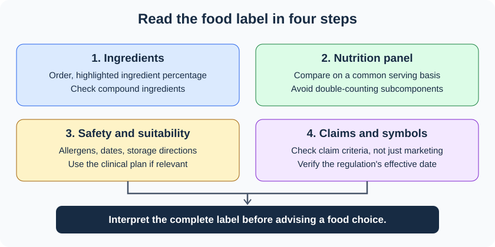

# Indian food labelling and nutrition claims

**Status:** Study-ready isolated PR35 draft. Original learning material, independent review pending. Regulatory sources checked 28 November 2026. Compendia are reference compilations, not substitutes for Gazette notifications.

[Chapter](../README.md) · [20 original MCQs](../MCQs/08A-Indian-Food-Labelling-and-Nutrition-Claims-20-MCQs.md)

## 🟠 Ingredients and label comparison

Jab nurse kisi packaged food ko assess karti hai, toh front par likhe marketing words ke saath actual ingredient list bhi padhti hai. Ingredients manufacturing ke waqt weight ya volume ke descending order mein diye jaate hain. Is order se relative quantity ka idea milta hai, exact percentage nahi. Agar mixture mein koi ingredient prominently highlight kiya gaya hai, toh applicable exceptions ko dhyan mein rakhkar uski ingoing percentage check karte hain. Compound ingredient, jaise seasoning mix, khud multiple ingredients se bana ho sakta hai. Applicable rule ke hisab se uske components bhi declare kiye jaate hain.

Nutrition panel ko same quantity ke basis par compare karo. Agar 30 g snack mein 150 kcal hain, toh 100 g mein 500 kcal honge. Agar 45 g doosre snack mein 180 kcal hain, toh 100 g mein 400 kcal honge. Sirf printed serving calories compare karne se galat conclusion aa sakta hai.

Total sugars mein added sugars bhi included hote hain. Total fat mein saturated aur trans fat components bhi included hote hain. Isliye components ko total ke upar dobara add nahi karte. Indian label reference mein 2,000 mg sodium ke against 250 mg sodium 12.5% contribution hai. Yeh general adult reference hai, individual patient ke prescribed target ka replacement nahi.

## 🔴 Safety, allergens and date marking

Best-before ka main relation stated storage conditions ke under quality retention se hai. Use-by ya expiry estimated safe-use period se related hai. Agar food unsafe ho, toh future printed date bhi safety guarantee nahi karti. Pack opening ke baad specific refrigeration instructions follow karna important hai.

Food allergy mein ingredient list aur applicable separate allergen declaration dono check karo. Soy protein present hone par applicable soy declaration dekho. Sulphite declaration ke liye specified concentration threshold 10 mg/kg ya zyada hai. Food allergy wale patient ka clinical plan aur actual ingredient suitability priority hai. Vegetarian symbol ya general product-category logo allergy safety ka proof nahi hota. Online food sale mein applicable label information purchase se pehle provide karne ki requirement hai, specified batch aur date particulars ke exceptions ke saath.

Permitted additive ka naam ya recognized INS number uske functional class ke saath check karo. Short shelf-life exception ko blanket date exemption mat samjho. Shelf life seven days tak ho toh manufacture date omit ki ja sakti hai, lekin expiry ya use-by required rehta hai under the cited provision.

## 🟠 Claims versus actual composition

No-added-sugar claim ka matlab zero total sugars nahi hota. Honey ko sweetening ke liye add kiya gaya ho toh woh non-addition claim ke conditions ko meet nahi karta. No-added-salt claim mein sirf directly added sodium chloride nahi, ingredients ke through added sodium salts bhi relevant hain.

Comparative claim ko same ya similar identifiable food ke reference se assess karo. General comparative energy threshold 30% hai under the cited Claims regulation. Agar original 450 kcal per 100 g aur new product 360 kcal per 100 g hai, toh reduction 90/450 × 100 = 20% hai. Stated general threshold meet nahi hota.

## 🟠 Current versus future requirements

| Gazette notification | Stated commencement | Teaching distinction |
|---|---|---|
| 24 March 2026 First Amendment | 1 July 2027 | Infant nutrition proviso aur other specified changes ko November 2026 mein already operative nahi bolte. |
| 6 November 2026 Second Amendment | 1 July 2028 | Specified milk aur milk products ke new category logo ko fortification mark ya allergy-safety certificate nahi samajhte. |

## Sources and video evidence

- [FSSAI Labelling and Display Regulations 2020, compendium version VIII, 9 September 2025](https://www.fssai.gov.in/upload/uploadfiles/files/Comp_Labelling%20Display_Version%20VIII_09_09_2025.pdf). Regulations 2, 4, 5 and 8. Retrieved text and selected page screenshots.
- [FSSAI Advertising and Claims Regulations 2018, compendium version IV](https://fssai.gov.in/upload/uploadfiles/files/Compendium_Advertising_Claims_Regulations_14_12_2022.pdf). Regulations 5 and 6. Retrieved text, screenshot access failed.
- [First Amendment 2026](https://fssai.gov.in/docs/whatsnew/gazette/69cca2b3f3ce9Notification%20dt%2024.03.2026_NRC.pdf) and [Second Amendment 2026 Gazette](https://egazette.gov.in/WriteReadData/2026/277816.pdf). Retrieved notification text, screenshot attempts failed.
- Teaching video lead: [Reading Food Labels Correctly — FSSAI](https://www.youtube.com/watch?v=D1ZdNXwx6kY), indexed title and channel only. Predates the 2020 regulations, so not evidence of current regulatory provisions. Dedicated item-level MCQ video verification remains pending.

Full statutory reconciliation, INC depth mapping and qualified independent review remain pending. This guide supports nursing food counselling and is not legal advice.

[Chapter](../README.md) · [Practice questions](../MCQs/08A-Indian-Food-Labelling-and-Nutrition-Claims-20-MCQs.md)
