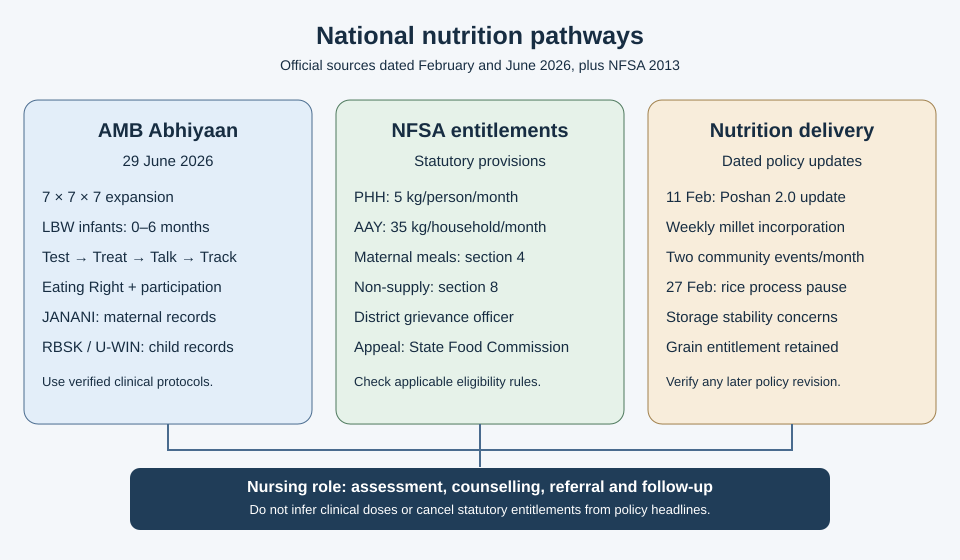

# 19 — National nutrition programme updates and food entitlements

**Status:** Draft concept guide for 08B. Read the dated official sources before using a policy statement as a current operational instruction. Independent review pending.

[Practice 20 original MCQs](../MCQs/08B-National-Nutrition-Programme-Updates-and-Food-Entitlements-20-MCQs.md)

## 1. AMB Abhiyaan: 29 June 2026 announcement

MoHFW ke announcement mein earlier 6×6×6 framework ko 7×7×7 approach mein expand kiya gaya. Additional beneficiary group low-birth-weight infants aged 0–6 months hai. Eating Right intervention diverse iron-rich food ko promote karta hai. Iska matlab prescribed anemia treatment ko replace karna nahi hai.

**T4:** Test, Treat, Talk, Track. Test se assessment, Treat se appropriate treatment, Talk se counselling aur Track se follow-up continuity support hoti hai. Maternal Hb record linkage ke liye JANANI aur child-level digital records ke liye RBSK and U-WIN announcement mein named hain. Unified monitoring aur Jan Bhagidari community participation ko support karte hain.

Nurse ko clinical assessment, referrals aur follow-up applicable protocol ke according arrange karna hai. Announcement se infant dose, route, duration ya treatment threshold infer nahi karna chahiye. Full revised 2026 operational guideline not retrieved, so these remain evidence gaps.

Source: [MoHFW PIB, 29 June 2026](https://www.pib.gov.in/PressReleasePage.aspx?PRID=2279050&lang=1&reg=48).

Teaching lead: [MoHFW AMB video, 14 August 2026](https://www.youtube.com/watch?v=WhQ0amTwYnY), description retrieved, full playback unverified. [NNL ONE nursing exam update](https://www.youtube.com/watch?v=u678CLYOlLw), description-level topic match only, no specific question or timestamp verified.

## 2. Rice fortification: dated policy and nutrient retention

27 February 2026 Food Ministry announcement ne PMGKAY aur allied schemes ke rice fortification process ko temporarily discontinue karne ka decision describe kiya, pending a better delivery mechanism. Long storage mein moisture, temperature, humidity aur packaging nutrient retention ko affect kar sakte hain. Specified procurement receipts ke liye fortified ya non-fortified rice supply ki transitional discretion described hai.

Is decision ko NFSA entitlement cancellation, all fortified food ban ya existing stock destruction na samjhein. Foodgrain entitlements aur PDS, ICDS aur school meal operations ko announcement ne withdraw nahi kiya. Later resumption status independently confirm nahi hua hai.

Source: [Food Ministry PIB, 27 February 2026](https://www.pib.gov.in/PressReleasePage.aspx?PRID=2233779&lang=1&reg=3).

## 3. NFSA statutory provisions

| Provision | Nursing exam concept |
|---|---|
| Section 3 | Priority household: 5 kg/person/month. Antyodaya household: 35 kg/household/month. |
| Section 4 | Pregnancy and six months after childbirth: free meal through local Anganwadi. Maternity benefit is a separate provision. |
| Section 5 | Cooking, drinking water and sanitation facilities in schools and Anganwadis, with the stated urban centralized-kitchen exception. |
| Section 8 | Prescribed food-security allowance on non-supply of entitled grains or meals from concerned State Government. |
| Section 13 | Eldest woman aged 18 years or above as ration-card household head, subject to the statutory exception. |
| Sections 15–16 | District Grievance Redressal Officer, followed by the State Food Commission appellate mechanism. |

PHH mein four eligible members ka 4 × 5 = 20 kg entitlement hai. AAY mein 35 kg household unit par based hai. Eligibility, price arrangements and claim procedure ko applicable current orders se verify karein.

Source: [National Food Security Act 2013, India Code](https://www.indiacode.nic.in/bitstream/123456789/18238/1/national_food_security_act_2013.pdf). Statutory text checked, PDF screenshot unavailable.

## 4. Mission Poshan 2.0: 11 February 2026 update

Updated nutrition norms dietary diversity, quality protein, healthy fats aur micronutrients par emphasis karte hain. Cited update mein millets at least once weekly in Anganwadi hot cooked meals and take-home rations, two community-based events monthly, Poshan Maah in September and Poshan Pakhwada in March–April describe kiye gaye hain. Exact yearly event dates local notices se check karein.

Source: [MWCD PIB, 11 February 2026](https://www.pib.gov.in/PressReleasePage.aspx?PRID=2226343&lang=1&reg=3). This update predates the separate February 27 rice decision. Do not conflate their dates.

**Evidence limits:** official announcement text and Act checked. Full 2026 AMB operational guideline, subsequent rice policy status, item-specific videos, independent clinical and regulatory review, curriculum-depth mapping and exhaustive semantic review remain pending. Not a standalone clinical protocol.
