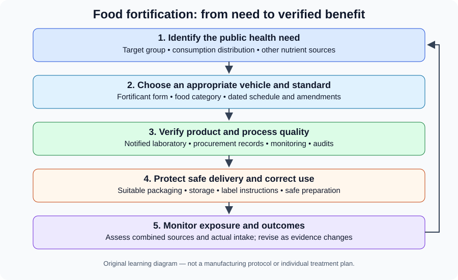

# Food fortification and quality assurance

**Status:** Isolated study-ready candidate, unattempted. Dated regulatory practice, not a complete current legal certification or individual prescription.

[Chapter](../README.md) · [08C original MCQs](../MCQs/08C-Food-Fortification-and-Quality-Assurance-20-MCQs.md)

## Public health purpose

Food fortification mein suitable foods ki micronutrient density intentionally badhaayi jaati hai. Iska purpose population mein vitamin ya mineral inadequacy ko reduce karna hai. Food vehicle aisa hona chahiye jo target group actually consume karta ho aur jiska sufficient share reliably fortified ho sake. Sirf premix mein nutrient concentration high hone se population tak adequate intake guarantee nahi hoti.

Biofortification mein crop ki nutrient density plant growth ke dauran breeding, agronomic practices ya biotechnology se improve hoti hai. Industrial fortification mein processing ke waqt fortificant add hota hai. Supplementation mein individual ko separate nutrient dose milti hai. Multiple interventions simultaneously chal rahe hon toh food, fortified product aur supplement contributions ko combine karke population exposure assess karna chahiye. Diagnosed deficiency ka individual treatment clinical team se guide hota hai.

## Dated FSSAI framework

Neeche rules named 2018 regulations aur specified amendments par based hain. 1 June 2022 compendium historical consolidated reference hai. Subsequent notifications aur operative dates ko separately verify karna necessary hai.

| Provision | Examination reasoning |
|---|---|
| Regulation 3(2) | Mandatory fortification ke liye public health problem ki severity aur extent ka scientific evidence important hai. |
| 2020 First Amendment, regulation 3(6) | Processed-food micronutrient target 15–30% adult RDA, stated 600 kcal processed-food intake basis par. Har single pack ka universal target nahi. |
| Regulation 3(7) | Established HFSS food ko added vitamins ke basis par specified fortified processed food category mein include nahi kar sakte. |
| Schedule I / III | Staple aur qualifying processed-food nutrient standards ko distinguish karo. Schedule II logo se related hai. |
| 2021 Second Amendment, regulation 4(1) | Declared amount ka minus 10% analytical tolerance permitted ho sakta hai, but specified maximum added amount must still comply. |
| Regulation 5 | Manufacturer/packer quality-assurance undertaking twice yearly, with notified laboratory certification, records, process monitoring, random testing and audits. |
| Regulation 7(1) | Packaging design fortificant characteristics aur shelf-life effect consider kare. |
| 2020 amendment, regulation 7(2) proviso | Iodine-fortified iodized salt specified fortification wording/logo condition se exempt hai, all labelling rules se nahi. |

### Worked analytical example

Hypothetical declared total amount 30 mg/kg hai. 10% = 3 mg/kg. Lower numerical tolerance value 27 mg/kg hogi. Yeh arithmetic alone batch compliance establish nahi karti. Applicable product category, declared range, maximum added amount aur other conditions separately review hote hain.

### Form and bioavailability

Named 2022 atta table mein different permitted iron compounds ke concentration ranges differ karte hain. Higher range ka note lower bioavailability ko account karta hai. Iska matlab nurse individual iron supplement prescription derive nahi karegi. Multigrain atta ke 2020 provision mein wheat flour more than 50% hona chahiye for that specific standard. Exactly 50% condition meet nahi karta.

## Quality and safe delivery

Nutrient testing ke saath manufacturing records important hain. Suspect lot ki investigation ke liye fortificant source aur batch inventory traceable honi chahiye. Supplier's own declaration notified food laboratory certification ka equivalent nahi hai. Product appearance se concentration establish nahi hoti.

Packaging, storage aur preparation product-specific instructions ke according honi chahiye. 2022 compendium clause 3A ka specified fortified milk powder government programme mein reconstituted fortified milk banane ke liye hai. Dry snack ya infant formula substitute nahi. Label ke full-pack reconstitution aur same-day use instructions follow karo. Same powder mass ko roughly double final volume mein dissolve karne par per-litre concentration approximately half ho jaati hai. Is example ko dilution recommendation na samjhein.

## Regulatory update versus clinical advice

2022 compendium mein iron-fortified food warning text tha. Official December 2024 parliamentary answer July 19, 2024 ko warning omission operationalize hone ki report karta hai. Is dated evidence ke basis par older warning ko unchanged current rule nahi batana chahiye. Direct circular aur later final legal consolidation abhi independently certify karna baaki hai. Label policy change iron overload, thalassemia ya sickle cell disease ke individual supplement decisions ka substitute nahi hai.

WHO 2025 edible oil fortification guideline public health strategy ko healthy diets aur diet-related noncommunicable disease prevention ke saath align karti hai. Added vitamins ke liye oil consumption unnecessarily increase nahi karna chahiye.

## Sources and verification

- [FSSAI compendium V, June 2022](https://fssai.gov.in/upload/uploadfiles/files/Compendium_Food_Fortification_Regulations_05_06_2022.pdf): extracted regulations and schedules, page index 4 visually verified. Other relevant screenshots unavailable.
- [First Amendment 2020](https://www.fssai.gov.in/upload/notifications/2020/12/5fe0896c5a160Gazette_Notification_Fortification_Foods_21_12_2020.pdf) and [Second Amendment 2021](https://www.fssai.gov.in/upload/notifications/2021/09/614d5d732e112Gazette_Notification_Fortification_24_09_2021.pdf): extracted official text; screenshot requests failed.
- [Parliamentary answer 10 December 2024](https://sansad.in/getFile/annex/266/AU1641_Zrzms8.pdf?source=pqars) and [PIB October 2024](https://www.pib.gov.in/PressReleasePage.aspx?PRID=2065835&lang=2&reg=48): indexed official update on warning omission; direct circular not certified.
- [WHO food fortification Q&A](https://www.who.int/news-room/questions-and-answers/item/food-fortification), [biofortification overview](https://www.who.int/tools/elena/interventions/biofortification), [2025 oil fortification overview](https://www.who.int/publications/i/item/9789240115101): indexed source text. Full guideline review pending.
- [FSSAI official teaching film](https://www.youtube.com/watch?v=B6kWVyYBTXc) and [Dr Eram Rao lecture](https://www.youtube.com/watch?v=akU4xetG32A): indexed official teaching leads, playback and dedicated MCQ matching not verified.

All 20 item-specific video gaps remain pending. No historical exam claim. Full current regulatory, independent clinical/dietetic, comprehensive semantic, INC curriculum depth and integration gates remain outstanding.

[Practice 20 original questions](../MCQs/08C-Food-Fortification-and-Quality-Assurance-20-MCQs.md)
