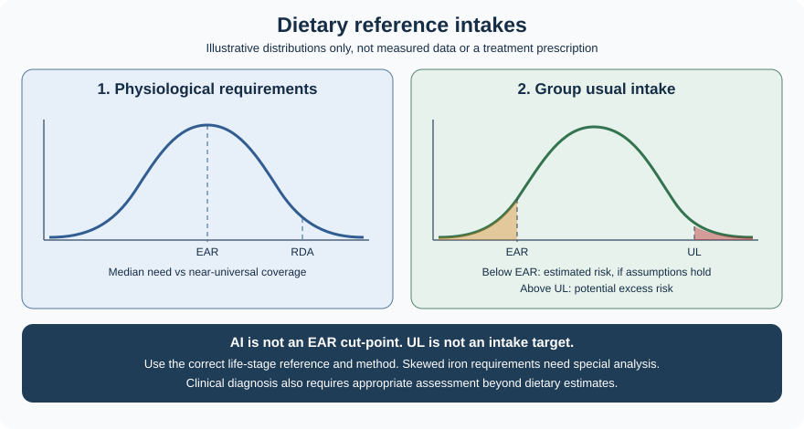

# 21 Dietary reference intakes and nutrient adequacy

**Status:** Isolated PR35 draft, unattempted original study material. Independent review pending. All numerical teaching scenarios are hypothetical.

[Chapter](../README.md) · [20 original questions](../MCQs/08D-Dietary-Reference-Intakes-and-Nutrient-Adequacy-20-MCQs.md)

## Requirement versus actual intake

Healthy logon mein bhi nutrient requirements identical nahi hoti. Requirement distribution ka median EAR kehlata hai. RDA distribution ke upper end se derive hota hai, taaki nearly all healthy reference individuals ki needs cover ho sakein. Actual dietary survey mein jo log consume karte hain, woh separate intake distribution hai.

| Reference | Main interpretation |
|---|---|
| EAR | Median requirement for a defined healthy reference group |
| RDA | Allowance designed for nearly all healthy people in that group |
| AI | Adequacy reference used when evidence is insufficient to establish EAR and derive RDA |
| TUL or UL | Upper reference for potential adverse effects, not a dietary target |

ICMR-NIN 2020 brief page 1 gives approximately 80% as the usual EAR-to-RDA relationship, not a universal conversion. Use the published nutrient-specific value. Age, sex and physiological stage matter. The brief discusses Indian planning recommendations. The following group-assessment methods are explicitly from the named National Academies references, not claimed as identical Indian clinical prescriptions.

## Group assessment

EAR cut-point method mein suitable homogeneous group ke usual intake distribution mein EAR se neeche proportion estimate karte hain. Assumptions include accurate usual intake estimation, independence of requirement and intake, approximately symmetric requirements and intake variability larger than requirement variability. Ek din ke records mein daily fluctuation ho sakta hai, isliye repeat observations se usual intake distribution ka estimate improve karte hain.

Example: 240 comparable participants mein 54 below EAR hain, so estimated inadequacy 54/240 × 100 = 22.5%, only when assumptions hold. Yeh clinical deficiency prevalence nahi hai. Below-RDA count ko inadequacy prevalence mat banao.

Menstruating women mein iron requirements substantially skewed ho sakti hain, isliye appropriate probability approach chahiye. Energy intake aur requirement correlated hote hain, so conventional cut-point estimation of energy inadequacy inappropriate hai.

Probability approach mein individual probabilities average karte hain. Agar 30 people ka risk 0.60 aur 70 ka 0.10 hai, estimated inadequacy (30 × 0.60 + 70 × 0.10)/100 = 25%. Group-specific prevalence estimates combine karte waqt actual group size se weight karo.

## AI and upper limits

AI se neeche group mean hone par actual inadequacy prevalence calculate nahi kar sakte. Individual usual intake at or above an applicable AI likely low inadequacy risk suggest karta hai, clinical disease absence guarantee nahi karta.

TUL ya UL ko maximum benefit target mat banao. Nutrient ke particular UL mein food, supplements aur fortified sources ka scope verify karo. Missing UL evidence gap ho sakta hai, unlimited safety ka proof nahi.

Group intervention ko evaluate karte waqt both tails dekho: below EAR and above the applicable UL. Same mean intake hone par bhi distribution ka spread alag ho sakta hai, so inadequacy estimate different ho sakta hai.

## Sources and evidence status

- [ICMR-NIN Nutrient Requirements for Indians 2020 brief](https://www.nin.res.in/rdabook/brief_note.pdf), page 1 text and screenshot retrieved.
- [INC Gazette curriculum, Unit VII](https://www.thc.nic.in/Central%20Governmental%20Regulations/Indian%20Nursing%20Council%20%28Revised%20Regulations%20and%20Curriculum%20For%20B.Sc.%28Nursing%29%20%28Program%29%20Regulations%2C2020..pdf), printed pages 273–274 text retrieved, screenshot cache miss. Unit VII explicitly includes RDA definition, limitations and uses.
- [National Academies: individual assessment](https://www.ncbi.nlm.nih.gov/books/NBK222891/), [EAR group assessment](https://www.ncbi.nlm.nih.gov/books/NBK222898/), [AI limitations](https://www.ncbi.nlm.nih.gov/books/NBK222886/?report=reader), [group planning and probability approach](https://www.ncbi.nlm.nih.gov/books/NBK221364/), [additional DRI information](https://www.ncbi.nlm.nih.gov/books/NBK469840/), [definitions](https://www.ncbi.nlm.nih.gov/books/NBK222321/) and [group applications](https://www.ncbi.nlm.nih.gov/books/NBK222874/). Methods cited by named source, not Indian therapeutic instructions.
- Dedicated teaching and item-specific question-solving video verification pending. No authenticated exam attribution claimed.

Independent dietetic and semantic certification, comprehensive INC mapping and release gates remain outstanding. No treatment dose inferred from these references.

[Practice the 20 questions](../MCQs/08D-Dietary-Reference-Intakes-and-Nutrient-Adequacy-20-MCQs.md)
