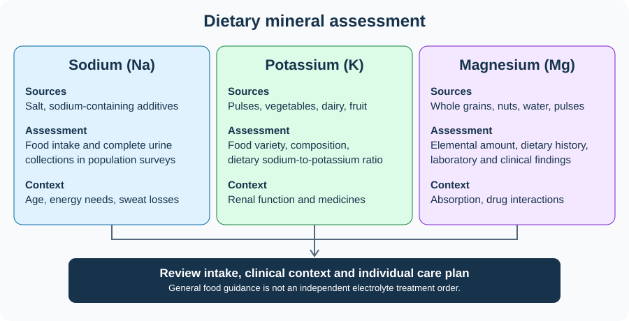

# 22 Dietary sodium, potassium and magnesium

**Status:** Isolated PR35 candidate. Original study material, unattempted, independent review pending. This chapter covers dietary assessment and counselling, not acute electrolyte management. Use disease-specific plans where relevant.

[Chapter](../README.md) · [20 original MCQs](../MCQs/08E-Dietary-Sodium-Potassium-and-Magnesium-20-MCQs.md)

## Sodium — food exposure and assessment

Sodium fluid balance aur normal cellular electrical activity mein important hai. Common salt sodium chloride hai, lekin sodium-containing additives jaise monosodium glutamate bhi total dietary sodium contribute karte hain. Sirf table salt count karne se actual sodium intake underestimate ho sakta hai. WHO general adult population guidance mein daily sodium less than 2,000 mg, approximately less than 5 g salt, recommend karta hai. Children aged 2–15 years ke liye adult recommendation ko energy requirements ke hisab se downward adjust karte hain. Infants ke liye age-appropriate feeding guidance follow karo.

Population salt-intake survey mein complete 24-hour urinary sodium excretion objective estimate provide kar sakti hai. Ek serum sodium result usual dietary sodium intake ka measurement nahi hai. Missed urine void ko document karo, incomplete collection ko complete mat maan lo. Hot weather aur strenuous work mein sweat losses urinary sodium aur total intake ka relationship affect kar sakte hain.

ICMR-NIN Dietary Guidelines for Indians 2024 Guideline 11 mein sodium-potassium balance aur dietary sources discuss kiye gaye hain. Us guideline ke numerical wording mein WHO attribution aur salt-sodium equivalence internally inconsistent hain, so WHO's own guidance above is used for the WHO target. General adult target individual therapeutic orders ka substitute nahi.

## Potassium — variety and dietary interpretation

Potassium many food groups mein milta hai. Dal, vegetables, curd, fruit aur suitable nuts food variety support karte hain. Banana compulsory source nahi hai. Naturally occurring potassium multiple chemical forms mein ho sakta hai. Potassium iodide in microgram quantities iodine source hota hai, major potassium supply nahi.

NIH ODS dietary potassium absorption ko approximately 85–90% estimate karta hai. Example mein 2,000 mg hypothetical intake ka estimated absorbed amount 1,700–1,800 mg hai, actual patient measurement nahi. Dietary sodium-to-potassium ratio ko compare karte waqt same units use karo. Same sodium aur double potassium ke saath mass-based ratio half ho jata hai.

Kidney disease, medications or prescribed potassium restriction present hone par general food advice ko individualized plan se reconcile karo. Published Renal diet bank already covers therapeutic potassium restriction, vegetable leaching, concentrated juice and dialysis-related adjustments. Those tasks are not counted here again.

## Magnesium — nutrient sources, absorption and clinical context

Whole grains, legumes, nuts, green leafy vegetables aur some water supplies magnesium contribute karte hain. Bran aur germ remove hone par grain magnesium content decrease ho sakta hai. Water ka magnesium concentration local source ke hisab se vary karta hai. Agar water 40 mg/L provide karta hai aur consumption 1.5 L hai, toh 60 mg contribution hoga.

Body magnesium ka substantial portion bone mein store hota hai aur serum sirf small fraction represent karta hai. Normal serum result alone se all tissue stores adequate prove nahi hote. History, clinical findings aur laboratory context assess karo.

Supplement label par elemental magnesium aur entire compound mass separate ho sakte hain. 100 mg elemental per tablet ke two tablets se elemental amount 200 mg hai, hypothetical calculation only. Citrate jaise more soluble forms generally oxide se better absorbed ho sakte hain. Equal elemental amount identical absorption guarantee nahi karta. Concentrated supplement ka unabsorbed fraction osmotic diarrhoea cause kar sakta hai.

Long-term proton pump inhibitors low magnesium se associated ho sakte hain. Magnesium-containing products oral bisphosphonate absorption bhi reduce kar sakte hain. Prescribing team aur pharmacist se medicine-specific instructions confirm karo. Independently drug dose ya high-dose supplement decide mat karo.

## Sources and video evidence

- [WHO sodium reduction fact sheet](https://www.who.int/news-room/fact-sheets/detail/sodium-reduction), retrieved adult and child guidance and sodium sources.
- [ICMR-NIN DGI 2024](https://www.nin.res.in/dietaryguidelines/pdfjs/locale/DGI24thJune2024fin.pdf), Guideline 11 printed pages 73–74 text retrieved. PDF screenshots attempted but unavailable. WHO primary guidance used for WHO's numeric recommendation.
- [WHO 24-hour urine protocol](https://www.who.int/europe/publications/i/item/WHO-EURO-2021-2333-42088-57949), official publication page retrieved, and [WHO SEARO salt measurement brief](https://cdn.who.int/media/docs/default-source/searo/healthy-diets/salt-reduction/measurement-of-population-salt-intake.pdf), indexed text on complete timed collection and undercollection.
- [NIH ODS Potassium professional fact sheet](https://ods.od.nih.gov/factsheets/Potassium-HealthProfessional/), retrieved food sources, forms and absorption.
- [NIH ODS Magnesium professional fact sheet](https://ods.od.nih.gov/factsheets/Magnesium-HealthProfessional/), retrieved status, food sources, supplement forms and medicine interactions. US reference context, not a separate Indian therapeutic prescription.
- [Level Up RN — Electrolytes: Nutrition in Nursing](https://www.youtube.com/watch?v=ZQ-sQU9wNxU): indexed description and published topic markers 2:27 magnesium, 4:54 potassium, 6:29 sodium, and 7:25 quiz. Teaching topic lead only, no item-specific playback verification. [Bhushan Science - Nursing — Classification of Minerals in Hindi](https://www.youtube.com/watch?v=IeGfQkW-SdU): indexed topic coverage, not independently verified question content.

All 20 dedicated question-specific video mappings remain pending. Full independent clinical/dietetic/pharmacy and semantic review, complete INC depth mapping and release gates remain outstanding.

[Practice these questions](../MCQs/08E-Dietary-Sodium-Potassium-and-Magnesium-20-MCQs.md)
