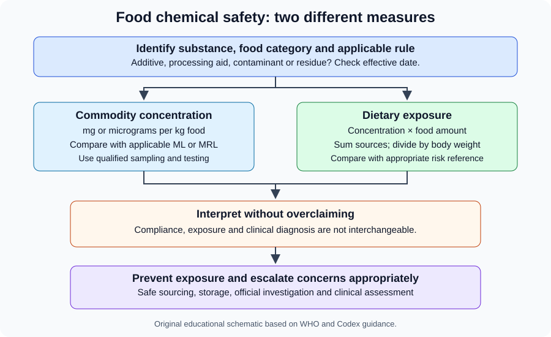

# Food additives, contaminants and residues

**Status:** Study-ready isolated candidate. Not independently certified. Calculations are hypothetical teaching exercises. Actual Indian regulatory compliance requires the applicable consolidated rules and qualified food-safety review.

[Chapter](../README.md) · [09A practice MCQs](../MCQs/09A-Food-Additives-Contaminants-and-Residues-20-MCQs.md)

## Food additives and processing aids

Food additive ka meaning hai ek substance jo technological purpose ke liye intentionally food processing ya preparation mein use kiya jaata hai. Codex definition contaminants aur nutritional quality improve karne ke liye added substances ko is definition se exclude karti hai. Processing aid ka role processing stage mein hota hai. Final food mein uske unintended unavoidable residues reh sakte hain. Exact classification substance aur intended use par depend karti hai.

| Functional class | Simple explanation |
|---|---|
| Antioxidant | Oxidation-related deterioration slow karta hai, jaise fats ki oxidative quality loss. |
| Emulsifier | Oil aur water jaise normally poorly miscible phases ko uniform mixture banane mein support karta hai. |
| Acidity regulator | Acidity ya alkalinity control karta hai. |
| Raising agent | Dough ya batter mein gas produce karke volume increase karta hai. |
| Colour | Food appearance modify karta hai. |

Food-grade additive ko sirf permitted conditions aur suitable food category mein use karna chahiye. Good manufacturing practice (GMP) ka matlab unlimited use nahi hai. Intended technological effect achieve karne ke liye reasonably required amount use hota hai. Natural origin safety ka proof nahi hai, aur synthetic origin alone unsafe hone ka proof nahi hai.

## Risk assessment and regulatory standards

JECFA (Joint FAO/WHO Expert Committee on Food Additives) scientific assessment karta hai. Codex Alimentarius Commission assessment ke basis par international food standards develop kar sakta hai. India mein FSSAI regulations ke applicable permitted uses, limits aur commencement dates verify karne padte hain. International recommendation automatically domestic legal permission nahi ban jaati.

### Concentration versus exposure

| Measure | Meaning |
|---|---|
| ADI | Acceptable daily intake, commonly mg/kg body weight/day. Lifetime dietary exposure reference, recommended consumption target ya acute poisoning threshold nahi. |
| MRL | Maximum residue limit, commonly mg/kg food for a specified residue and commodity. |
| ML | Maximum level applicable to specified contaminant and commodity. |
| Dietary exposure | Food concentration aur actual consumption se calculated intake, often body weight ke according normalized. |

Ek food sample ka concentration aur patient ka total daily exposure different quantities hain. Appropriate measurement unit, food category aur body weight verify karo. Same substance ke relevant dietary sources add karo. Individual diagnosis ke liye exposure history aur clinical assessment alag se required ho sakti hai.

**Example 1:** Hypothetical ADI 2 mg/kg body weight/day aur body weight 50 kg. Reference total = 2 × 50 = 100 mg/day. Iska matlab 100 mg lena necessary hai, aisa nahi.

**Example 2:** Drinks se 24 mg aur foods se 36 mg daily intake, weight 40 kg. Combined exposure = (24 + 36) ÷ 40 = 1.5 mg/kg/day. Provided hypothetical ADI 1.5 ke equal hai. Yeh product-by-product legal compliance certify nahi karta.

**Example 3:** Contaminant concentration 4 micrograms/kg food, consumption 250 g/day, weight 50 kg. 250 g = 0.25 kg. Intake = 4 × 0.25 = 1 microgram/day. Body-weight-normalized exposure = 1 ÷ 50 = 0.02 micrograms/kg body weight/day. Microgram aur milligram mein 1000-fold difference hota hai. Contaminant-specific reference ke bina safety conclusion mat nikalo.

Veterinary drug residues control karne ke liye authorized withdrawal periods aur applicable residue requirements follow karna essential hai. Animal clinically well dikhne ya milk ka smell normal hone se compliance establish nahi hoti.

## Mycotoxins and environmental contaminants

Mycotoxins kuch moulds se produce hone wale naturally occurring toxic compounds hain. Warm, humid conditions aur damaged grains contamination risk badha sakte hain. Many mycotoxins ordinary processing ke baad persist kar sakte hain, isliye mouldy foods ko roasting ya surface removal se guaranteed safe assume nahi karna chahiye.

| Toxin | High-yield association |
|---|---|
| Aflatoxin B1 | Chronic exposure liver cancer risk se linked hai, especially hepatitis B ke context mein. |
| Aflatoxin M1 | Contaminated feed consume karne wale dairy animals ke milk mein aa sakta hai. |
| Patulin | Damaged apples aur affected apple juice. |
| Ochratoxin A | Kidney toxicity concern, human kidney cancer evidence animals ke comparison mein less clear. |

Appropriate drying, dry protected storage, grain damage reduction aur safe sourcing prevent karne mein useful hain. Suspect lots ko authorized food-safety process se evaluate karna chahiye. Normal smell ya appearance regulatory testing ka substitute nahi hai. Environmental metal contamination mein soil, water aur food-chain source control necessary ho sakta hai.

Risk assessment ka outcome har toxin ke liye same nahi hota. Tolerable intake ya margin of exposure jaise approaches substance-specific ho sakte hain. Universal safe daily intake assume nahi karna chahiye.

## Indian regulation: date-specific example

FSSAI Contaminants, Toxins and Residues Amendment Regulations 2026, notification dated 14 May 2026, states commencement on **1 December 2026**. As of 28 November 2026, this is future commencement, not an assertion of already operative law.

Named amendment ke fish-oil note mein inorganic arsenic maximum 0.1 mg/kg diya hai. Total arsenic above that limit ho toh follow-up testing se inorganic arsenic concentration determine karni hai. Total arsenic above limit ko automatically inorganic arsenic noncompliance declare nahi karna chahiye. Q18 explicitly future-effective named provision apply karta hai. Actual compliance decision ke liye current legal text, later amendments, sampling and qualified testing verify karo.

## Source and evidence notes

- [WHO Food additives](https://www.who.int/en/news-room/fact-sheets/detail/food-additives): direct safety-assessment text and ADI principles.
- [Codex definitions](https://www.fao.org/fao-who-codexalimentarius/codex-texts/procedural-manual/sections/section1/section1-4/en/): direct text on processing aids, GMP, contaminant and residue terminology.
- [Codex functional classes](https://codex.fao.org/codex-texts/codex-online-databases/gsfa/food-additives-functional-classes): indexed definitions, direct retrieval pending.
- [WHO Mycotoxins](https://www.who.int/news-room/fact-sheets/detail/mycotoxins): direct text on health effects, food pathways and prevention.
- [WHO Food safety, June 2026](https://www.who.int/news-room/fact-sheets/detail/food-safety): direct chemical hazard text.
- [FSSAI 2026 amendment](https://fssai.gov.in/upload/uploadfiles/files/272840.pdf): direct PDF text, printed page 5 screenshot checked for fish-oil note, printed page 4 screenshot unavailable. Commencement verified from extracted text.

Dedicated MCQ video verification for Q1–20 is pending. No historical exam claim. Full independent dietetic, clinical, toxicological, regulatory, curriculum and semantic review remain required before release.

[Practice 20 original MCQs](../MCQs/09A-Food-Additives-Contaminants-and-Residues-20-MCQs.md)
