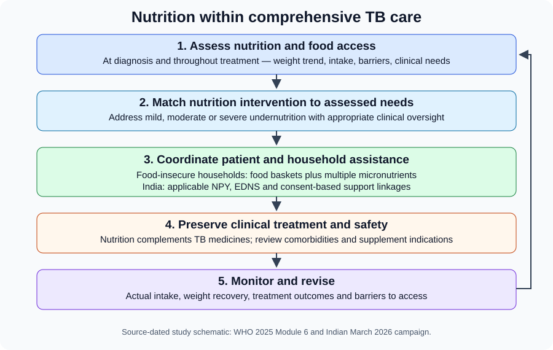

# Tuberculosis nutritional care and food support

**Status:** Original study candidate, unattempted. Source-dated educational guidance, not an independently approved individualized nutrition prescription.

[09B practice questions](../MCQs/09B-Tuberculosis-Nutritional-Care-20-MCQs.md) · [Chapter](../README.md)

## TB aur nutrition ka relationship

Tuberculosis mein prolonged illness, inflammation, appetite loss, reduced intake aur socioeconomic barriers nutritional status ko affect kar sakte hain. Undernutrition se immunity aur recovery bhi affect ho sakti hai. Isliye nutritional care ko effective anti-TB treatment ke saath integrate karna important hai. Sirf food supplement se infection eradicate nahi hota.

WHO 2025 Module 6 ke nutrition recommendations mein assessment aur counselling diagnosis par aur treatment ke dauran offer karne ka approach hai. Baseline assessment normal ho tab bhi later intake, weight aur clinical condition change ho sakti hai. Household contacts ko bhi suitable nutritional assessment aur counselling offer ki jaati hai. Food insecurity ki setting-specific food assistance recommendation isse separate hai.

## Assessment and individualized care

Patient ka nutritional history, actual food intake, recent weight trend, anthropometry, clinical condition aur food access consider karo. Adult BMI aur age-specific child growth assessment interchangeable nahi hain. Nutrition assessment ke baad clinical team underlying needs ke according intervention select karti hai.

WHO 2025 recommendation 3 mein mild, moderate aur severe undernutrition ke liye suitable nutritional interventions offer karne ka approach hai. Pulmonary ya extrapulmonary location, age, pregnancy aur drug resistance automatically exclusion nahi hain. Severe undernutrition mein clinical assessment aur applicable malnutrition care protocols especially important hain. Existing disease management aur medication plan continue hote hain.

TB aur poorly controlled diabetes ek saath ho toh undernutrition ko treat karna aur glycaemic management coordinate karna zaroori hai. Excess sugary drinks ya rigid weight-loss diet dono individual clinical assessment ke substitutes nahi hain.

## Household food assistance

WHO 2025 recommendation 6 food-insecure settings mein TB-affected households ke liye food baskets with multiple micronutrients ka approach support karti hai. Household contacts normal nutritional status mein bhi ho sakte hain. Nutritional assessment aur appropriate counselling ka scope all settings hai, jabki specific food assistance recommendation food insecurity setting se linked hai.

Food basket share hone par patient ka actual planned intake kam ho sakta hai. Family ko blame karne ke bajay household food needs identify karo. Suitable patient and household assistance aur practical transport options explore karo. Mobile phone access na hone par programme-approved alternative arrangements consider karo. Privacy aur consent protect karna important hai.

Nutrition support eligible contact investigation, preventive treatment aur other clinical care ka substitute nahi hai.

## Indian programme context

| Dated source | Nutrition-related detail |
|---|---|
| MoHFW statement, 9 December 2025 | Ni-kshay Poshan Yojana ka financial support 1 November 2024 se ₹1,000 per patient per month for treatment duration bataya gaya. |
| March 2026 TB Mukt Bharat Abhiyaan campaign | Adult BMI below 18.5 context mein first two treatment months EDNS target. Relevant clinical and operational requirements follow karo. |
| March 2026 campaign | NPY direct benefit transfer within 15 days ka stated target. |
| March 2026 campaign | Consent-based Ni-kshay Mitra linkage aur comorbidity review. |

EDNS ka meaning energy-dense nutritional supplementation hai. Named campaign target ko har patient ki universal formulation ya dose prescription mat samjho. Current local programme implementation, eligibility and product protocol independently verify karna hoga.

## Micronutrients: new evidence versus old practice

WHO 2025 update routine standalone multiple micronutrients solely to improve TB outcomes ke liye purane approach ko support nahi karti. Iska matlab clinically indicated deficiency treatment stop karna nahi hai. Household food assistance ka combined package bhi separate recommendation hai.

Recommendation 7 TB-specific vitamin D supplementation ko rigorous research context mein consider karti hai. Isse every patient ke liye same high-dose vitamin D routine treatment infer nahi kar sakte. Documented deficiencies aur other established indications appropriate clinician review se address hoti hain.

Serum zinc improve hone se TB cure automatically prove nahi hota. Biochemical endpoints aur patient-important outcomes separate evaluate hote hain. Pregnancy and postpartum care mein current relevant maternal supplementation guidance apply hoti hai, individualized TB care ke saath.

## Monitoring and evidence interpretation

Food basket distribution process indicator hai, actual consumption ya recovery ka proof nahi. Weight trend, actual intake, nutrition recovery aur TB outcomes review karo. Treatment ke intensive phase ke end par expected weight gain na ho toh food insecurity, adherence, malabsorption, diabetes aur disease response assess karwana zaroori hai. Weight change alone drug resistance diagnosis nahi hai.

RATIONS study ka overall adjusted incidence rate ratio 0.61 tha. Relative reduction = 1 − 0.61 = 0.39 or 39%. Yeh absolute 39 cases per 100 ka reduction nahi hai. Baseline incidence ke bina absolute risk reduction calculate nahi hota. Overall trial benefit ko all age subgroups mein identical precise effect kehna appropriate nahi hai.

## Evidence

- [WHO 2025 Module 6 recommendations, sections 2.1–2.3](https://www.ncbi.nlm.nih.gov/books/NBK619209/): retrieved text on assessment, undernutrition, food assistance, micronutrients, implementation and RATIONS evidence.
- [WHO 2025 consolidated guidelines overview](https://www.who.int/publications/i/item/9789240111967).
- [March 2026 TB Mukt Bharat Abhiyaan campaign document](https://tbcindia.mohfw.gov.in/wp-content/uploads/2026/03/TB-Mukt-Bharat-Abhiyan-Campaign-2026-v6.pdf): text and PDF page index 11 visually checked for nutrition intervention targets.
- [MoHFW parliamentary reply, 9 December 2025](https://www.pib.gov.in/PressReleasePage.aspx?PRID=2200795&lang=1&reg=3): directly retrieved.
- [2025 TB nutritional care roadmap](https://pmc.ncbi.nlm.nih.gov/articles/PMC12276968/): indexed text on inadequate weight recovery.

Specific item-linked MCQ videos remain unverified. Independent clinical/dietetic review, broader curriculum and semantic review, source/video and publication gates remain open. No historical exam claim.

[Practice all 20 MCQs](../MCQs/09B-Tuberculosis-Nutritional-Care-20-MCQs.md)
