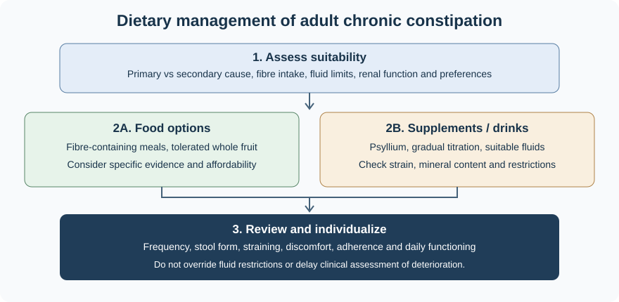

# 25 — Dietary management of chronic constipation

**Status:** Isolated PR35 draft study content, not an individualized prescription or independently certified clinical guideline. Scope: nutrition for clinically assessed adult primary constipation, not bowel procedures or pediatric, pregnancy or opioid-induced constipation protocols.

[Practice 20 original questions](../MCQs/09C-Dietary-Management-of-Chronic-Constipation-20-MCQs.md) · [Chapter](../README.md)

## 1. Pehle patient ki situation samjho

Chronic primary constipation aur medicine, neurological disorder ya pregnancy se related constipation ek hi clinical population nahi hain. 2025 British Dietetic Association (BDA) guideline adult primary constipation par focus karti hai. Nurse diet history, habitual fibre, fluids, medicines, patient ke symptoms aur clinical restrictions assess karti hai. New severe pain, vomiting, distension, blood in stool ya unexplained weight loss ko sirf dietary problem samajhkar delay nahi karna chahiye.

## 2. Food aur fibre selection

Whole grains, dal, suitable fruits aur vegetables se fibre intake improve ho sakta hai. Patient ke routine Indian meals mein practical gradual changes karo. Fibre supplement ka evidence uske type par depend karta hai. AGA–ACG 2023 evaluation mein psyllium ke liye strongest supporting evidence among tested fibre supplements tha. BDA 2025 ke hisab se tolerated fibre trial ko adequate duration do, often at least four weeks for relevant outcomes. Dose gradually increase karna gas aur discomfort ko manage karne mein useful ho sakta hai. Adverse effects ya clinical deterioration par pehle review chahiye. Fluid limit ho toh independent extra water instruction mat do.

Inulin-type fructans stool consistency improve kar sakte hain, but stool frequency benefit established nahi tha aur gas badh sakti hai. Polydextrose ke liye frequency aur consistency benefit demonstrate nahi hua. Sab fibre products ko interchangeable mat samjho.

## 3. Food and drink evidence: outcome-specific

| Option | Evidence interpretation from BDA 2025 |
|---|---|
| Whole kiwifruit | Small frequency advantage versus psyllium, no established greater consistency effect. May be considered when psyllium causes discomfort, if suitable. |
| Prunes | No demonstrated consistency superiority versus psyllium. Does not prove universal equivalence. |
| Rye bread | Frequency may increase compared with white bread, but global symptoms can worsen. Consider feasibility and tolerance. |
| High mineral-content water | Symptomatic response may improve, without demonstrated frequency superiority. No universally validated mineral-content threshold. |

Mineral water ke actual sodium aur magnesium concentrations vary kar sakte hain. CKD ya heart failure mein clinical restrictions priority hain. Trial volumes ko patient-specific fluid allowance ke upar automatically add nahi karte.

## 4. Probiotics and supplement safety

Bifidobacterium lactis subgroup trials ne frequency benefit report kiya, without demonstrated stool consistency improvement. Different strains aur endpoints ke results alag ho sakte hain. Generic probiotic label benefit prove nahi karta.

Magnesium oxide laxative evidence ko renal impairment par automatically apply nahi karte. Reduced clearance se magnesium accumulation ka risk hai. Treating team aur pharmacist se appropriate alternative review karvao.

Whole high-fibre diet ke constipation-specific trial evidence mein gaps hain. Iska matlab fibre ki general nutrition value nahi hai, aisa conclusion nahi nikalna chahiye.

## 5. Follow-up

Actual adherence, stool frequency, stool form, straining, abdominal discomfort aur daily functioning assess karo. Ek endpoint improve hone par har symptom better hona zaroori nahi hai. Shared decision se tolerable aur feasible plan revise karo.

## Sources and limits

- [BDA adult chronic constipation guideline 2025](https://doi.org/10.1111/nmo.70173), full text retrieved through the Queen Mary University repository, PDF screenshot cache miss. [BDA author summary, 10 February 2026](https://www.bda.uk.com/resource/the-first-bda-evidence-based-dietary-guidelines-for-chronic-constipation-in-adults-from-evidence-to-practice.html) directly retrieved.
- [AGA–ACG 2023 chronic idiopathic constipation guideline](https://pmc.ncbi.nlm.nih.gov/articles/PMC10544839/), indexed text and recommendation excerpts reviewed, direct society page forbidden.
- [NIDDK constipation diet guidance](https://www.niddk.nih.gov/health-information/digestive-diseases/constipation/eating-diet-nutrition), directly retrieved.
- [INC BSc Nursing curriculum Gazette 2020](https://www.thc.nic.in/Central%20Governmental%20Regulations/Indian%20Nursing%20Council%20%28Revised%20Regulations%20and%20Curriculum%20For%20B.Sc.%28Nursing%29%20%28Program%29%20Regulations%2C2020..pdf), Unit IX explicitly names constipation diet. Text retrieved from Gazette mirror, screenshot cache miss.

Dedicated item-specific YouTube evidence, independent clinical/dietetic/pharmacy certification and full semantic checks remain pending. No authenticated historical exam attribution.
