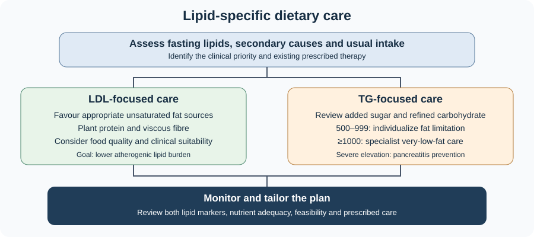

# 26 — Cardiovascular nutrition: dyslipidemia-specific dietary care

**Status:** Isolated candidate study guide. Independent clinical and dietetic certification pending. International guideline evidence is not an Indian statutory rule or individualized treatment order.

[Chapter](../README.md) · [20 original questions](../MCQs/09D-Cardiovascular-Dyslipidemia-Dietary-Care-20-MCQs.md)

## 1. Identify the lipid-related goal

LDL-C aur triglycerides alag lipid markers hain. LDL-focused care mein atherogenic lipoprotein burden reduce karne ka goal important hai. Bahut high TG mein pancreatitis prevention bhi urgent concern ban sakta hai. Diet plan fasting lipid profile, secondary causes, diabetes control, medicines, usual intake aur clinical assessment ke hisab se tailor hota hai.

## 2. Triglyceride severity

| Fasting TG (mg/dL) | Dietary principle from 2026 ACC/AHA guidance |
|---|---|
| 150–499 | Improve carbohydrate quality, reduce added sugar and saturated fat, minimize alcohol |
| 500–999 | Individualize total fat restriction and avoid alcohol, reduce added sugars and refined carbohydrates |
| ≥1000 | Specialist-directed very-low-fat strategy, with elimination of alcohol and added sugars and restriction of refined carbohydrates |

These are source-specific clinical categories, not a self-treatment protocol. Severe TG elevation needs prompt professional review. Familial chylomicronemia can require ongoing specialized dietary management even when levels improve. Long-term restriction should preserve essential fatty acids and fat-soluble vitamins under professional supervision.

Example: prescribed 1800 kcal and 15% total energy from fat gives 270 kcal from fat, or 30 g/day. If a different prescribed allowance is 32 g and meals plus a supplement supply 26 g, 6 g remains. The numbers are teaching examples only.

## 3. LDL-focused interventions

Viscous fibres, including suitable oat beta-glucan sources, intestinal cholesterol handling ko influence kar sakte hain. Plant sterols compete with cholesterol during intestinal absorption. Sitosterolemia mein concentrated sterol enrichment avoid karne ke liye specialist advice chahiye. General heart-healthy food pattern includes suitable plant proteins and unsaturated fat sources. In mixed dyslipidemia, saturated fat ko refined starch aur added sugar se replace karna TG goal ko compromise kar sakta hai.

Population trial estimates individual outcome guarantee nahi karte. If a hypothetical LDL-C of 160 mg/dL falls by 6–9%, absolute reduction is 9.6–14.4 mg/dL. Multiple intervention estimates ko guaranteed total response ki tarah add mat karo.

## 4. Care coordination

Nonprescription supplements are not recommended as LDL-C or TG-lowering treatment under the 2026 guideline, given inconsistent or limited evidence. Prescription omega-3 preparations and retail fish-oil supplements are not automatically interchangeable. Verify the exact prescribed product with the pharmacist. Non-drinkers ko heart health ke liye alcohol start karne ki advice mat do.

Plant-based label alone healthy food prove nahi karta. Ingredients, nutritional profile, processing aur actual portion review karo. LDL improve hone ke baad bhi persistent TG elevation separately assess karo. Severe restrictive dietary care mein dietitian affordable and nutritionally adequate meal plan develop karne mein help karta hai.

## 5. Evidence and limits

- [ACC/AHA 2026 dyslipidemia guideline](https://doi.org/10.1016/j.jacc.2025.11.016) — indexed recommendation extracts, direct full-text access failed.
- [NLA 2023 nutrition clinical perspective summary](https://www.lipid.org/wp-content/uploads/NLA_2023_Nutrition_Interventions_for_Adults_with_Dyslipidemia.pdf) — PDF text retrieved, screenshot cache miss. [Full clinical perspective](https://www.lipidjournal.com/article/S1933-2874%2823%2900185-X/fulltext) indexed.
- [AHA 2026 dietary guidance](https://professional.heart.org/en/science-news/2026-dietary-guidance-to-improve-cardiovascular-health) — indexed summary.
- [Endotext dyslipidemia guidelines](https://www.ncbi.nlm.nih.gov/sites/books/NBK305897/) — indexed supporting summary.
- INC Unit IX CVD therapeutic diet scope located in indexed curriculum copies, fresh official Gazette retrieval failed.

Specific teaching-video and question-video validation, comprehensive curriculum and independent reviews remain pending. No historical exam authenticity or individualized treatment advice claimed.
