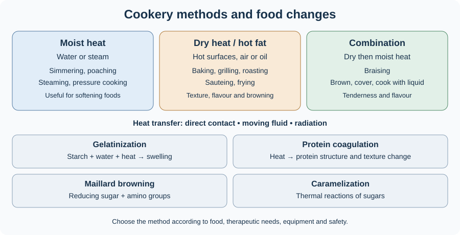

# 27 — Cookery methods and practical food preparation

**Status:** Isolated PR35 candidate. Original exam-oriented study guide for INC Unit X. Independent review pending.

[Chapter](../README.md) · [20 original MCQs](../MCQs/09E-Cookery-Methods-and-Food-Preparation-20-MCQs.md)

## Heat transfer

Tawa par roti ke contact surface mein conduction hoti hai. Soup mein warm aur cool liquid ka movement convection hai. Glowing grill element se bina direct contact energy radiation ke through food tak pahunch sakti hai. Microwave electromagnetic energy use karta hai aur heating uneven ho sakti hai. Isliye correct appliance instructions aur applicable safe doneness checks follow karna important hai.

## Cooking methods

| Method | Principle and practical consideration |
|---|---|
| Boiling | Food hot bubbling liquid mein cook hota hai. High altitude par lower atmospheric pressure se boiling point kam hota hai. |
| Simmering | Gentle bubbles, delicate pieces ki shape preserve karne mein useful. |
| Poaching | Gentle hot liquid, e.g. egg or fish. Added fat method ki essential requirement nahi hai. |
| Steaming | Steam heat supply karti hai, e.g. idli above water. |
| Pressure cooking | Higher pressure raises boiling temperature and can shorten cooking time. Use manufacturer instructions. |
| Double boiler | Indirect water-bath heating, e.g. custard. |
| Baking, grilling, roasting | Dry heat methods, different equipment and heat-transfer patterns. |
| Sauteing | Small measured amount of hot fat with movement of the pieces. |
| Shallow frying | Partial immersion in hot fat. Deep frying uses greater immersion. |
| Braising | Initial browning followed by slow moist cooking. |

Frying fat exposure badha sakti hai, although final absorption recipe aur method par depend karti hai. Gentle heating texture control mein useful ho sakti hai, but safe doneness verify karna zaroori hai. Cooking method ka choice individual therapeutic plan, available equipment, food texture aur nutrient needs ke hisab se hota hai. Cooking automatically har food ko sterile nahi banati.

## Food chemistry

- **Starch gelatinization:** Heat aur water starch granules ko swell karte hain, e.g. sauce thickening.
- **Protein denaturation and coagulation:** Egg white heat se firm opaque mass ban sakta hai. Ordinary cooking sab protein ko free amino acids mein convert nahi karti.
- **Maillard reaction:** Reducing sugars aur amino groups ke reactions se browning aur flavours develop ho sakte hain.
- **Caramelization:** Sugars ke thermal reactions se browning ho sakti hai, added amino groups necessary nahi hain.

## Pre-cooking preparation

Soaking dry whole pulses se hydration aur subsequent softening mein help mil sakti hai. Proper complete cooking remains necessary. Germination can improve digestibility and some micronutrient bioavailability, but does not guarantee microbial safety. Follow appropriate hygiene and safe preparation, especially for vulnerable patients. Avoid treating nutrient preservation, food safety and cookery technique as interchangeable topics.

## Sources and scope

- [INC Revised BSc Nursing Regulations, Gazette printed page 274, Unit X](https://abmamcon.com/wp-content/uploads/2025/06/Indian-Nursing-Council-Revised-Regulations-and-Curriculum-For-B.Sc_.Nursing-Program-Regulations2020.pdf): Gazette mirror text retrieved, screenshot unavailable.
- [IGNOU food preparation, Unit 8](https://egyankosh.ac.in/bitstream/123456789/62045/3/Block-2.pdf) and [CBSE Food Nutrition and Dietetics, chapter 4](https://cbseacademic.nic.in/web_material/Curriculum21/publication/srsec/834_food%20nutrition%20-%20xii.pdf): text retrieved, screenshots unavailable.
- [ICMR-NIN 2024 Guideline 13](https://www.nin.res.in/dietaryguidelines/pdfjs/locale/DGI24thJune2024fin.pdf): preparation and germination evidence, text retrieved, screenshot unavailable.
- [TNAU cooking methods](https://agritech.tnau.ac.in/nutrition/nutri_food_cookingmethods.html): heat-transfer and method classification only, not the page's unsafe blanket sterilization assertion.
- [CSU high-elevation food preparation](https://extension.colostate.edu/resource/high-elevation-food-preparation-guide/) and [USDA FSIS microwave heating](https://ask.fsis.usda.gov/article/How-do-I-reheat-leftover-take-out-food): indexed relevant excerpts.
- [University of Arizona culinary medicine chapter 2](https://opentextbooks.library.arizona.edu/culinarymedicine/chapter/chapter-2-kitchen/): indexed text, direct access forbidden. [Yale food chemistry unit](https://teachersinstitute.yale.edu/curriculum/units/2020/2/20.02.03/2), [IGNOU practical manual](https://egyankosh.ac.in/bitstream/123456789/100208/1/CNCC-01%20Practical%20Manual%28English%29%20%281%29.pdf) and [Kansas State Maillard reaction](https://www.k-state.edu/news/wild-west-district/articles/2022/08/the-maillard-reaction.html): supporting educational text and indexed excerpts. Direct K-State access unavailable.
- Teaching-video candidate: [Nursing Notes For You, cooking and its methods](https://www.youtube.com/watch?v=yKwS-n4BjNs), published 6 November 2025. Description matches methods, not full playback verified. Its microwave classification is not adopted as a universal category. No verified dedicated item-level MCQ video.

Independent clinical/dietetic and semantic review, full curriculum reconciliation, video verification and integration gates remain open. No authenticated PYQs.
