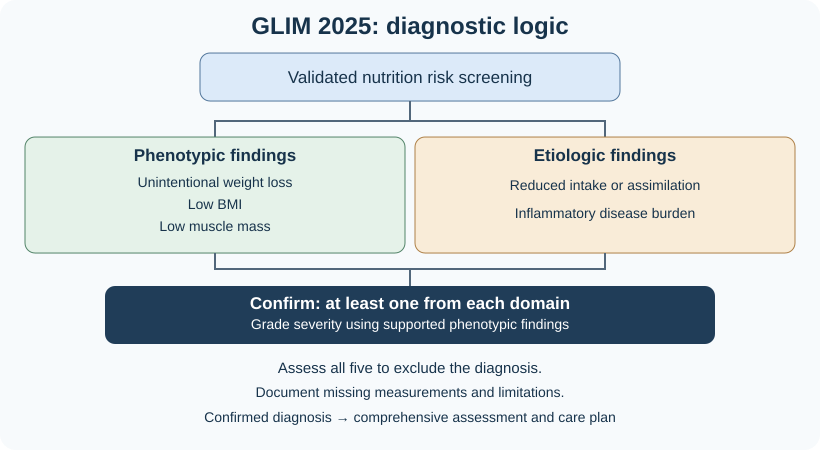

# 28 — GLIM adult malnutrition diagnosis — 2025 update

**Status:** Isolated PR35 candidate. Not an independent clinical signoff or individualized treatment order.

[Chapter](../README.md) · [20 original questions](../MCQs/10A-GLIM-Adult-Malnutrition-Diagnosis-20-MCQs.md)

## Screening aur diagnosis

Screening aur diagnosis ko alag rakho. GLIM adult clinical framework mein pehle validated risk screening hoti hai. At-risk patient mein body-related three findings (non-volitional weight loss, low BMI, low muscle mass) aur cause-related two findings (reduced intake/assimilation, inflammatory disease burden) assess karte hain. Ek phenotype aur ek etiology confirmed hone par diagnostic combination meet hota hai. All five assess karna preferred hai. Compelling practical limitation mein available positive combination se confirmation possible hai, lekin exclusion ke liye all five assess karo. Missing measure ko normal ya abnormal assume mat karo.

## Criteria aur context

Weight loss >5% within six months or >10% beyond six months qualifies. For Asian populations, low BMI is below 18.5 kg/m² under age 70 or below 20 at age 70 and above. Under the 2025 framework, intake at or below half of requirements for more than a week, sustained reduction for more than two weeks, or clinically established impaired assimilation may qualify. Use clinical context and valid measurements. Grip strength is useful for functional assessment but does not substitute for muscle mass in the updated diagnostic algorithm. Fluid accumulation can distort measurements. Hypoalbuminaemia is not a GLIM diagnostic criterion.

## Inflammation

Clinical judgment may establish inflammatory burden in clear cases. CRP can support uncertain cases, with lab-specific reference values and serial measurement where appropriate. The GLIM 2025 guidance describes an acute CRP result at least ten times the upper reference as supportive of moderate-to-severe acute inflammation, not a standalone malnutrition diagnosis. In chronic conditions repeated above-reference results can support inflammatory etiology.

## Severity and follow-up

Severity phenotype par based hai. The 2025 severity table reports unavailable data for grading by muscle mass alone. After confirmation, comprehensive assessment and appropriate clinical nutrition planning are needed. Screening and diagnostic results should not be used to prescribe feeding independently.

## Evidence and unresolved update

- [GLIM 2025 full consensus](https://edepot.wur.nl/692708) — earlier full text retrieved, PDF screenshots blocked. [JPEN consensus](https://pmc.ncbi.nlm.nih.gov/articles/PMC12053077/) indexed table excerpts corroborate criteria, direct full-text access currently blocked.
- [2019 consensus](https://pmc.ncbi.nlm.nih.gov/articles/PMC6438340/).
- [INC curriculum mirror](https://abmamcon.com/wp-content/uploads/2025/06/Indian-Nursing-Council-Revised-Regulations-and-Curriculum-For-B.Sc_.Nursing-Program-Regulations2020.pdf) indexed text, full mapping not certified.
- [2026 GLIM dietary intake and nutrition impact symptoms Delphi guidance](https://pubmed.ncbi.nlm.nih.gov/42178847/): indexed abstract describes usual intake comparator and symptom-based assessment of assimilation. Full text not accessible at inspection. Q7 and Q8 explicitly test the 2025 consensus rather than claiming the latest clinical operational instructions. Full reconciliation is required before release.
- Specific teaching and item-level video evidence not verified. Independent review remains pending.
