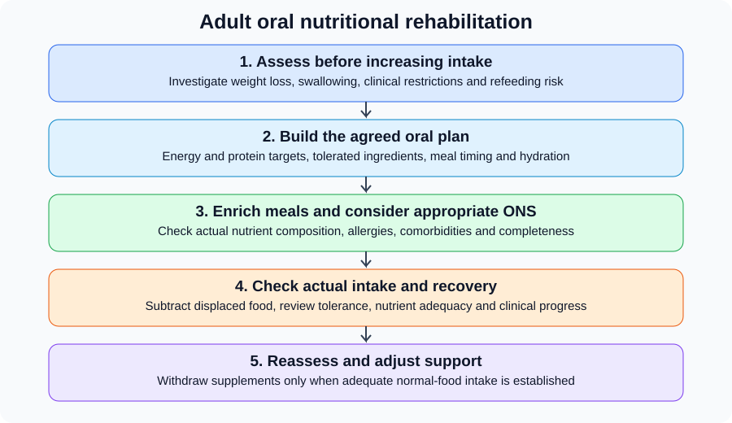

# Adult underweight and oral nutrition rehabilitation

**Status:** Study-ready draft candidate, unattempted. Educational examples are not individual nutrition prescriptions.

[20 original MCQs](../MCQs/10B-Adult-Underweight-and-Oral-Nutrition-Rehabilitation-20-MCQs.md) · [Chapter](../README.md)

## Assessment pehle, nutritional rehabilitation baad mein

Low body weight ka cause samajhna important hai. Unexplained weight loss, reduced appetite, absorption problems, medical conditions aur treatment effects assess karna chahiye. BMI alone se clinical cause establish nahi hota. Existing [GLIM bank](../MCQs/10A-GLIM-Adult-Malnutrition-Diagnosis-20-MCQs.md) diagnosis aur severity cover karta hai. Yeh guide oral rehabilitation ki planning par focused hai.

Prolonged negligible intake ya severe malnutrition mein rapid nutrition escalation dangerous ho sakti hai because of refeeding risk. Clinical team electrolyte status, nutritional history aur appropriate feeding protocol review kare. Safe swallowing aur relevant allergy/comorbidity requirements verify honi chahiye.

## Food-first enrichment

Nutritional recovery ke liye energy aur protein dono useful hain. Patient ke liye suitable meal portion mein extra nutrient-rich ingredient add karna food enrichment hai. Quantity tolerate nahi hoti toh density increase karna helpful ho sakta hai.

| Ingredient example, if tolerated | Main contribution |
|---|---|
| Unsaturated vegetable oil | Mainly energy from fat |
| Skimmed milk powder | Protein and energy |
| Dal, tofu or eggs | Protein plus energy and other nutrients |
| Sugar | Energy but no meaningful protein |
| Plain water | Hydration, not energy or protein |

Individual dietary enrichment aur industrial staple micronutrient fortification ek hi regulatory intervention nahi hain. Clinical enrichment assessed needs ke hisaab se hoti hai. Industrial fortification ki applicable food standards aur public health objectives separately assess hote hain.

## Meal pattern and preferences

Patient morning mein relatively energetic ho aur evening mein fatigued ho toh nourishing main meal morning ya daytime mein shift karna useful ho sakta hai. Drinks se early fullness ho toh suitable fluid timing meals ke beech consider karo, without compromising hydration or any prescribed fluid plan.

Cardiovascular disease ke saath weight regain mein measured unsaturated fat enrichment selected cases mein useful ho sakti hai. Known allergy, food preferences, availability, glucose management aur relevant clinical restrictions ke according foods choose karo. Clinical clearance ke baad suitable strength-focused rehabilitation nutrition ke saath coordinate ki ja sakti hai.

## Oral nutritional supplements (ONS)

ONS ordinary food intake ke gaps address karne ke liye use ho sakte hain. Dietitian product composition, patient needs, tolerance and appropriate intake plan consider karta hai. Har ONS nutritionally complete nahi hota. Energy-only product ko sole diet ki tarah use nahi karna chahiye. Equal calories ka matlab same protein, fat, vitamins aur minerals nahi hai.

Energy enrichment se micronutrient adequacy guarantee nahi hoti. Limited food variety ho toh qualified professional vitamin-mineral intake review kare. Unnecessary high-dose supplements appropriate substitute nahi hain.

## Worked examples — hypothetical teaching plans

**Q16: whole portions.** Additional target 350 kcal hai. Snack 160 kcal deta hai. Remaining 190 kcal ko 45 kcal per portion se divide karte hain. Result 4.22 hai, so minimum five whole portions. Actual serving amount clinically approved hona chahiye.

**Q17: two independent constraints.** Base 110 kcal and 4 g protein. A adds 90 kcal with no protein, total 200 kcal and 4 g protein. B adds 75 kcal and 7 g protein, total 185 kcal and 11 g protein. Target at least 180 kcal and 10 g protein ho toh B dono satisfy karta hai.

**Q18: displacement.** Extra 250-kcal snack ke baad lunch intake 140 kcal kam ho gayi. Net increment 110 kcal hai, not 250 kcal.

**Q19: recipe yield.** Four equal portions ke batch mein 120 kcal aur 8 g protein add hua. One portion ka increment 30 kcal aur 2 g protein hai.

## Monitoring and discontinuation

Prescribed supplement ka actual consumption aur ordinary food intake dono assess karo. Weight improvement alone normal food se complete adequacy prove nahi karti. NICE CG32 ke oral support principle ke according adequate normal-food intake establish hone par clinical team support stop karne ki suitability review karti hai.

## References and limits

- [NHS healthy weight gain](https://www.nhs.uk/live-well/healthy-weight/managing-your-weight/healthy-ways-to-gain-weight/) — directly retrieved.
- [BAPEN food first](https://www.bapen.org.uk/education/nutrition-support/nutrition-by-mouth/food-first-food-enrichment/) and [ONS](https://www.bapen.org.uk/education/nutrition-support/nutrition-by-mouth/oral-nutritional-supplements-ons/) — directly retrieved.
- [CUH food enrichment](https://www.cuh.nhs.uk/patient-information/food-fortification-the-healthy-way/) and [North Tees NHS healthy gain](https://www.nth.nhs.uk/resources/dietary-advice-about-gaining-weight-in-a-healthy-way/) — directly retrieved.
- [NICE CG32](https://www.nice.org.uk/guidance/cg32/chapter/Recommendations) — indexed recommendation text; direct HTML retrieval blocked.
- [INC revised BSc 2020 Gazette](https://thc.nic.in/Central%20Governmental%20Regulations/Indian%20Nursing%20Council%20%28Revised%20Regulations%20and%20Curriculum%20For%20B.Sc.%28Nursing%29%20%28Program%29%20Regulations%2C2020..pdf) — retrieved PDF text, printed p274 Unit IX underweight; screenshot request failed. Full official programme-specific mapping pending.

Independent clinical/dietetic and semantic review pending. Specific item-level video evidence for all 20 questions remains unverified. No authenticated historical exam claim.

[Practice questions](../MCQs/10B-Adult-Underweight-and-Oral-Nutrition-Rehabilitation-20-MCQs.md)
